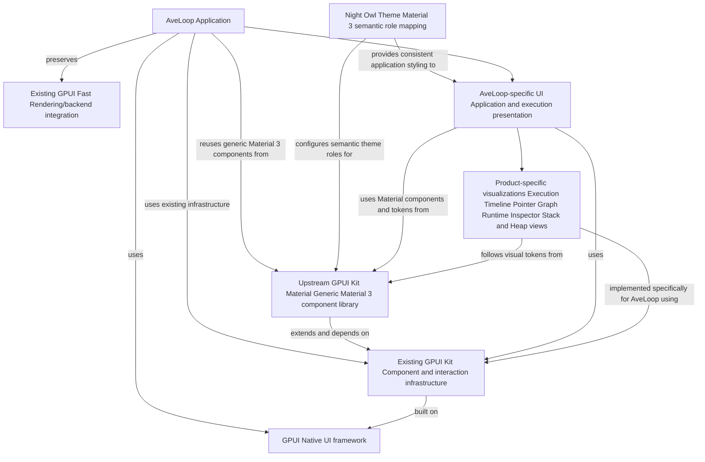
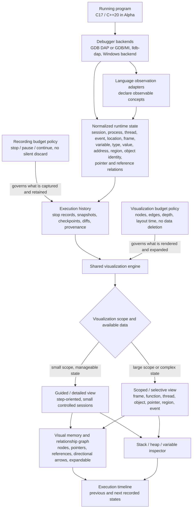
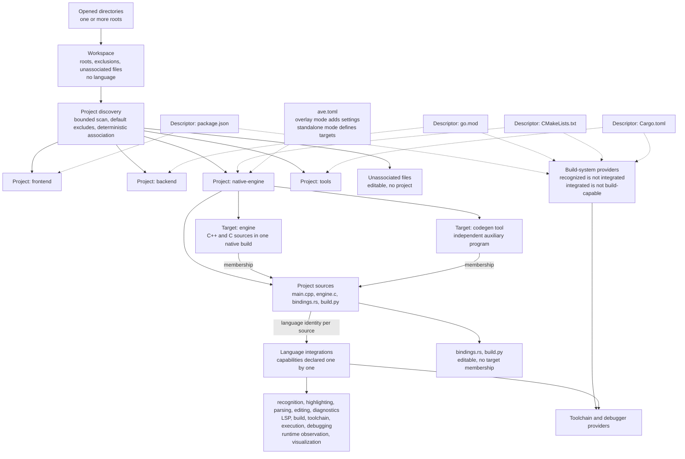

# AveLoop Alpha — Consolidated Specification, Plan, and Tasks

> Review package. The three documents remain separate sources for their respective concerns.


<!-- BEGIN spec.md -->

# AveLoop — Product & Software Requirements Specification

**Document ID:** AVE-SPEC-001\
**Version:** 1.1.0\
**Status:** Consolidated Alpha Baseline — Review Required\
**Date:** 22 November 2026\
**Product:** AveLoop Native Desktop Visual Programming IDE\
**Target release:** Alpha\
**Specification authority:** This document supersedes the earlier draft SRS where explicitly stated below.

---

## 0. Document authority and interpretation

This specification defines the product contract for the AveLoop Alpha. It is the source of truth for **what** the Alpha must do and the conditions under which it is considered complete. `plan.md` defines **how** the product is to be implemented. `tasks.md` is the dependency-ordered work breakdown derived from those two documents.

Requirement classifications:

- **MUST** — required for Alpha acceptance.
- **SHOULD** — required unless a documented technical constraint justifies deferral.
- **MAY** — optional and not an Alpha release blocker.
- **OUT** — explicitly excluded from Alpha.

This is a consolidated baseline, not a claim that implementation or platform verification has already happened. Product decisions explicitly established in the conversation are treated as approved constraints. Technical selections made here to make the Alpha executable are identified as **Alpha baseline decisions** and must be validated by the implementation gates in `plan.md`.

### 0.1 Superseded statements

The following statements in the earlier SRS draft are obsolete:

1. “C is the leading candidate” and “the first language remains open” are superseded by the approved Alpha language scope: **C17 and C++20**.
2. “Linux-first” is rejected. Linux, Windows, and macOS are co-equal target platforms for one application and one shared codebase.
3. The preliminary six/eight-crate Cargo workspace is not approved and must not be used as a default structure.
4. A Cargo workspace is not a prerequisite. The Alpha starts as one Rust package and one application crate, organized as a modular monolith.
5. The HTML prototype is not the product implementation, but its interaction model and visual decisions are valid design references. Its simulated compiler/runtime/trace boundaries are intentional prototype limitations.
6. A debugger's ability to inspect variables must not be conflated with complete knowledge of the process heap, allocation history, or pointer lifetime.
7. "Clang/LLVM 23.1.4 as the mandatory cross-platform compiler baseline" and "LLDB as the sole debugger backend" are superseded by the per-platform toolchain policy in §7.2 and §7.3. No compiler or debugger is bundled, downloaded, or installed by the application.

---

# 1. Product definition

## 1.1 Purpose

AveLoop is a native desktop development environment that makes real program execution observable and navigable. It connects source code to execution progression and to the runtime information that can be reliably obtained from the program being debugged.

The defining capability is not code editing alone and not a conventional debugger panel. It is a synchronized visual explanation of a program's recorded execution: source location, call stack, variables, inspectable memory objects, pointer relationships, events, and output.

## 1.2 Product promise

> AveLoop makes real program execution inspectable, step by step, without presenting inferred or simulated information as verified runtime truth.

The product prefers a smaller, accurate visualization over a visually complete but technically fabricated one.

## 1.3 Product category

AveLoop is a:

- General-purpose, multi-language native desktop IDE; C17 and C++20 are the Alpha language set.
- Visual execution and runtime-inspection environment.
- Recorded execution timeline and state navigator.
- Source, stack, variable, memory, pointer, and output visualizer.

AveLoop is not a general-purpose visual programming language, cloud IDE, or replacement for every feature of a mature commercial IDE.

Workspace management, language integration, build-system handling, and debugger backends are separate, extensible responsibilities. Alpha implements only C17 and C++20; adding another language must not require redesigning the workspace, project, or project-configuration model.

Workspace, project, build target, source file, and language integration are independent identities. One workspace may contain several projects, one project may contain several languages and several build targets, and one build target may contain sources from more than one language when its build system genuinely supports that arrangement. No workspace or project carries one authoritative language. A source file stays editable even when it belongs to no build target.

Build-system recognition is not build-system integration and is not successful build support. The application reports what it recognized, what it can consume, and what it can actually build as separate states.

Runtime execution visualization is AveLoop's central product capability. AveLoop makes actual program execution — progression, stack frames, variables, objects, pointers, references, and memory relationships — observable and navigable. It serves both teaching-scale examples and real, complex programs from one normalized runtime-observation model: small, controlled sessions may present detailed step-oriented views, while large sessions use scoped, selective, expandable views. The same observation, history, and normalization model feeds both; there is no separate educational engine. Accuracy outranks visual completeness: no visualization may present an inference as an observation.

## 1.4 Intended users

1. Learners who need to understand how source statements affect runtime state.
2. C and C++ developers investigating scopes, calls, pointers, arrays, objects, and memory.
3. Educators demonstrating actual program behavior.
4. Developers who need a visual view of recorded execution rather than only textual debugger output.

## 1.5 Alpha success definition

An Alpha user can create or open a local project, edit a C17 or C++20 source file, build it with the platform's supported C/C++ toolchain, launch a real debug session, record a sequence of debugger stops, navigate the recorded sequence in both directions, and inspect all supported runtime panels at one consistent selected state.

The Alpha is successful only if this workflow works on Linux, Windows, and macOS according to the platform acceptance matrix.

---

# 2. Product scope

## 2.1 Included in Alpha

### A. Native desktop shell and project workflow
- Native Rust/GPUI desktop application.
- One shared application codebase for Linux, Windows, and macOS.
- Open any local directory as a workspace without requiring an AveLoop manifest.
- Discover zero or more projects in a workspace, including nested and sibling projects with different build systems.
- Recognize multiple build-system descriptors (`CMakeLists.txt`, `Makefile`, `compile_commands.json`, `Cargo.toml`, `go.mod`, and other registered kinds) without modifying or replacing them, reporting recognition, integration, and build support as separate states.
- Treat a project as language-agnostic: languages are recorded per source file, never as one project-wide language field.
- Represent multiple build targets per project, each with its own source membership, language participation, dependencies, entry point, build configuration, and run configuration.
- Use an optional `ave.toml` either as an overlay on a native descriptor or as a standalone definition of AveLoop-managed targets when no native integration exists.
- Open, edit, and save source files.
- Maintain a clear current-workspace/current-project/current-file context.
- Report missing or incompatible toolchains.

### B. Source editor
- Native text editing; no WebView.
- C and C++ syntax highlighting.
- Line numbers.
- Cursor movement and selection.
- Undo and redo.
- Clipboard operations.
- Keyboard-first editing and navigation.
- Unsaved-change indication.
- Current execution-line marker and source mapping.
- Stale-trace indication when source changes after recording.

### C. Build and launch
- C17 compilation.
- C++20 compilation.
- Platform C/C++ toolchain integration: GCC/G++ on Linux, Apple Clang on macOS, MSVC or MinGW-w64 on Windows.
- Debug build configuration suitable for source-level debugging.
- Compiler diagnostics with source locations where available.
- Capture standard output and standard error.
- Launch and terminate a local debug session.

### D. Execution capture and navigation
- Real execution through the platform debugger — GDB on Linux, LLDB on macOS, a debugger compatible with the selected Windows toolchain — using the Debug Adapter Protocol where the installed backend provides it.
- Source-line-granularity stepping for Alpha.
- Capture ordered stop records and runtime observations.
- Record the source revision and build configuration used by the session.
- Navigate first, previous, next, last, and seek to a recorded stop.
- Play and pause automatic navigation through recorded stops.
- Playback speed selection.
- Reverse navigation means selecting an earlier recorded state; it is **not** reverse execution by the debugger.
- The timeline is bounded by the recorded trace. It does not promise that every machine instruction or every source expression is represented.

### E. Runtime inspection
- Call stack and active frames.
- Parameters and local variables when exposed by the debugger.
- Supported primitive values.
- Arrays and aggregate members when exposed by debug information.
- C structures and C++ classes/structs.
- Pointer and reference values.
- Null pointer distinction.
- Pointer target relationships when the target can be resolved.
- Interior pointer offsets when both pointer and target range can be established.
- Aliasing when multiple inspected references resolve to the same observed target.
- Observable memory objects reachable from inspected variables.
- Expandable pointer/object relationship graph with verified nodes, edges, and directional arrows.
- Scope selection for visualization: selected frame, function, thread, variable, pointer, object, memory region, or execution event.
- On-demand expansion of related objects, with branch collapse and cancellation of stale expansion requests.
- Explicit coverage and budget disclosure for any visualization that is scoped, filtered, or truncated.
- Explicit unavailable/optimized-out/unknown states.

### F. Trace and event inspection
- Ordered recorded stops.
- Function entry/exit and stepping events when available.
- Variable observations/differences between recorded stops.
- Runtime errors and debugger-reported exceptions/signals when available.
- Build and execution diagnostics.
- Event selection updates the one authoritative selected state.

### G. Output console
- Captured stdout and stderr.
- Output records associated with the session.
- Show output up to the selected stop only when the backend provides reliable attribution; otherwise show session output with an explicit attribution limitation.
- Copy, wrap, resize, collapse, and follow-latest-output behavior.

### H. Visual system
- Material Design 3 as the actual component and interaction system.
- Night Owl as the default application-wide theme.
- GPUI-native components.
- Product-specific Stack, Heap, Pointer, Timeline, and Runtime Inspector visualizations.
- Keyboard-accessible interactions, visible focus, and non-color-only status communication.

## 2.2 Explicit Alpha limits

These are deliberate scope boundaries, not unfinished promises:

1. **No complete process-memory map.** The Heap view displays objects that the debugger can inspect or that the capture layer can reliably identify. It must not imply that it displays every allocation in the process.
2. **No universal allocation/deallocation history.** `malloc/free`, `new/delete`, custom allocators, allocator pools, and optimized code can prevent reliable lifecycle reconstruction. An allocation or deallocation event is shown only when observed and verified.
3. **No unsupported dangling-pointer claims.** A pointer whose target cannot be resolved is “unresolved/unknown”, not automatically “dangling”. “Dangling” is reserved for a target whose lifetime end was actually observed.
4. **No true reverse debugger execution.** Previous/seek operates on captured records and reconstructed states.
5. **No instruction-level trace guarantee.** Alpha navigation is source-line/debugger-stop based.
6. **No guarantee that optimized-out variables are recoverable.** The Alpha debug profile uses low/no optimization; values unavailable from the debugger remain unavailable.
7. **No arbitrary C++ object-layout guarantee.** Debugger-provided fields and values are shown; the application does not invent object layout.
8. **No full STL visualizer guarantee.** Standard-library pretty-printers may vary by platform/toolchain and are capability-reported.
9. **No LSP-based IDE feature set in Alpha.** Completion, refactoring, semantic navigation, and advanced diagnostics are not required.
10. **No integrated terminal/PTY.** The output console is a captured-output viewer, not an interactive shell.
11. **No remote/cloud execution, collaboration, plugin marketplace, AI features, or integrated Git hosting.**
12. **No hardened security sandbox claim.** Alpha launches local programs with the user's OS permissions. It applies explicit launch consent, working-directory controls, timeout/cancellation, and process-tree termination where supported, but it is not a security boundary against hostile code.
13. **No bundled or automatically installed toolchain.** AveLoop neither bundles nor downloads a compiler, debugger, or LLVM distribution. Missing components are reported with official installation guidance; the user performs any installation.
14. **No artificial small-program ceiling.** Resource limits exist and are configurable, accounted, and reported, but no fixed step count or program size defines the product. A large program that cannot be wholly visualized at once remains fully debuggable through scoped visualization. Visualization budgets and recording budgets are independent policies with different guarantees (§6.6).
15. **No claim of a complete relationship graph.** Any node/edge set is a view over observed, derived, or explicitly labelled inferred relationships, not a claim that all process memory has been discovered.

## 2.3 Out of scope

- Any implementation language other than Rust for AveLoop itself, and any target language beyond C17/C++20 in Alpha. Additional target languages are deferred, not architecturally excluded (§1.3).
- Build or test execution through CMake, Cargo, Go modules, or another native descriptor. Alpha recognizes those descriptors and reports their integration status but does not drive them.
- Language integration for Rust, Go, or any language outside C17/C++20. Their files open as plain text, remain editable, and are not built, debugged, or visualized by Alpha.
- JavaScript/HTML/CSS production UI.
- WebView-based application UI.
- CodeMirror 5 or a browser editor embedded in the native app.
- Microservices or a separate Go execution service.
- A mandatory multi-crate workspace.
- Full IDE parity with Zed, Visual Studio, or CLion.
- Remote debugging.
- Distributed execution.
- Multi-user collaboration.
- AI code generation or AI debugging.
- Full static analysis suite.
- Full C/C++ language-server implementation.
- Guaranteed reverse execution.
- Guaranteed complete heap/allocation visualization.

---

# 3. Product invariants

These are non-negotiable correctness rules.

## INV-001 — Execution truth
Runtime information presented as actual must originate from the real compiler/debugger/session or a documented deterministic derivation from its recorded data. Synthetic fixtures must be visibly identified as fixtures and must never be mixed into a real session.

## INV-002 — One authoritative selected execution state
At any moment, there is exactly one selected execution position for the active session. Source highlighting, stack, variables, heap, pointers, trace selection, and attributable output derive from that same selected state.

## INV-003 — Atomic state publication
A state transition is published as one coherent state. Panels must not independently update from different trace indices. If reconstruction fails, the application retains the last valid state and reports the failure.

## INV-004 — Honest uncertainty
Known-empty, null, uninitialized, optimized-out, unavailable, invalid, unresolved, and unknown are distinct states. The UI must not collapse them into one blank value.

## INV-005 — Identity is not display
Variable names, addresses, labels, and UI positions are not stable identity. Runtime entities use session-scoped identities where possible. Address reuse must not silently imply object identity continuity.

## INV-006 — Address semantics
The UI labels actual process addresses as addresses and symbolic identifiers as symbolic IDs. It must not invent physical addresses or imply that an abstract identifier is a machine address.

## INV-007 — Source/trace provenance
Every trace is bound to the exact source snapshot/build inputs that produced it. Editing source after capture marks the trace stale; old source mappings remain tied to the captured revision.

## INV-008 — Platform parity
The same feature contract and Rust application code apply to Linux, Windows, and macOS. OS-specific adapters are allowed only at real platform boundaries; platform divergence must be documented and tested.

## INV-009 — UI/domain separation
GPUI types and presentation state do not define runtime semantics. The domain model remains independent of GPUI.

## INV-010 — No fabricated completeness
If the backend cannot establish a value, target, allocation lifetime, or source location, the UI reports the limitation rather than drawing a definitive but unsupported representation.

---

# 4. Users and primary workflows

## US-01 — Create/open a project
A user opens a local directory as a workspace, or creates/opens a project with an optional AveLoop configuration, then selects a source file and sees the workspace, project, and file context.

**Acceptance criteria**
- Opening an ordinary directory never requires an AveLoop manifest and never modifies the directory.
- A workspace that contains a recognized native build-system descriptor opens as a project and reports that descriptor without claiming it can build through it.
- A workspace may contain several projects with different descriptors, and a project may contain several languages and targets.
- `ave.toml` is optional; when present it either overlays a native descriptor or, in a distinct standalone mode, defines AveLoop-managed targets.
- No project or workspace exposes one authoritative language; languages are reported per source file.
- The app can create a workspace, add an optional `ave.toml`, and reopen it.
- Invalid or unsupported project metadata produces an actionable error.
- File paths are handled correctly on all three target OSes.
- The application does not silently modify source files during project opening.

## US-02 — Edit source
A user edits C17/C++20 code in a native editor.

**Acceptance criteria**
- Typing, selection, cursor movement, undo/redo, copy/paste, save, and unsaved indication work.
- Syntax highlighting is selected by language/file mode.
- Source edits invalidate the current trace mapping without deleting the recorded session.
- No browser/WebView editor is used.

## US-03 — Build a program
A user builds the selected project using the configured C17 or C++20 mode.

**Acceptance criteria**
- The correct language standard flag is passed explicitly.
- Compiler output and diagnostics are captured.
- Build failure is distinct from runtime failure.
- A failed build cannot create a valid-looking new execution session.
- Debug artifacts are generated with the Alpha debug profile.

## US-04 — Run and record execution
A user starts a real debug session and captures source-level execution stops.

**Acceptance criteria**
- A real executable is launched under the platform debugger.
- The user is informed that local program code runs with the user's OS permissions.
- The session records source/build provenance.
- Stop records preserve order and available source locations.
- Cancellation/termination ends the active process and releases session resources.

## US-05 — Navigate the trace
A user moves through captured execution stops.

**Acceptance criteria**
- First/previous/next/last and seeking select valid recorded positions.
- Play advances through the recorded positions; pause stops it.
- End-of-trace stops playback.
- Previous selects a recorded earlier state and does not claim to reverse the live process.
- A new session cannot receive delayed updates from a previous session.

## US-06 — Inspect runtime state
A user inspects stack frames, variables, aggregates, pointers, and observable memory.

**Acceptance criteria**
- Each panel is derived from the same selected state.
- Frame, variable, and object identities are stable within the session where possible.
- Null, unavailable, optimized-out, unresolved, and known values are distinguishable.
- Pointer links are rendered only when a target can be resolved.
- References, aliases, and interior offsets are labelled by provenance class; inferred relationships are never shown as verified.
- Scoping the view to a frame, function, object, or memory region changes what is displayed, not what was recorded.
- Expanding a graph node retrieves additional state on demand and a stale request cannot overwrite a newer selection.
- A scoped or truncated view is visibly distinct from an incomplete recording.
- Reaching a visualization budget never deletes recorded data; reaching a recording budget is reported and never disguised as a display limit.
- Heap visualizations explicitly state that they are debugger-observable/reachable objects, not a complete process heap.

## US-07 — Inspect trace and output
A user selects trace entries and reviews program output.

**Acceptance criteria**
- Selecting a trace entry selects its corresponding execution state.
- Trace, timeline, source, and runtime inspector stay synchronized.
- stdout and stderr are distinguishable when captured separately.
- Output attribution precision is shown honestly.

## US-08 — Use the native workspace
A user works in the editor, visualization, inspector, transport, and output areas.

**Acceptance criteria**
- The workspace supports resizing and practical window dimensions.
- The output area can be resized/collapsed and restored.
- Keyboard navigation and focus are predictable.
- The interface uses Material 3 behavior and Night Owl semantic tokens throughout.

## US-09 — Work across platforms
A user performs the same primary workflow on Linux, Windows, and macOS.

**Acceptance criteria**
- Each platform has a documented supported toolchain installation path.
- CI builds the application on all three target OSes.
- The primary build/debug/record/navigate/inspect workflow is manually verified on each OS before claiming support.
- A missing platform dependency is reported clearly, not hidden behind a generic failure.

---

# 5. Functional requirements

Priority: **P0** = Alpha critical; **P1** = Alpha usability requirement; **P2** = post-Alpha candidate.

## 5.1 Project and source

| ID | Requirement | Priority |
|---|---|---|
| FR-001 | The application shall open any local directory as a workspace without requiring an AveLoop manifest, and shall discover zero or more projects within it. | P0 |
| FR-002 | The application shall open, edit, and save C and C++ source files. | P0 |
| FR-003 | The editor shall provide cursor movement, selection, text insertion/deletion, undo/redo, and clipboard operations. | P0 |
| FR-004 | The editor shall display line numbers and syntax highlighting for C17 and C++20. | P0 |
| FR-005 | The editor shall indicate unsaved changes. | P1 |
| FR-006 | The editor shall distinguish the source revision used by a trace from the current buffer revision. | P0 |
| FR-007 | The editor shall display execution source locations only when provided by the recorded session. | P0 |
| FR-008 | Source changes shall mark the trace mapping stale. | P0 |
| FR-009 | The application shall treat `ave.toml` as optional and shall distinguish its overlay role (additional settings over a native descriptor) from its standalone role (AveLoop-managed targets when no native integration exists); native descriptor metadata remains authoritative for its own source and target graph. | P0 |
| FR-010 | The application shall recognize multiple build-system descriptors per workspace and per project root (`CMakeLists.txt`, `Makefile`, `compile_commands.json`, `Cargo.toml`, `go.mod`, and other registered kinds), shall report recognition, integration, and build support separately, and shall never modify, replace, or silently reinterpret them. | P0 |
| FR-011 | No workspace or project shall expose one authoritative language. The application shall associate language identity with individual source units. | P0 |
| FR-012 | The application shall represent multiple build targets per project, each with source membership, language participation, dependencies, optional entry point, and build/run configuration. | P0 |
| FR-013 | The application shall determine a source unit's language from an explicit override, then a registered extension mapping, and shall report ambiguous or unknown identities as such rather than guessing. | P0 |
| FR-014 | The application shall keep language detection, build-system recognition, build integration, and language support as separate reported states. | P0 |

## 5.2 Build and execution

| ID | Requirement | Priority |
|---|---|---|
| FR-020 | The application shall build C sources in C17 mode. | P0 |
| FR-021 | The application shall build C++ sources in C++20 mode. | P0 |
| FR-022 | The application shall use the configured platform C/C++ toolchain — GCC/G++ on Linux, Apple Clang on macOS, MSVC or MinGW-w64 on Windows — and explicitly select the language standard. | P0 |
| FR-023 | The application shall produce debug information and use the Alpha debug profile. | P0 |
| FR-024 | The application shall capture compiler stdout, stderr, exit status, and source diagnostics where available. | P0 |
| FR-025 | Build failure shall be distinct from launch failure and runtime failure. | P0 |
| FR-026 | The application shall launch the executable under the configured platform debug adapter — GDB on Linux, LLDB on macOS, or the debugger matching the selected Windows toolchain. | P0 |
| FR-027 | The application shall support explicit cancellation and process termination. | P0 |
| FR-028 | The application shall record the compiler/debugger versions and build inputs used for a session. | P1 |

## 5.3 Execution capture and trace

| ID | Requirement | Priority |
|---|---|---|
| FR-040 | The application shall record ordered debugger stop records from a real execution session. | P0 |
| FR-041 | Each stop record shall preserve the source location and thread/frame context when available. | P0 |
| FR-042 | The capture layer shall record available stack and variable observations for a stop. | P0 |
| FR-043 | The trace shall distinguish raw debugger observations from derived events/diffs. | P0 |
| FR-044 | The trace shall preserve stdout/stderr records and their available ordering metadata. | P0 |
| FR-045 | The trace shall record session provenance and source revision. | P0 |
| FR-046 | The trace shall support deterministic reconstruction of every recorded selected position. | P0 |
| FR-047 | The system shall use captured records/checkpoints for reverse navigation; it shall not require debugger reverse-step support. | P0 |
| FR-048 | Trace corruption or incomplete capture shall be reported and shall not be rendered as a complete trace. | P0 |
| FR-049 | The trace shall distinguish unsupported, missing, and known-empty values. | P0 |
| FR-050 | Trace storage shall be bounded and cancellable; exact limits are established by the Alpha performance gate. | P1 |

## 5.4 Selected execution state

| ID | Requirement | Priority |
|---|---|---|
| FR-060 | The application shall maintain one authoritative selected execution position per active trace. | P0 |
| FR-061 | Every runtime panel shall derive its content from the same resolved selected state. | P0 |
| FR-062 | Timeline, trace-list, and transport actions shall update the same selected position. | P0 |
| FR-063 | State reconstruction shall complete before a new state is published to dependent panels. | P0 |
| FR-064 | A failed reconstruction shall retain the last valid selected state and show an error. | P0 |
| FR-065 | Session replacement/cancellation shall invalidate stale asynchronous updates from the old session. | P0 |

## 5.5 Runtime inspection

| ID | Requirement | Priority |
|---|---|---|
| FR-080 | The application shall display available call-stack frames. | P0 |
| FR-081 | The application shall display available parameters and local variables. | P0 |
| FR-082 | The application shall display primitive values and debugger-provided aggregate children. | P0 |
| FR-083 | The application shall display C arrays, structures, and available C++ class/struct members. | P0 |
| FR-084 | The application shall display pointer/reference values and distinguish null pointers. | P0 |
| FR-085 | The application shall draw pointer relationships only when the target is resolved from observed data. | P0 |
| FR-086 | The application shall show interior offsets only when the base range and offset are established. | P1 |
| FR-087 | The application shall identify aliases when inspected references resolve to the same observed object/address under the session's identity rules. | P1 |
| FR-088 | The Heap view shall identify itself as an observable/reachable-object view, not a complete process heap. | P0 |
| FR-089 | Allocation/deallocation lifecycle labels shall be shown only when the lifecycle event is observed and verified. | P0 |
| FR-090 | The application shall not label an unresolved pointer as dangling without evidence of target lifetime termination. | P0 |
| FR-091 | The application shall distinguish known, null, uninitialized, unavailable, optimized-out, invalid, unresolved, and unknown states where the backend provides that distinction. | P0 |
| FR-092 | The UI shall disclose backend capability/coverage limitations. | P0 |
| FR-093 | The application shall let the user scope runtime visualization to a selected frame, function, thread, variable, pointer, object, memory region, or execution event. | P0 |
| FR-094 | The application shall render relationships as an expandable graph with verified nodes and directional edges, retrieving additional state on demand and cancelling stale expansion requests. | P0 |
| FR-095 | Detailed and scoped visualization shall consume the same normalized observation and history model; no separate visualization engine shall exist for small programs. | P0 |
| FR-096 | Reaching a visualization budget or rendering a scoped/filtered view shall be reported as partially displayed, shall not delete or alter recorded data, and shall never be presented as an incomplete recording. | P0 |
| FR-097 | Runtime recording shall impose no fixed small-program step ceiling; recording limits shall be configurable, accounted, and reported through a declared stop/pause/continue policy, and reaching one shall identify the recorded interval and missing observations without silently discarding data. | P0 |
| FR-098 | Each language integration shall declare which runtime concepts it can observe, and concepts it cannot observe shall be reported as unavailable rather than inferred. | P0 |
| FR-099 | Visualization budgets and recording budgets shall remain independent: no visualization limitation shall be reported as a recording failure, and no recording limitation shall be presented as complete visualization. | P0 |

## 5.6 Navigation and visualization

| ID | Requirement | Priority |
|---|---|---|
| FR-100 | The application shall provide first, previous, play, pause, next, last, and seek controls. | P0 |
| FR-101 | The application shall provide configurable playback speed. | P1 |
| FR-102 | The timeline shall represent recorded stops and selected position. | P0 |
| FR-103 | The Trace inspector shall list ordered recorded stops/events. | P0 |
| FR-104 | Selecting a trace row shall select its corresponding state. | P0 |
| FR-105 | Source, Stack, Variables, Heap, Pointer relationships, Trace, and attributable Output shall update from one selected state. | P0 |
| FR-106 | The workspace shall provide Variables, Stack, Heap, and Trace inspector views. | P0 |

## 5.7 Output

| ID | Requirement | Priority |
|---|---|---|
| FR-120 | The application shall display captured stdout and stderr. | P0 |
| FR-121 | stdout and stderr shall be visually distinguishable when separately available. | P1 |
| FR-122 | Output-to-state attribution shall be shown only at the precision supported by the backend. | P0 |
| FR-123 | The console shall support copy, line wrapping, resize, collapse, and follow-latest behavior. | P1 |

## 5.8 Safety and failure handling

| ID | Requirement | Priority |
|---|---|---|
| FR-140 | The application shall inform users that Alpha programs execute locally with the user's OS permissions. | P0 |
| FR-141 | The application shall require an explicit user action to launch a program. | P0 |
| FR-142 | The application shall support execution timeout and cancellation. | P0 |
| FR-143 | The application shall terminate the launched process and its child-process tree where the OS integration supports it. | P0 |
| FR-144 | The application shall not claim hardened sandbox isolation. | P0 |
| FR-145 | Compiler, debugger, launch, protocol, timeout, and trace errors shall be distinguishable and actionable. | P0 |

---

# 6. Runtime information model requirements

The specification defines concepts and invariants, not final Rust struct names.

## 6.1 Distinct concepts

- **Workspace:** the user's opened working context. One or more root directories, exclusion rules, discovered projects, and unassociated files. A workspace has no language. Opening one never requires an AveLoop file and never modifies the directory.
- **Project:** an identifiable project discovered within a workspace, owned by one or more descriptor attachments (native descriptor and/or `ave.toml`) at a project root. A project may contain several languages and several build targets and has no single authoritative language.
- **Build Target:** a concrete build or execution unit inside a project. It owns source membership, language participation, build-system ownership, toolchain requirement, target dependencies, an entry point where applicable, and build/run configuration. Its sources may span several languages only when its build system and toolchain genuinely support that.
- **Source File:** a file or language unit carrying its own language identity (explicit override, registered extension, ambiguous, or unknown) and zero or more target memberships. Zero target memberships means editable but not built.
- **Language Integration:** a registered capability provider keyed by an extensible identifier. It declares file recognition, highlighting, parsing, editing, diagnostics, LSP, build integration, toolchain discovery, execution, debugging, runtime observation, and visualization individually.
- **Build-System Provider:** a descriptor kind together with its recognition, integration, and build-support status. It is separate from any language: one descriptor may own targets in several languages, and one language may be built by several providers.
- **Debug Session:** one launched process/debugger lifetime and its provenance.
- **Debugger Observation:** raw data returned by the debugger at a stop.
- **Execution Stop:** one navigable source-level/debugger stop.
- **Trace Event:** a recorded or deterministically derived occurrence, such as a stop, frame transition, variable difference, output record, or verified memory event.
- **Checkpoint/Snapshot:** a stored representation sufficient to resolve a selected stop without depending on the live debugger state.
- **Selected Execution State:** the fully resolved state currently presented to the user.

A debugger observation is not automatically a complete memory snapshot. A trace event is not automatically a new state. A derived event must retain provenance to the observations from which it was derived.

Every runtime datum carries one provenance class:
- **Observed** — returned by the backend for the recorded stop.
- **Derived** — computed from observations by a deterministic, documented rule.
- **Inferred** — produced by a heuristic; labelled inferred in the UI and never presented as a verified relationship.
- **Unavailable** — the backend or the debug information does not provide it.
- **Unreconstructable** — it existed at runtime but cannot be recovered from the recording.

Derived or inferred data must never overwrite or masquerade as observed data.

## 6.2 Identity and lifetime

- Session IDs are unique per debug session.
- Stop IDs are stable within a trace.
- Frame identity distinguishes recursive calls to the same function.
- Variable identity must account for scope/frame lifetime and shadowing.
- Object identity must not be based only on a display address.
- Address reuse after a verified deallocation must not silently preserve object identity.
- Unknown identity must remain unknown rather than being guessed.

## 6.3 Value-state vocabulary

The runtime model must represent, where available:

- Known value.
- Null.
- Uninitialized.
- Unavailable.
- Optimized out.
- Invalid.
- Unresolved reference.
- Unknown.

The presentation must explain unavailable information without implying that the variable does not exist.

## 6.4 Memory and pointer model

The model must represent debugger-observable:

- Stack frame variables.
- Aggregate members.
- Arrays and indexed elements.
- Pointer values.
- Resolved target objects.
- Interior offsets when provable.
- Aliases when identity resolution is reliable.
- Verified allocation/deallocation events if captured.

It must not claim complete visibility into:
- All process allocations.
- Allocator metadata.
- Memory not reachable/inspectable through the debugger.
- Object lifetime events not observed by the capture mechanism.
- C++ object lifetime details erased by optimization or unavailable debug information.

## 6.5 Language observation adapters

Runtime observation is language-specific even when the normalized model is shared. Each language integration supplies an observation adapter that declares which concepts it can observe reliably: frames, locals, aggregates, arrays, pointers, references, object identity, allocation/deallocation events, and thread relationships.

- A concept the adapter cannot observe is reported as unavailable for that language/backend combination; it is not rendered as empty, inferred, or silently omitted.
- Universal assumptions about pointers, object identity, or lifetimes are not allowed to override language semantics.
- Alpha declares adapter capabilities for C17 and C++20 only. Rust (ownership, borrowing, slices) and Go (slices, maps, interfaces, goroutines, channels) require new adapters and are post-Alpha.

## 6.6 Visualization budgets and recording budgets

Two independent resource policies govern the visualization system. They carry different correctness guarantees and must never be conflated.

### A. Visualization budget — controls what is displayed

Applies to displayed state only: maximum visible nodes and edges, graph expansion depth, rendering memory, layout computation time, and on-demand inspection limits.

Reaching a visualization budget:
- Must not delete recorded events, modify historical snapshots, or truncate the execution trace.
- Must not mark an otherwise complete recording as incomplete.
- Must not imply that the underlying recording is missing information.
- Must be reported as a scoped or partially displayed visualization, and the user must be able to expand or change the inspection scope while more recorded information is available.

### B. Recording budget — controls what is captured and retained

Applies to capture and retention: recording memory, trace and snapshot storage, event capture limits, recording time, and other explicitly configured constraints.

Reaching a recording budget:
- Must never silently discard previously recorded information.
- Must inform the user.
- Must be resolved by a declared policy: stop, pause, or continue recording.
- Must identify the recorded interval and any missing observations accurately.
- Must never present the trace as a complete recording of the entire session.

A recording that ended at a declared stopping point (intentional stop) is distinct from a recording interrupted before the session's expected completion.

### C. Independence

A visualization limitation shall never be reported as a recording failure. A recording limitation shall never be hidden by presenting the remaining graph as complete.

---

# 7. Language and toolchain requirements

## 7.1 Alpha language standards

- C: ISO C17, selected explicitly with `-std=c17`.
- C++: ISO C++20, selected explicitly with `-std=c++20`.
- GNU language extensions are not enabled by default.
- Compiler extensions required by a project must be explicit project configuration, not silently enabled.
- The selected language mode does not imply that every standard-library facility or every C++20 feature is fully implemented by the compiler. AveLoop must maintain a tested C++20 feature/toolchain matrix and report compiler diagnostics rather than claiming universal conformance beyond the compiler's documented support.

## 7.2 Compiler baseline

AveLoop uses the C/C++ toolchain already present on the user's system. No compiler is bundled, downloaded, or installed by the application.

Platform defaults:
- **Linux:** the existing GCC/G++ toolchain when it supports C17/C++20 and debug information. Clang is used only when the user or project selects it.
- **macOS:** the active Apple Clang/Clang++ toolchain from Xcode or the Xcode Command Line Tools.
- **Windows:** a complete, compatible compiler-debugger pair: MSVC (`cl.exe`) with its compatible debugger (CDB/DbgEng), or MinGW-w64 GCC/G++ with GDB.

Selection order is: explicit project configuration, then `CC`/`CXX`, then the platform default discovered on `PATH`. `cc` and `c++` are resolved to the actual compiler behind the alias before capabilities are reported. Compiler discovery and debugger discovery are separate probes, but a selection is valid only when the pair is complete: a compiler without its compatible debugger, or a debugger without its compatible compiler, is not a usable toolchain.

On Windows the selection rules are:
1. If only MinGW-w64 GCC/G++ with GDB is complete and compatible, select it.
2. If only MSVC with its compatible debugger (CDB/DbgEng) is complete and compatible, select it.
3. If both pairs are complete and compatible, prefer MinGW-w64 GCC/G++ with GDB.
4. If neither pair is complete, report that no supported Windows compiler-debugger combination was found. Do not install or download anything.

Explicit user or project toolchain configuration overrides the default preference. If the explicitly configured family has no complete compatible pair, report that family as unavailable; do not silently substitute the other family.

On Linux and macOS the pairing is fixed by the platform (GCC with GDB, Apple Clang with LLDB), so the completeness rule applies without a preference order.

A toolchain is considered supported only after the compiler, debugger adapter, debug symbols, launch, capture, and navigation workflow pass the platform smoke test. Verified compiler versions are recorded per platform rather than pinned to one cross-platform reference version.

## 7.3 Debugger baseline

The debugger is the one that matches the selected platform toolchain:
- **Linux:** GDB, using its DAP interpreter when the installed build provides one (GDB DAP requires Python support), otherwise GDB/MI.
- **macOS:** the LLDB and `lldb-dap` shipped with the active Apple developer toolchain.
- **Windows:** the debugger of the compiler-debugger pair selected by the §7.2 rules — the Visual Studio debugger interfaces (CDB/DbgEng) for MSVC, GDB for MinGW-w64.

DAP is a protocol, not a debugger. A backend that exposes only a different machine interface is reached through a narrow adapter inside infrastructure. Capabilities are negotiated at session start and verified per backend; no capability is assumed because a protocol defines a related message.

`supportsStepBack` is not assumed. Backward timeline navigation is implemented over AveLoop's recorded trace.

Debugger protocol and message types are infrastructure implementation details. They must not leak into domain entities or presentation components.

## 7.4 Debug build profile

The Alpha default debug profile uses:
- Debug information enabled.
- Optimization disabled or set to the lowest supported level.
- Frame pointers retained where supported.
- Explicit C17/C++20 standard flags.
- Compiler and linker diagnostics captured.

The exact flags may differ by platform/toolchain driver, but the resulting profile must satisfy the same debugging acceptance tests.

---

# 8. User interface and design requirements

## 8.1 Workspace composition

The primary workspace contains:
1. Source Editor.
2. Execution Visualization (Stack/Heap/Pointer relationships).
3. Runtime Inspector (Variables/Stack/Heap/Trace).
4. Execution transport/timeline.
5. Output console.
6. Compact status/context area.

The exact pixel dimensions and split ratios are responsive implementation decisions. The interaction model should preserve the hierarchy and key behaviors shown in the HTML prototype.

## 8.2 Prototype as reference

The existing `index.html` is a deliberate HTML/CSS/JavaScript preview prototype. It contains interactive UI behavior and simulated execution data. Its limitations—no real compiler, no real debugger, no real execution trace—are intentional.

Preserve and evaluate these demonstrated behaviors:
- Three-area workspace.
- Source edit/execution modes.
- Stack and Heap visualization.
- Inspector tabs.
- Execution transport and timeline seeking.
- Play/pause and speed control.
- Trace navigation.
- Execution-line highlighting.
- Pointer relationship drawing.
- Changed-value indication.
- Output console resize/collapse/maximize/follow/wrap/copy.
- Keyboard shortcuts.
- Stale-trace indication.

The prototype is not a production dependency. Do not embed it, convert it to WebView, or port its HTML/CSS mechanically into GPUI.

## 8.3 Material Design 3

Material Design 3 is the actual design system, not an inspiration label. It governs:
- Semantic color roles.
- Typography.
- Shape.
- Elevation/surface hierarchy.
- State layers.
- Component behavior.
- Motion.
- Focus and accessibility behavior.

### 8.3.1 Component source

Generic Material 3 components are obtained from the upstream `gpui-kit-material` library (GPUI-native Material 3 component system built on GPUI Kit), not reimplemented in AveLoop. AveLoop:

- Uses upstream GPUI Kit Material as the primary source of generic Material 3 components (buttons, inputs, menus, dialogs, navigation, feedback, progress, containment, pickers, shapes, window chrome, adaptive components, dynamic color).
- Keeps GPUI Kit as the underlying component and interaction infrastructure.
- Keeps GPUI Fast as the existing rendering/backend integration.
- Maps Night Owl into the upstream Material 3 semantic theme roles.
- Owns its specialized execution visualizations (Execution Timeline, Pointer Graph, Runtime Inspector, Stack and Heap views) using GPUI Kit primitives and Material 3 tokens.

AveLoop does not create or maintain a local fork of GPUI Kit Material, does not vendor modified upstream code, and does not introduce a WebView or web component runtime.

Generic design-system components are separate from product-specific runtime visualizations.

The conceptual integration is:



## 8.4 Night Owl

Night Owl is the default application-wide theme. It must cover the editor chrome, workspace, panels, dialogs, menus, console, timeline, and visualizations. Its source palette is mapped deliberately to Material 3 semantic roles. It is not limited to syntax highlighting. Dynamic system colors do not replace it by default.

## 8.5 Accessibility

Alpha requirements:
- Keyboard access to primary workflows.
- Visible focus.
- Predictable focus order.
- Accessible names/roles/states where GPUI/platform support permits.
- Status never communicated by color alone.
- Adequate contrast.
- Resizable layout that does not make essential controls unreachable.
- Reduced-motion respect where the platform/GPUI integration exposes it.

Accessibility limitations must be documented; do not claim full conformance without an audit.

---

# 9. Non-functional requirements

| ID | Requirement | Acceptance approach |
|---|---|---|
| NFR-001 | Compilation, debugger I/O, trace reconstruction, and large parsing work shall not block the UI event path. | UI responsiveness tests during active build/capture. |
| NFR-002 | Selected-state publication shall be atomic across dependent views. | Integration tests asserting shared stop ID across panels. |
| NFR-003 | Trace reconstruction shall be deterministic for the same trace and schema version. | Repeatable fixture/property tests. |
| NFR-004 | Trace growth shall be bounded by configurable session limits. | Long-running trace stress test and documented limit behavior. |
| NFR-005 | Large variable/aggregate lists shall not require rendering every row at once. | Virtualization or incremental rendering test where needed. |
| NFR-006 | Background work shall support cancellation where technically possible. | Cancellation tests for build, launch, capture, and reconstruction. |
| NFR-007 | A failed or malformed debugger-protocol response shall not crash the application or corrupt the selected state. | Protocol fault-injection tests. |
| NFR-008 | Platform-specific code shall be isolated and tested on its target OS. | CI matrix plus manual smoke-test evidence. |
| NFR-009 | The application shall not install, download, or silently substitute compilers, debuggers, or toolchains, and shall not execute project code during project opening. | Behavior/security tests. |
| NFR-010 | The application shall disclose execution's local privilege model and absence of hardened sandboxing. | UI copy and release checklist. |
| NFR-011 | The app shall use a single Rust codebase and avoid duplicated per-OS application implementations. | Repository architecture review. |
| NFR-012 | Dependencies shall be justified, license-reviewed, and pinned/reproducible. | Dependency audit and lockfile review. |

Exact latency, memory, and trace-size budgets are set from measured Alpha baselines before release; no arbitrary performance numbers are asserted without measurement.

---

# 10. Cross-platform requirements

## 10.1 Target platforms

Alpha release targets:
- Linux x86_64.
- Windows x86_64.
- macOS Apple Silicon (arm64).

The application codebase and product behavior are shared. Additional architectures may be added after their toolchain and GPUI paths are validated; they are not implied by this Alpha target list.

## 10.2 Platform support levels

A platform is:
- **Build-supported** only when CI produces the application successfully.
- **Runtime-supported** only when the app launches and core UI/input works.
- **Alpha-supported** only when the primary build/debug/capture/navigate/inspect workflow passes on that OS.

A green compile alone is not platform support.

## 10.3 OS integration boundaries

Only actual differences belong in platform adapters, including:
- Native path and executable resolution.
- Process creation, termination, and process-tree handling.
- Toolchain discovery.
- File dialogs/window-system integration where GPUI requires it.
- Packaging and signing/notarization requirements.

Business rules, runtime models, trace semantics, and visual state must remain shared.

---

# 11. Architecture constraints (product-level)

1. Rust is the sole language used to implement the native AveLoop application.
2. GPUI is the selected native UI framework.
3. The application is a modular monolith in one Rust package for Alpha.
4. The default structure is one Cargo package/crate, not a forced multi-crate workspace.
5. Domain/runtime semantics must be independent of GPUI and DAP.
6. Application use cases coordinate domain and infrastructure through explicit interfaces.
7. Compiler/debugger/process integration belongs behind infrastructure boundaries.
8. Presentation contains GPUI views, design-system components, and AveLoop-specific visualizations.
9. Platform-specific code exists only where an OS boundary requires it.
10. A module may be extracted into a crate only when dependency ownership, independent testing/reuse, or build isolation provides a concrete benefit and the extraction is approved.

---

# 12. Alpha release acceptance

The Alpha is not accepted until all of the following are true:

### Product workflow
- [ ] Create/open a local project.
- [ ] Edit/save a C17 source file and a C++20 source file.
- [ ] Build both standards with the platform's C/C++ toolchain.
- [ ] Display compiler diagnostics and distinguish build/runtime failures.
- [ ] Launch a real program under the platform debug adapter.
- [ ] Capture ordered source-level stops.
- [ ] Navigate forward and backward through recorded states.
- [ ] Verify selected-state synchronization across source, stack, variables, heap, trace, pointers, and output.
- [ ] Demonstrate pointer/null/aggregate behavior using real programs.
- [ ] Correctly label unavailable and unverified memory information.
- [ ] Cancel a running program and clean up its process/session.
- [ ] Preserve trace provenance and stale-source behavior.

### Cross-platform
- [ ] Linux x86_64 build, launch, and primary workflow verified.
- [ ] Windows x86_64 build, launch, and primary workflow verified.
- [ ] macOS arm64 build, launch, and primary workflow verified.

### Quality
- [ ] Unit and integration tests cover runtime invariants and trace reconstruction.
- [ ] DAP protocol failure and cancellation tests pass.
- [ ] No fabricated memory completeness or reverse-debugging claims.
- [ ] Material 3/Night Owl visual review passes.
- [ ] Keyboard/focus/accessibility review completed.
- [ ] Toolchain installation and limitations documented.
- [ ] Known Alpha limitations published.

---

# 13. Risks and mitigations

| Risk | Impact | Required mitigation |
|---|---|---|
| GPUI is pre-1.0 and changes | UI/API churn | Pin exact revision; isolate GPUI in presentation; update deliberately. |
| Debugger backend capabilities vary by platform | Inconsistent inspection | Negotiate capabilities per backend; platform smoke tests; capability reporting. |
| DAP has no step-back guarantee | False reverse-debugging assumption | Record stop snapshots and navigate the trace. |
| Heap visibility is incomplete | Misleading diagrams | Model observable/reachable objects only; disclose coverage. |
| C++ debug info/pretty printers vary | Partial object views | Explicit supported-value matrix and honest unavailable states. |
| Compiler/runtime availability differs | Platform parity risk | Discover the installed per-OS toolchain; document per-OS setup and acceptance evidence. |
| Untrusted local code | Host security risk | Explicit consent, process limits/termination, no sandbox claim. |
| Large traces | Memory/latency issues | Bounded capture, checkpoints, incremental reconstruction, stress tests. |
| Prototype interactions are copied literally | Native UX mismatch | Preserve behavior intent; implement with GPUI-native patterns. |

---

# 14. Decisions register

## Approved product decisions
- Native desktop visual execution IDE.
- Rust-only implementation.
- GPUI UI framework.
- Linux, Windows, and macOS as co-equal targets in one shared codebase.
- C17 and C++20 as the Alpha languages.
- Material Design 3 as the real design system.
- Night Owl as the application-wide default theme.
- HTML prototype is a preview/reference, not production UI or runtime.
- Python Tutor is a behavioral reference, not a product blueprint.
- One authoritative selected execution state.
- Real execution data only for claims presented as actual runtime facts.
- No Go, WebView production UI, or CodeMirror 5.
- No forced multi-crate architecture.

## Alpha baseline technical decisions
- One Rust package / one application crate, modular monolith.
- Platform-native C/C++ toolchain discovery: GCC/G++ on Linux, Apple Clang on macOS, MSVC or MinGW-w64 on Windows.
- Platform-native debugger integration: GDB on Linux, Apple LLDB on macOS, the debugger matching the selected Windows toolchain.
- Source-line/debugger-stop granularity.
- Recorded trace/checkpoint reconstruction for backward navigation.
- Local execution under the user's OS permissions; not a hardened sandbox.
- Native GPUI editor implementation for the Alpha's bounded editing scope.
- Tree-sitter for C/C++ syntax parsing/highlighting; no LSP requirement in Alpha.
- Runtime memory visualization is limited to debugger-observable/reachable entities and verified events.

## Explicitly rejected
- Linux-only Alpha.
- Separate platform-specific application codebases.
- Six/eight crates created up front.
- Go execution backend.
- HTML/CSS/JS/WebView production UI.
- Fake/static traces presented as real execution.
- Assuming debugger step-back exists.
- Claiming complete process heap visibility from ordinary debugger variable inspection.
- Treating unresolved pointers as proven dangling pointers.

## Deferred beyond Alpha
- LSP/completion/refactoring.
- Full STL/container visualization parity.
- Complete allocation instrumentation across custom allocators.
- True reverse execution.
- Remote/cloud execution.
- Collaboration and plugin marketplace.
- Additional languages.
- Additional CPU architectures beyond the defined Alpha matrix.

---

# 15. Reference sources

These sources inform the implementation plan; they do not override the product requirements above.

- Spec Kit Quickstart: https://github.com/github/spec-kit/blob/main/docs/quickstart.md
- Spec Kit Agentic SDD: https://github.com/github/spec-kit/blob/main/docs/reference/agentic-sdd.md
- Spec Kit task template: https://github.com/github/spec-kit/blob/main/templates/commands/tasks.md
- GPUI README: https://github.com/zed-industries/zed/blob/main/crates/gpui/README.md
- GPUI platform implementation: https://github.com/zed-industries/zed/blob/main/crates/gpui_platform/src/gpui_platform.rs
- Clang C language modes: https://clang.llvm.org/docs/UsersManual.html
- Clang C++ status: https://clang.llvm.org/cxx_status.html
- GCC instrumentation options: https://gcc.gnu.org/onlinedocs/gcc/Instrumentation-Options.html
- GDB documentation: https://sourceware.org/gdb/current/onlinedocs/gdb.html/
- GDB Python support: https://sourceware.org/gdb/current/onlinedocs/gdb.html/Python.html
- LLDB-DAP overview and capabilities: https://lldb.llvm.org/use/lldbdap.html
- Apple Command Line Tools: https://developer.apple.com/documentation/xcode/installing-the-command-line-tools
- MSVC command-line build: https://learn.microsoft.com/en-us/cpp/build/building-on-the-command-line
- Tree-sitter: https://github.com/tree-sitter/tree-sitter
- Material Design 3: https://m3.material.io/
- GPUI Kit Material (upstream Material 3 component library): https://github.com/mizorewww/gpui-kit-material (release 0.2.0)
- GPUI Material Symbols: https://github.com/mizorewww/gpui-material-symbols
- Night Owl: https://github.com/sdras/night-owl-vscode-theme
- Python Tutor: https://pythontutor.com/
- AveLoop UI prototype: repository/project `index.html` supplied with this conversation.

<!-- END spec.md -->


<!-- BEGIN plan.md -->

# AveLoop Alpha — Implementation Plan

**Document ID:** AVE-PLAN-001\
**Version:** 1.1.0\
**Status:** Derived from AVE-SPEC-001; review required\
**Date:** 22 November 2026

---

## 1. Plan objective

Deliver the Alpha defined in `spec.md` as one native cross-platform desktop application. The plan deliberately avoids premature package splitting, platform-specific product forks, and broad IDE scope.

The delivery sequence is:

1. Establish project rules and verify the external toolchain/framework assumptions.
2. Create the smallest clean Rust/GPUI application foundation.
3. Implement the shared domain and application state contracts.
4. Implement native editing and project workflow.
5. Implement build and debugger integration.
6. Record and reconstruct real execution states.
7. Add runtime visualizations and synchronized navigation.
8. Validate the full workflow on Linux, Windows, and macOS.
9. Complete release hardening and Alpha acceptance.

Implementation must not begin by creating a large directory tree or multiple crates. Create a module only when a coherent responsibility is implemented.

---

## 2. Delivery strategy

### 2.1 Architecture style

**Modular monolith, one Cargo package, one application crate.**

This is the Alpha default. Cargo workspaces and extra crates are not introduced merely to make the repository look modular. Extraction requires a documented reason: independent lifecycle, dependency isolation, reuse outside the app, compile-time isolation, or an independently maintained public API.

### 2.2 Shared codebase policy

All product behavior, domain types, use cases, trace semantics, and GPUI views are shared. Platform differences are handled behind narrow adapters only where the OS APIs actually differ.

No `linux-app`, `windows-app`, or `macos-app` application trees. No duplicated application logic.

### 2.3 Dependency direction

```text
main / composition root
        |
        v
presentation  ------> application ------> domain
     |                    ^
     |                    |
     v                    |
infrastructure -----------+
     |
     v
platform adapters (only where OS-specific behavior is required)
```

Rules:
- `domain` imports no GPUI, DAP, filesystem, compiler, or OS process types.
- `application` owns use cases and ports/contracts.
- `infrastructure` implements compiler, debugger, trace, and project persistence ports.
- `presentation` owns GPUI views, design tokens/components, and view models.
- `platform` contains narrow OS-specific process/path/toolchain adapters. It must not become a second business-logic layer.
- `main` composes concrete implementations; it does not contain product logic.

### 2.4 Proposed repository layout

This is a starting layout for one package, not a mandate to create every directory empty on day one.

```text
aveloop/
├── Cargo.toml
├── Cargo.lock
├── rust-toolchain.toml
├── README.md
├── LICENSE
├── .gitignore
├── .github/
│   └── workflows/
│       └── ci.yml
├── assets/
│   ├── fonts/
│   └── icons/
├── docs/
│   ├── decisions/
│   ├── development/
│   └── testing/
├── specs/
│   └── 001-ave-loop-alpha/
│       ├── spec.md
│       ├── plan.md
│       └── tasks.md
└── src/
    ├── main.rs
    ├── app/
    │   ├── mod.rs
    │   └── composition.rs
    ├── domain/
    │   ├── mod.rs
    │   ├── project/
    │   ├── source/
    │   ├── execution/
    │   ├── trace/
    │   └── runtime/
    ├── application/
    │   ├── mod.rs
    │   ├── ports/
    │   └── use_cases/
    ├── infrastructure/
    │   ├── mod.rs
    │   ├── project/
    │   ├── toolchain/
    │   ├── debugger/
    │   └── trace/
    ├── presentation/
    │   ├── mod.rs
    │   ├── design_system/
    │   ├── workspace/
    │   ├── editor/
    │   ├── execution/
    │   └── inspector/
    └── platform/
        ├── mod.rs
        ├── process/
        ├── paths/
        └── toolchain/
```

Structure rules:
- Do not create empty modules solely to match this diagram.
- Keep feature-local private modules private; expose only necessary module APIs.
- `presentation` may depend on application-facing view models, never the reverse.
- Platform submodules may use `cfg` only at the OS boundary. Shared code remains outside `cfg`.
- Add a new top-level module only when it owns a distinct dependency boundary.

---

## 3. Technical baseline

### 3.1 Rust and GPUI

- Rust is the only application implementation language.
- GPUI is the native UI framework.
- Pin the exact GPUI Git revision used by the first verified integration; do not depend on a moving `main` branch.
- Pin the Rust toolchain and commit `Cargo.lock`.
- Isolate GPUI APIs within `presentation` and app composition.
- GPUI is pre-1.0 and active development; framework upgrades are explicit maintenance work, not automatic dependency drift.

### 3.2 Cross-platform target matrix

| OS | Alpha architecture | UI backend | Required validation |
|---|---|---|---|
| Linux | x86_64 | GPUI Linux backend; Wayland and X11 build/runtime coverage | CI build + real desktop smoke test + full debugger workflow |
| Windows | x86_64 | GPUI Win32 backend | CI build + real desktop smoke test + full debugger workflow |
| macOS | arm64 | GPUI macOS/Metal backend | CI build + real desktop smoke test + full debugger workflow |

The application code remains shared. The table identifies release targets, not separate products.

### 3.3 C/C++ toolchain

AveLoop uses the compiler already installed on the platform. It does not bundle, download, or install one.

- **Linux:** existing GCC/G++, or the compiler explicitly selected through project configuration or `CC`/`CXX`. Clang is used only when the user selects it.
- **macOS:** the active Apple Clang/Clang++ toolchain (`xcrun --find clang`); Command Line Tools are sufficient.
- **Windows:** existing MSVC (`cl.exe`) with its compatible debugger (CDB/DbgEng), or existing MinGW-w64 GCC/G++ with GDB.

Windows selection is pair-based, never compiler-only:
1. Only MinGW-w64 GCC/G++ with GDB complete and compatible → select that pair.
2. Only MSVC with CDB/DbgEng complete and compatible → select that pair.
3. Both pairs complete and compatible → prefer MinGW-w64 GCC/G++ with GDB.
4. Neither pair complete → report that no supported Windows compiler-debugger combination was found; install nothing.

A compiler without its compatible debugger, or a debugger without its compatible compiler, is not a valid pair. Explicit project or user configuration overrides the default preference; when the configured family has no complete pair, report that family as unavailable instead of silently switching. Linux and macOS pairings are fixed by the platform (GCC/GDB, Apple Clang/LLDB).

Standards: C17 (`-std=c17`), C++20 (`-std=c++20`), debug information enabled, low/no optimization in the debug profile. Platform-native linker and runtime prerequisites are documented per OS. Discovery reports executable path, version, target, and required companions; `cc`/`c++` aliases are resolved to the real compiler before capability reporting. Unsupported or mismatched installations produce actionable diagnostics. Verified versions are recorded per platform; there is no single pinned cross-platform compiler version.

### 3.4 Debugger

- **Linux:** GDB. Use its DAP interpreter when the installed build provides one (GDB DAP requires Python support); otherwise use GDB/MI through a narrow adapter.
- **macOS:** LLDB and `lldb-dap` from the active Apple developer toolchain.
- **Windows:** the debugger of the pair selected by §3.3 — CDB/DbgEng for MSVC, GDB for MinGW-w64. Never pair an MSVC-built binary with GDB or a MinGW-built binary with CDB.

DAP capability negotiation happens at session startup and is verified per backend, never assumed. DAP protocol structures stay inside infrastructure. Do not assume `supportsStepBack`. Capture ordered stop observations and reconstruct prior selected states from AveLoop-owned trace data. Source-level stepping is the Alpha granularity. Compiler and debugger discovery are independent.

### 3.5 Editor

Build a bounded native editor using GPUI text/input primitives. Alpha is not intended to reproduce Zed's full editor. Use Tree-sitter C/C++ grammars for syntax parsing/highlighting. Do not embed CodeMirror or a WebView. LSP is deferred.

### 3.6 Design system

AveLoop uses upstream `gpui-kit-material` as its Material 3 component system instead of owning a separate generic component layer. The intended integration relationships are:


Rules:
- **GPUI Kit** remains the existing component and interaction infrastructure; it is not replaced.
- **GPUI Fast** remains the existing rendering/backend integration; it is not replaced.
- **GPUI Kit Material** supplies the generic Material 3 components; AveLoop does not reimplement them.
- **Night Owl** remains the default theme and maps its colors into the upstream Material 3 semantic role system; it is not replaced by the upstream default palette.
- AveLoop owns its specialized execution visualizations; they reuse GPUI Kit primitives and Material 3 tokens where appropriate.
- No local GPUI Kit Material fork is created or modified; no second independent theme system is introduced.

Dependency-level details (exact Cargo features, version pins, Rust MSRV) live in §8.

---

## 4. Runtime observation and visualization architecture

One pipeline serves both small, controlled sessions and large real programs. The difference between the two experiences is visualization scope and detail, not a second execution or rendering engine.



This is a conceptual data-flow diagram, not a module or directory tree. The recording budget policy and the visualization budget policy are independent: the first decides what enters history, the second decides what is drawn from it.

### 4.1 Responsibilities

1. **Toolchain discovery:** locate the platform compiler, matching debugger adapter, linker, and prerequisites; report versions and capabilities.
2. **Build adapter:** produce a deterministic debug build from project configuration and source revision.
3. **Debug session adapter:** launch/attach through the selected backend, negotiate capabilities, send step/continue/terminate requests, and parse protocol responses. DAP and GDB/MI structures stay inside infrastructure.
4. **Language observation adapter:** translate backend responses into language-meaningful observations and declare which concepts the language/backend pair can observe.
5. **Normalizer:** map observations into the normalized runtime-state model while preserving provenance and language/capability metadata.
6. **History store:** persist ordered stops, snapshots, checkpoints, diffs, and source/build/session provenance within recorded budgets.
7. **Visualization engine:** build view models from normalized state, route scope, schedule lazy expansion, and publish immutable state to panels.
8. **Presentation:** render the resolved state. Panels never query the debugger directly and never read backend protocol types.

### 4.2 Observation layer

Alpha records source-level debugger stops. Backend interfaces are capability-based, not assumed uniform: each backend reports which of frames, scopes, variables, memory reads, registers, threads, module/source mapping, function entry/exit, and reverse execution it supports for the current session.

No capability is inferred from the backend's name or version. A capability that is absent is reported as unavailable, not emulated with guesses.

### 4.3 Normalized runtime state

The normalizer represents, where observed:

- Execution session, process, thread, execution event, and source location.
- Stack frame, variable, type information, and runtime value.
- Memory address and memory region.
- Object identity, established only under documented session rules.
- Pointer relationship, reference relationship, and alias relationship.
- Allocation and deallocation events, only when observed.

The model is language-neutral in shape and language-aware in meaning. It contains no GPUI, DAP, GDB/MI, or filesystem types. Unknown, unavailable, and unsupported are distinct states, not empty values.

### 4.4 Provenance classes

Every datum and every relationship carries one class:

| Class | Meaning | Rendering rule |
|---|---|---|
| Observed | Returned by the backend for the recorded stop | Normal |
| Derived | Computed from observations by a deterministic, documented rule | Normal, with rule available on inspection |
| Inferred | Produced by a heuristic | Explicitly labelled; never described as verified |
| Unavailable | Not provided by the backend or debug information | Shown as unavailable, with reason |
| Unreconstructable | Existed at runtime but cannot be recovered from the recording | Shown as unreconstructable |

Derived and inferred data never overwrite observed data. A relationship with no established provenance is not drawn.

### 4.5 Execution history and snapshots

Keep these concepts distinct: raw observation, stop record, derived event/diff, snapshot/checkpoint, and resolved selected state.

- Stops are recorded in their real order and never reordered or fabricated.
- A checkpoint is stored at a chosen interval or when needed to bound reconstruction cost.
- The Alpha implementation may store complete stop observations for a bounded trace and optimize only after measuring.
- Recording bounds are configured, accounted (memory/disk), and reported. Reaching one is resolved by a declared stop, pause, or continue policy and produces a partial recording whose recorded interval is identified — never a trace trimmed to look complete. An intentional stop is distinguished from an interrupted recording.
- Capture is not a claim of reverse execution.

### 4.6 Capture granularity

A stop record captures:
- Session and monotonically ordered stop ID.
- Thread identity and selected frame when available.
- Source location when available.
- Available stack frames.
- Available variables and child values within configured inspection depth.
- Output records and ordering metadata available at that time.
- Observation provenance and capture limitations.

The capture layer bounds recursive expansion and never evaluates arbitrary expressions.

### 4.7 Visualization engine

The engine consumes normalized state and history, never debugger protocols. It:

1. Resolves the visualization scope from the selected inspection context (frame, function, thread, variable, pointer, object, memory region, or event) plus available data.
2. Selects guided detail for small, manageable state and scoped detail for large or complex state. Both use the same renderers and the same normalized data.
3. Builds nodes and edges for the requested scope only.
4. Schedules on-demand expansion, cancelling requests that a newer selection has made stale.
5. Publishes one immutable view per selected stop so every panel shows the same state.
6. Reports coverage: what is shown, what is expandable, what is unavailable, and whether the recording itself is partial.

Depth limits, node budgets, and aggregation thresholds belong to visualization policy. They change what is displayed, never what was recorded, and the UI labels the view as scoped or partially displayed rather than implying a recording failure.

### 4.8 Relationship graph

- **Nodes:** frames, variables, aggregate members, arrays, objects, memory regions, and unresolved references.
- **Edges:** points-to, references, member-of, element-of, interior-offset, and alias.
- An edge is drawn only from an observed relation, a documented derivation, or an explicitly labelled inference.
- Object identity follows documented session rules; address equality alone is not identity. Address reuse after a verified deallocation does not silently preserve identity.
- Null, uninitialized, invalid, unresolved, unavailable, optimized-out, and unknown values render as distinct node states, not empty objects.

### 4.9 Two independent resource policies

Real programs require selective inspection, not restricted capability. Scalability limits are split into two policies with different guarantees; neither may be reported as the other (`spec.md` §6.6).

**Visualization budget — what is displayed.** Nodes and edges per view, expansion depth, rendering memory, layout time, and on-demand inspection limits. Reaching it changes only the rendered view: recorded stops, snapshots, and events are untouched, an otherwise complete recording stays complete, and the UI reports the view as scoped or partially displayed with a way to expand or re-scope.

**Recording budget — what is captured and retained.** Recording memory, trace and snapshot storage, event capture limits, and recording time. Reaching it is resolved by a declared stop, pause, or continue policy; the user is informed, the recorded interval and missing observations are identified, and nothing already recorded is discarded. An intentional stop is distinguishable from an interrupted recording.

**Independence.** A scoped view is never described as an incomplete recording. A partial recording is never hidden by rendering a smaller graph that looks complete. The two states are labelled by different UI mechanisms.

Implementation techniques:

- Scope selection narrows the graph before rendering; it never disables debugging.
- Object graphs expand on demand; nothing is eagerly traversed to the end of a pointer graph.
- Rendering is virtualized and incremental: only visible nodes are laid out, and updates are applied as diffs.
- Heavy inspection runs off the UI thread; results that no longer match the current selection are discarded.
- Snapshots use structural sharing so unchanged subtrees are not duplicated.
- Both budgets are configurable and surfaced in the UI when they affect the view.

### 4.10 Language observation adapters

C and C++ are Alpha adapters. Rust and Go are post-Alpha adapters, not model changes.

- Each adapter declares its observable concepts and its known limitations. Concepts it cannot observe are reported as unavailable.
- C: raw pointers, stack/static storage, heap blocks when observable, structs, unions, arrays, pointer arithmetic.
- C++: pointers and references, classes and inheritance, object lifetime, containers, smart pointers, RAII, dynamic dispatch where debug information supports it.
- Debugger pretty-printers and language runtime metadata are adapter inputs, not core-model assumptions.

### 4.11 Reverse navigation

Previous/seek selects a prior recorded stop and resolves its state from the history store. It never asks the backend to reverse the running process. GDB's reverse execution requires target support and is not assumed; where a backend supports it, it remains an optional backend capability, not an AveLoop requirement. The UI labels the session as recorded when showing historical states and prevents stale live responses from overwriting them.

### 4.12 Honesty constraints

The Heap panel is an **observable object view**, not a process-wide allocator map. Lifecycle labels come only from verified capture evidence. The first vertical slice prioritizes variables, frames, aggregates, pointers, null and unresolved values; allocation instrumentation is not a prerequisite for claiming heap support, and the UI states the coverage limit.

---

## 5. Workspace, project, language, and build-target model

### 5.1 Three independent identities

A workspace is not a language, a project is not necessarily a single language, and a build target is not necessarily a single source file. The model keeps these identities separate so that mixed-language projects and multi-project workspaces are ordinary cases, not migrations.



Conceptual data flow, not a directory tree. A project owns descriptor attachments, targets, and sources; a language integration is registered globally and referenced by sources, never stored as a project field.

### 5.2 Workspace

- Represents the opened working context: one or more root directories, exclusion rules, discovered projects, and files that belong to no project.
- Has no language, build system, or compiler of its own.
- Opening a workspace never requires `ave.toml`, never modifies the directory, and never executes project code.
- Multi-root workspaces are first class; roots inside another root collapse into the ancestor root instead of duplicating the tree.
- Files outside any project stay editable; they are shown as unassociated, not silently attached to a nearby project.

### 5.3 Deterministic project discovery

1. Canonicalize roots, preserve user order, deduplicate, and collapse nested roots.
2. Never scan default-excluded directories: `.git`, `.hg`, `.svn`, `build`, `out`, `target`, `node_modules`, `vendor`, `dist`, `.venv`, `__pycache__`. User exclusions extend this list.
3. Bound the scan by depth and visited-entry count. Exceeding a bound reports an **incomplete discovery**, never a silently truncated tree.
4. A candidate project root is a directory containing a recognized descriptor or an `ave.toml`.
5. Association is nearest-ancestor: a file belongs to the closest candidate ancestor. A candidate inside another candidate is a **child project**, never merged into its parent.
6. Several descriptors in one root produce **one project with several descriptor attachments**; each attachment contributes targets in its own namespace, and targets are never merged across attachments.
7. Conflicts (two attachments claiming the same target name, or two standalone definitions claiming the same source) are reported with both candidates. Nothing is silently resolved.
8. Symlinks are not followed by default; skipping them is reported.
9. User overrides: add or remove a root, exclude a path, pin or unpin a project root, disable a descriptor, rename a project, or force a source's language.

Discovery never infers a build target from directory layout alone.

### 5.4 Project

- Identity: workspace identity plus the project root path. Renaming does not change identity; moving does.
- Owns one or more descriptor attachments, zero or more build targets, and the source files associated with its root.
- Its language set is **derived** from its sources and targets. There is no stored project language.
- Projects in one workspace keep separate build configurations, compilers, dependencies, and debug capabilities. Workspace membership is a presentation fact, not a merge.

### 5.5 Build target

A target is the unit that build, run, and debug operate on:

- Identity: project identity plus owning descriptor attachment plus target name.
- Kind: executable, library, test, or auxiliary tool.
- Source membership: an explicit set of source units, not "every file under the root".
- Language participation: derived from its sources. Multiple languages only when the owning build system and toolchain genuinely support the combination.
- Build-system ownership: exactly one descriptor attachment owns a target.
- Toolchain requirement: requested compiler family and language standard, resolved at build time.
- Target dependencies and an optional entry point.
- Build configuration (defines, include directories, arguments) and run configuration (arguments, working directory, environment where supported).

Alpha honesty rule: a native descriptor is recognized but not parsed, so Alpha reports it with **zero enumerated native targets**. Targets exist in Alpha only where `ave.toml` standalone mode defines them. The model admits native targets without pretending they are already discovered.

### 5.6 Source language identity

Resolution order for each source unit:

1. Explicit override from `ave.toml` (path or glob), highest precedence.
2. Registered extension mapping from the language registry.
3. **Ambiguous** (for example `.h`, which may be C or C++): reported as ambiguous, resolved only by an explicit override or a target-scoped language hint. Never guessed silently.
4. **Unknown**: reported as unknown, opened as plain text, editable, never built or debugged.

Generated files identified from build output directories are excluded from project source scans but remain viewable. Language detection never implies language support: the integration's declared capability status decides what is available.

### 5.7 Native descriptors and status

Each descriptor attachment carries three independent statuses:

| Status | Meaning | Alpha |
|---|---|---|
| Recognized | The descriptor kind was identified at a path | CMakeLists.txt, Makefile, compile_commands.json, Cargo.toml, go.mod |
| Integrated | AveLoop can read the descriptor's model and targets | none |
| Build-capable | AveLoop can execute a build through it | none |

Descriptors are never modified, replaced, or reinterpreted. A recognized `Cargo.toml` does not mean Rust building, debugging, or visualization is available; it means the descriptor was seen and reported.

### 5.8 `ave.toml`: two distinct roles

One file, two modes with different semantics. The mode is explicit; it is never inferred from content.

**A. Overlay mode** — used when a native descriptor owns the project. Adds only what the native descriptor cannot express: run configurations, debug configurations, user-selected target, source language overrides, discovery exclusions, presentation preferences. It cannot define, rename, or duplicate native targets, and native metadata stays authoritative for its own source and target graph.

**B. Standalone mode** — defines AveLoop-managed targets when no integrated native descriptor owns the project. It is a project definition, not an overlay. It is permitted when the root has no descriptor or has only recognized-but-unintegrated descriptors; in that case the application labels the build as AveLoop-managed and does not claim the native descriptor's semantics. Standalone definitions that would shadow an integrated native descriptor are rejected with an actionable error.

Shared semantics for both modes:

- Format version, unknown keys rejected, paths relative to the project root and forbidden from escaping it.
- No project-wide language key. A project-level `language` is an invalid key with an actionable message; language belongs to sources and, for ambiguous files only, to a target-scoped hint.
- Target entries carry: name, kind, entry (optional for libraries), source membership, optional target-scoped language hint, include directories, defines, compiler and linker arguments, run arguments, working directory, and target dependencies where supported.
- Multiple named targets, each with its own language participation, run configuration, and settings, are the normal case.
- Conflicts between two targets claiming the same source or name are reported, not auto-resolved.

The exact TOML schema is fixed during T022 implementation; the semantics above are the contract.

### 5.9 Language capability registry

Each integration declares twelve capabilities independently: recognition, highlighting, parsing, editing, diagnostics, LSP, build integration, toolchain discovery, execution, debugging, runtime observation, and visualization. Each is one of supported, partial, or unavailable.

Alpha registers two integrations:

| Capability | C17 (`c`) | C++20 (`cpp`) |
|---|---|---|
| Recognition, highlighting, parsing, editing | supported | supported |
| Diagnostics | partial (compiler diagnostics) | partial (compiler diagnostics) |
| LSP | unavailable | unavailable |
| Build integration | supported for standalone targets | supported for standalone targets |
| Toolchain discovery, execution, debugging, observation, visualization | supported | supported |

Rust and Go are extension targets, not registrations: their files are unknown extensions in Alpha, opened as plain text. Adding them later is a registry addition plus a capability declaration, not a model change.

### 5.10 Separation of responsibilities

| Responsibility | Owner |
|---|---|
| Roots, exclusions, unassociated files | workspace |
| Discovery rules and conflict reporting | `application` (ports) over `infrastructure/project` |
| Descriptor recognition and status | `infrastructure/build_system` |
| `ave.toml` two-role contract | `domain/project`; I/O in `infrastructure/project` |
| Project, target, and source language identity | `domain/project` |
| Language capability registry | `domain` (registry) plus per-language integration |
| Compiler and debugger discovery/invocation | `infrastructure/toolchain`, `infrastructure/debugger` |
| Target build and run configuration | `application`, resolved from the owning attachment |

A project is never coupled to one compiler, build system, or language: targets carry the requirement, descriptors own targets, and sources carry languages.

### 5.11 Module: not a separate entity in Alpha

`Project` and `BuildTarget` express every relationship the three scenarios require; a separate `Module` entity would duplicate target membership without adding a distinct responsibility. Module-level grouping is represented today by target membership and directory scope. Revisit only if a requirement needs a grouping that is neither a project nor a build target (for example partial linkage units that span targets).

---

## 6. Delivery phases and gates

### Phase 0 — Product baseline and repository hygiene

**Outcome:** the team has one authoritative specification set and a clean project baseline.

Work:
- Apply the approved constraints from `spec.md`.
- Establish project constitution/principles for implementation quality.
- Confirm repository state and avoid overwriting prototype assets.
- Add Spec Kit feature directory and document authority.
- Record decisions and rejected alternatives.

**Exit gate:** no conflicting product definition remains; no production code changes are made in this phase.

### Phase 1 — Ecosystem and feasibility spikes

**Outcome:** critical external dependencies are verified on all three OS targets before architecture is frozen.

Spikes:
- Build and launch a minimal GPUI app on Linux, Windows, and macOS.
- Verify GPUI platform features and system dependencies.
- Verify the platform C/C++ toolchain builds C17/C++20 debug binaries on each OS: GCC/G++ on Linux, Apple Clang on macOS, MSVC or MinGW-w64 on Windows.
- Verify debugger integration on each OS: GDB DAP or GDB/MI on Linux, Apple `lldb-dap` on macOS, the compiler-matched debugger on Windows.
- Verify Tree-sitter C/C++ grammars and highlighting.
- Evaluate GPUI text primitives for editor scope.
- Verify Material 3 implementation effort and required GPUI component primitives.
- Test process cancellation/child termination per OS.

**Exit gate:** platform feasibility matrix is completed with evidence. A platform blocker is resolved or the Alpha release target is explicitly re-baselined before production foundation work. Do not silently proceed with Linux-only behavior.

### Phase 2 — Native application foundation

**Outcome:** a minimal native application launches from one Rust package on all target platforms.

Work:
- Pin Rust toolchain, GPUI revision, and dependencies.
- Establish the modular-monolith boundaries.
- Add CI build matrix.
- Add error/logging conventions and test harness.
- Establish application composition and background-task ownership.
- Add initial Material 3/Night Owl tokens.

**Exit gate:** same shared application builds and launches on all three targets; no duplicate OS-specific app implementation.

### Phase 3 — Domain and application contracts

**Outcome:** the execution model and selected-state invariant are testable without GPUI or DAP.

Work:
- Workspace, project, build-target, and per-source language identity.
- Source revision tracking.
- Debug session and provenance model.
- Stop/observation/event/checkpoint/selected-state concepts.
- Runtime values, frames, scopes, objects, pointers, and capability metadata.
- State resolver and deterministic reconstruction.
- Application ports and use cases.
- Architecture tests for forbidden dependencies.

**Exit gate:** core invariants pass unit/property tests with clearly labelled synthetic fixtures.

### Phase 4 — Project workflow and native editor

**Outcome:** users can open a workspace or project, edit C/C++ source, save, and configure a build.

Work:
- Workspace discovery and the project/target model, including nested and multi-project cases, native-descriptor recognition status, and the two-role `ave.toml` contract (overlay and standalone).
- Workspace/file navigation.
- Native GPUI text editor.
- Tree-sitter highlighting.
- Editing operations, undo/redo, clipboard, line numbers.
- Source revision tracking and stale-trace state.
- Responsive workspace skeleton.

**Exit gate:** native editing workflow passes on all target OSes, and discovery reports multi-project, nested, multi-descriptor, ambiguous, and excluded cases deterministically.

### Phase 5 — Toolchain and debugger integration

**Outcome:** the app builds and launches real C17/C++20 programs under the platform debugger.

Work:
- Platform toolchain discovery and diagnostics.
- Compiler command construction.
- Build output/diagnostic parsing.
- Debugger transport and protocol lifecycle (DAP or GDB/MI).
- Capability negotiation per backend.
- Launch, stop, step, continue, terminate.
- stdout/stderr capture.
- Cancellation and process cleanup.

**Exit gate:** real sample programs compile and run under debugger on all three platforms.

### Phase 6 — Trace capture and state reconstruction

**Outcome:** a real debug session becomes a deterministic, navigable trace.

Work:
- Capture ordered stops and observations.
- Persist source/build/session provenance.
- Normalize frames, variables, values, and source locations through a language observation adapter that declares its observable concepts.
- Store bounded trace records, checkpoints, and diffs; label a recording that hit its bound as partial.
- Reconstruct any recorded selected stop.
- Handle missing/partial/malformed debugger data with provenance classes.
- Prevent old-session async messages from mutating the active trace.

**Exit gate:** trace replay and selected-state identity tests pass; Previous/seek work without reverse debugger support; a partial recording is distinguishable from a complete one.

### Phase 7 — Runtime visualizations and synchronized workspace

**Outcome:** the distinctive AveLoop experience is usable.

Work:
- Shared visualization engine: scope routing, incremental graph construction, on-demand expansion, stale-request cancellation, virtualization, and disclosed budgets.
- Stack visualization.
- Variables inspector.
- Arrays/structures/class member inspection.
- Heap observable-object view with explicit coverage limits.
- Pointer/null/alias/interior-offset visualization when provable, with provenance labels.
- Expandable pointer/object relationship graph.
- Trace inspector and timeline.
- Output console.
- Atomic selected-state publication.
- Material 3 component states and Night Owl mapping.
- Keyboard shortcuts and workspace resizing.

**Exit gate:** every panel displays the same selected stop ID under forward, backward, seek, playback, session replacement, and reconstruction failure tests; a scoped view of a large session stays responsive and expands on demand; a visualization budget is never reported as a recording failure, and a recording budget is never hidden as a complete trace.

### Phase 8 — Cross-platform validation and Alpha hardening

**Outcome:** Alpha release criteria are evidenced rather than assumed.

Work:
- CI build/test matrix.
- Per-OS toolchain setup docs.
- Full manual workflow on Linux/Windows/macOS.
- DAP fault injection and cancellation tests.
- Long-trace/performance/resource tests.
- Accessibility/focus/keyboard review.
- Dependency/license audit.
- Installer/package smoke tests.
- Known limitations and release notes.

**Exit gate:** all acceptance items in `spec.md` are checked with evidence. Unsupported capabilities remain explicitly labelled.

---

## 7. Testing strategy

### Domain tests
- Identity and lifetime.
- Value-state distinctions.
- Pointer target resolution.
- Address reuse behavior.
- Trace ordering.
- State reconstruction determinism.
- Selected-state invariants.

### Application tests
- Create/open project.
- Build and launch use cases.
- Session cancellation.
- Stale source handling.
- Trace selection and navigation.
- Session replacement and async invalidation.

### Infrastructure tests
- Compiler command construction.
- Toolchain discovery.
- DAP request/response handling.
- GDB/MI request/response handling where the installed GDB lacks DAP.
- Capability negotiation.
- Malformed/partial protocol payloads (DAP and GDB/MI).
- stdout/stderr capture.
- Process termination.
- Trace serialization/recovery.

### Presentation tests
- GPUI view rendering and interactions.
- Keyboard/focus behavior.
- Panel synchronization.
- Timeline/trace selection.
- Console resize/collapse/copy.
- Accessibility semantics where supported.

### End-to-end tests
Use small deterministic C17 and C++20 sample projects covering:
- Local variables and scopes.
- Nested calls and recursion.
- Arrays and structs/classes.
- Pointer initialization and null.
- Pointer reassignment and aliases.
- Interior pointer where safely demonstrable.
- Heap allocation and release only where observed by the backend.
- stdout/stderr.
- Compile failure.
- Runtime exit/failure.
- Timeout and cancellation.

Synthetic fixtures may be used for unit tests, but end-to-end acceptance must use real compiled programs.

### Cross-platform evidence
A CI matrix is necessary but insufficient. Each OS requires a real desktop smoke test and at least one full build/debug/record/navigate/inspect run.

---

## 8. Dependency policy

Every dependency must be classified as:
- Use upstream.
- Reuse selected primitives.
- Fork (only with explicit approval).
- Build in AveLoop.
- Reject.

Before adoption, record:
- Purpose and exact feature used.
- License.
- Release/activity and maintenance evidence.
- API stability.
- Platform support.
- Transitive dependency cost.
- GPUI compatibility.
- Exit/migration cost.

Alpha baseline:
- GPUI: selected framework, exact revision pinned.
- Tree-sitter: use for C/C++ syntax parsing/highlighting after integration validation.
- LLDB-DAP: one supported debugger interface on macOS (Apple toolchain); GDB is the Linux default. Exact versions are recorded per verified platform, not pinned globally.
- Material components: upstream `gpui-kit-material` release 0.2.0 is the adopted generic Material 3 component system; AveLoop does not own a separate generic component layer.
- GPUI Kit Material dependency decision (verified against crates.io):
  - Upstream repository: https://github.com/mizorewww/gpui-kit-material (release 0.2.0, 2026-11-18; 45★, 7 forks, 1 open issue, not archived).
  - License: MIT AND Apache-2.0.
  - Verified compatibility baseline: depends on GPUI Kit 0.10.0 and GPUI Base 0.10.0, matching AveLoop's pinned versions (`gpui-kit` 0.10.0, `gpui-base` 0.10.0).
  - Newer upstream release: `gpui-kit-material 0.3.0` was published 2026-11-24 and requires GPUI Kit `^0.11.0` and GPUI Base `^0.11.0` (it also moves the optional Fast pin to `=0.1.19`, symbols to `^0.3`, and pickers to `jiff`). That is incompatible with AveLoop's 0.10.0 baseline, so 0.2.0 remains the correct pin; 0.3.0 is recorded but not adopted.
  - GPUI Fast: the upstream release declares an optional exact-pin dependency `gpui-fast = "=0.1.16"`. AveLoop pins `gpui-fast` 0.1.17. Enabling the upstream `gpui-fast` feature would introduce a duplicate `gpui-fast` version (0.1.16 alongside 0.1.17) and two incompatible framework type trees, so the feature is **not** enabled. Material components integrate with AveLoop's existing GPUI Fast 0.1.17 through the shared GPUI Kit 0.10.0 / GPUI Base 0.10.0 types instead.
  - Cargo configuration (baseline example to be applied at implementation): `gpui-kit-material = { version = "0.2.0", default-features = false, features = ["full", "serde"] }`. `full` enables the complete Material component groups; `serde` enables serialization support. `embedded-symbols` and `gpui-fast` are deliberately excluded.
  - Embedded symbols: the upstream default enables `embedded-symbols`, which pulls `gpui-material-symbols/embed-assets` (~51 MB of fonts/SVG data). AveLoop excludes it; icon use is evaluated separately against AveLoop's existing asset infrastructure.
  - Rust MSRV: upstream release 0.2.0 requires Rust 1.98; AveLoop's installed toolchain is 1.96.0. A toolchain update to at least 1.98 is a documented developer/CI requirement, not an end-user requirement (AveLoop does not bundle a Rust toolchain).
  - No fork: consuming the published upstream crate is allowed; creating or modifying a local fork or vendoring modified upstream code is prohibited.
- GPUI Kit: remains the component and interaction infrastructure; it is not replaced or duplicated.
- LSP: defer.

---

## 9. Release and quality gates

No phase is considered complete based on code presence alone.

A phase is complete only when:
1. Its output exists.
2. Its tests pass.
3. Its documented acceptance criteria are met.
4. Its known limitations are recorded.
5. It does not violate the architecture boundaries.
6. Cross-platform implications are assessed.

No commits, pushes, PRs, repository creation, fork creation, or upstream modifications are authorized by these documents. Those actions require separate explicit user authorization.

---

## 10. Risk register

| ID | Risk | Mitigation / gate |
|---|---|---|
| R-01 | GPUI API/platform gaps | Phase 1 GPUI spike on all OSes; pin revision. |
| R-02 | Debugger backends behave differently by OS | Phase 1 debugger matrix; per-backend capability negotiation. |
| R-03 | Debugger data insufficient for full heap | Observable-object scope; no complete-heap claim. |
| R-04 | C++ debug information is incomplete | Debug profile; supported type matrix; unavailable states. |
| R-05 | Reverse debugger support absent | Trace-backed reverse navigation. |
| R-06 | Process termination differs by OS | Narrow process adapter and per-OS tests. |
| R-07 | Untrusted code runs with user privileges | Explicit consent and honest security disclosure. |
| R-08 | Trace growth harms responsiveness | Bounded capture, checkpoints, stress tests. |
| R-09 | UI and runtime state diverge | Single selected-state owner and integration invariants. |
| R-10 | Architecture becomes over-modular | One crate; extraction requires evidence and approval. |

---

## 11. Plan completion definition

The plan is complete when the tasks in `tasks.md` are implemented and verified, all Alpha acceptance criteria are satisfied on the three target OSes, and the remaining known limitations are published. The existence of the three documents alone is not completion.

<!-- END plan.md -->


<!-- BEGIN tasks.md -->

# AveLoop Alpha — Task Breakdown

**Document ID:** AVE-TASKS-001\
**Version:** 1.1.0\
**Status:** Derived from `spec.md` and `plan.md`; not implementation authorization\
**Date:** 22 November 2026

---

## Task conventions

- `[ ]` means not started.
- `[P]` marks work that can proceed in parallel once its stated prerequisites are met.
- `[USn]` maps work to the corresponding user story in `spec.md`.
- Tasks follow the Spec Kit structure: Setup, Foundational, prioritized User Stories, and Polish.
- Each task produces a reviewable outcome with a verification method.
- The list groups cohesive work. It is not a file-by-file checklist.
- File paths are introduced only when the relevant responsibility is implemented; no empty placeholder directories.
- No task authorizes repository creation, fork creation, commits, pushes, PRs, or upstream changes.

---

# Phase 1 — Setup

- [x] T001 Establish the AveLoop project constitution covering Rust-only implementation, shared cross-platform code, modular-monolith boundaries, execution truth, testing, dependency governance, and honest capability reporting.
- [x] T002 Create `specs/001-ave-loop-alpha/` and place the authoritative `spec.md`, `plan.md`, and `tasks.md` artifacts there.
- [x] T003 [P] Record approved decisions, superseded proposals, and rejected alternatives in `docs/decisions/alpha-baseline.md`.
- [x] T004 Inspect the existing repository and preserve `index.html` as a prototype/reference asset; do not convert it into production UI.

**Gate:** one authoritative product baseline exists; no production scaffold is created yet.

---

# Phase 2 — Foundational feasibility

These are mandatory before production foundation work. They are verification tasks, not excuses to silently drop a target platform.

All compiler and debugger verification uses toolchains already installed on each platform. No compiler, debugger, or LLVM distribution is bundled, downloaded, or installed by the project.

- [x] T005 Verify a minimal GPUI application builds and launches on Linux x86_64; record the exact GPUI revision, Rust toolchain, system dependencies, and runtime result.
- [x] T006 [P] Verify the same GPUI application builds and launches on Windows x86_64.
- [x] T007 [P] Verify the same GPUI application builds and launches on macOS arm64.
- [x] T008 Verify GPUI text rendering, keyboard input, focus, clipboard, window resizing, and required Linux Wayland/X11 configurations across the target matrix.
- [x] T009 Verify the installed platform C/C++ toolchain builds C17 and C++20 debug binaries on Linux (GCC/G++), Windows (MSVC or MinGW-w64), and macOS (Apple Clang), documenting each platform's linker/runtime prerequisites.
- [x] T010 Verify platform debugger launch, breakpoint, source-level stepping, stack, variables, aggregate children, pointer values, stdout/stderr, and termination on all three platforms: GDB on Linux, LLDB on macOS, the compiler-matched debugger on Windows.
- [x] T011 Record actual debugger capabilities per platform and backend (DAP or GDB/MI); explicitly verify that the design does not depend on `supportsStepBack`.
- [x] T012 Verify process cancellation and child-process cleanup behavior on each OS.
- [x] T013 [P] Verify Tree-sitter C/C++ grammar integration and license compatibility.
- [x] T014 Evaluate GPUI text primitives and the required Material 3 component surface; document build/reuse decisions without creating a fork.
- [x] T015 Produce the cross-platform feasibility report. Do not proceed to production foundation until every Alpha target has a verified path or the target matrix is explicitly re-approved.
- [x] T016 Implement the Windows compiler-debugger pair detection policy (MinGW-w64 GCC/G++ with GDB, or MSVC with CDB/DbgEng; both complete → prefer MinGW-w64/GDB; neither → report and install nothing; explicit configuration respected and never silently substituted) and validate all four scenarios in Windows CI.
- [x] T017 Verify a live Windows debugger session with the detected pair: launch, breakpoint, source-level stepping, stack, variables, aggregate children, pointer values, stdout/stderr separation, and termination.
- [x] T018 Complete macOS LLDB live verification: source-level stepping, variables, aggregate children, pointer values, stdout/stderr separation, and termination (launch, breakpoint, and backtrace already proven).
- [x] T019 Verify the GPUI application launches and renders on Windows and macOS at runtime, not only via `cargo check`.

**Gate:** GPUI, compiler, debugger, process control, and required platform prerequisites have evidence on Linux, Windows, and macOS.

---

# Phase 3 — Native application and architecture foundation

- [x] T016 Pin the Rust toolchain, exact GPUI revision, and direct dependency versions; establish reproducible Cargo metadata and lockfile policy.
- [x] T017 Create one Cargo package and a minimal native GPUI application that launches on all Alpha targets.
- [x] T018 Establish the modular-monolith boundaries and composition root; keep domain independent of GPUI, DAP, filesystem, and OS process APIs.
- [x] T019 Add shared diagnostics, structured logging, error classification, and background-work cancellation conventions.
- [x] T020 [P] Add CI build, formatting, lint, and test checks for Linux x86_64, Windows x86_64, and macOS arm64.
- [x] T021 Add architecture checks that prevent presentation/GPUI and infrastructure/DAP types from leaking into domain models.
- [x] T022 Define and validate the workspace/project/build-target/source-language model and the two-role `ave.toml` contract: a workspace opens without a manifest and may hold several projects; a project holds several targets and no authoritative language; each source carries its own language identity (explicit override, registered extension, ambiguous, or unknown); several native descriptors are recognized with recognition, integration, and build support reported separately; `ave.toml` is an overlay over a native descriptor or a standalone definition of AveLoop-managed targets; versioning, relative-path rules, deterministic discovery, conflict reporting, and actionable invalid-project errors apply to both modes.

**Gate:** one shared application builds and launches on all targets; module boundaries are real and tested rather than represented by empty folders.

---

# Phase 4 — User Story 1: Project workflow and native source editing

- [x] T023 [US1] Implement open-workspace and create/open-project use cases with cross-platform path handling: opening a workspace requires no manifest, discovery returns zero or more projects with deterministic association and reported conflicts, each recognized native descriptor is reported with recognition/integration/build-support status rather than driven, and `ave.toml` is read through a port in its overlay or standalone role.
- [x] T024 [US1] Implement native GPUI workspace composition for editor, visualization, inspector, transport, and output regions.
- [ ] T025 [US1] Implement the bounded native editor: text input, cursor, selection, editing, undo/redo, clipboard, line numbers, save, and unsaved state.
- [ ] T026 [US1] Integrate Tree-sitter C/C++ parsing and syntax highlighting.
- [ ] T027 [US1] Bind buffers to source revisions; preserve trace provenance and mark a trace stale when its source diverges.
- [ ] T028 [US1] Verify open-workspace/create-project/edit/save/reopen and keyboard/focus behavior on all three platforms, including a multi-project workspace with distinct descriptors and a mixed-language project.

**Acceptance:** users can create/open a project and edit/save C17 and C++20 source in the native application on all Alpha targets.

---

# Phase 5 — User Story 2: Build and launch real C/C++ programs

- [ ] T029 [US2] Implement platform C/C++ compiler discovery — project configuration, `CC`/`CXX`, `cc`/`c++` alias resolution, GCC/G++, Apple Clang, MSVC, MinGW-w64 — with version/target reporting and platform prerequisite diagnostics.
- [ ] T030 [US2] Implement deterministic C17/C++20 compiler command construction from the resolved build target (source membership, per-source language, toolchain requirement, and target build configuration) for the discovered compiler family, including debug profile and provenance, without assuming one language or one entry source per project.
- [ ] T031 [US2] Implement build process execution, cancellation, stdout/stderr capture, exit status, and cleanup.
- [ ] T032 [US2] Map compiler diagnostics to source locations where available and distinguish build, launch, and runtime failures.
- [ ] T033 [US2] Implement explicit launch consent and clear disclosure that Alpha programs run locally with the user's OS permissions and are not sandboxed.
- [ ] T034 [US2] Verify real C17 and C++20 sample builds and failed-build behavior with the per-platform toolchains on Linux, Windows, and macOS.

**Acceptance:** real programs compile with debug information; failures are classified correctly; no failed build creates a valid-looking trace.

---

# Phase 6 — User Story 3: Debug sessions, trace capture, and historical navigation

- [ ] T035 [US3] Implement debugger transport and session lifecycle for the selected backend (GDB DAP or GDB/MI on Linux, `lldb-dap` on macOS, the compiler-matched Windows debugger), including initialize, capability negotiation, launch, configuration, and termination.
- [ ] T036 [US3] Implement source-level breakpoint/step operations and bounded, on-demand retrieval of stack frames, scopes, variables, and aggregate children for a selected frame or thread.
- [ ] T037 [US3] Capture stdout/stderr and ordered debugger observations and normalize them through a language observation adapter that preserves source, build, session, thread, and frame provenance and declares which runtime concepts it can observe.
- [ ] T038 [US3] Implement trace records, snapshots, checkpoints, and diffs with explicit storage accounting; resolve a reached recording budget through a declared stop/pause/continue policy, identify the recorded interval and missing observations, and distinguish an intentional stop from an interrupted recording, without conflating observations, events, snapshots, and visualization scope.
- [ ] T039 [US3] Implement deterministic selected-state reconstruction from recorded trace data.
- [ ] T040 [US3] Implement first/previous/next/last, seeking, play/pause, and playback speed over recorded stops.
- [ ] T041 [US3] Implement cancellation, process-tree cleanup, protocol timeouts, malformed-response handling, and stale-session message rejection.
- [ ] T042 [US3] Verify capture and historical navigation using real C17/C++20 programs on all three target platforms and their platform debuggers; verify no reverse-debugger request is required.

**Acceptance:** real execution yields an ordered, provenance-bound trace; earlier states can be selected from recorded data without claiming reverse execution.

---

# Phase 7 — User Story 4: Runtime inspection and synchronized visualization

- [ ] T043 [US4] Implement the authoritative selected-state owner and atomic publication contract consumed by all runtime panels.
- [ ] T044 [US4] Implement Stack and Variables views from resolved frames, scopes, and debugger observations, with frame/thread/function scope selection for the visualization.
- [ ] T045 [US4] Implement arrays, structures, C++ class/struct members, and explicit known/unavailable/optimized-out value states.
- [ ] T046 [US4] Implement the expandable pointer/reference/object relationship graph with verified nodes, directional edges, aliases, and interior offsets, drawing each edge only from an observed or documented derivation and labelling any inference.
- [ ] T047 [US4] Implement the Heap observable-object view with on-demand expansion of reachable objects, a visualization budget that limits only what is displayed without deleting recorded data, and verified allocation/deallocation labels only.
- [ ] T048 [US4] Implement unresolved/unknown pointer states and prevent unsupported dangling-pointer or complete-heap claims.
- [ ] T049 [US4] Add invariant tests proving that source, Stack, Variables, Heap, Pointer, Trace, Timeline, and attributable Output show the same selected stop.
- [ ] T050 [US4] Verify synchronization during forward/backward navigation, seek, playback, session replacement, missing data, and reconstruction failure; verify that scoping a large session changes only the view, that a visualization budget is never reported as a recording failure, and that a recording budget is never hidden behind a smaller rendered graph.
- [ ] T072 [US4] Implement the shared runtime visualization engine: scope routing, incremental graph construction, on-demand expansion scheduling, cancellation of stale inspection requests, virtualized rendering, and independent visualization and recording budget policies. Existing tasks cover observation (T035–T038), individual views (T044–T048), and verification (T049–T050) but none owns the engine that connects normalized state to scoped views.

**Acceptance:** runtime visualizations are truthful, synchronized, scale from guided detail to scoped views over the same model, and are explicit about incomplete debugger visibility.

---

# Phase 8 — User Story 5: Trace inspector, output, and workspace behavior

- [ ] T051 [US5] Implement the ordered Trace inspector and bind row selection to the authoritative selected-state use case.
- [ ] T052 [US5] Implement stdout/stderr display with honest output-to-state attribution.
- [ ] T053 [US5] Implement console copy, wrapping, follow-latest, resize, collapse, maximize, and restore.
- [ ] T054 [US5] Implement transport shortcuts and ensure editing mode stops playback without destroying the recorded trace.
- [ ] T055 [US5] Verify trace row, timeline, source highlight, runtime panels, and output remain synchronized.

**Acceptance:** trace/output navigation and workspace interactions preserve the single-state invariant.

---

# Phase 9 — User Story 6: Material 3, Night Owl, and accessibility

- [ ] T056 [US6] Define Material 3 semantic tokens and map the Night Owl palette to application-wide roles using upstream GPUI Kit Material's theme and semantic-token facilities. Preserve GPUI Kit and GPUI Fast, avoid a second generic theme-token system, and do not replace Night Owl with the upstream default palette.
- [ ] T057 [P] [US6] Reuse upstream Material 3 visual primitives (typography, shapes, elevation, focus, state layers, layout metrics, and motion) from GPUI Kit Material where appropriate. Implement only necessary AveLoop-specific adaptations and keep specialized execution views AveLoop-owned.
- [ ] T058 [US6] Integrate upstream `gpui-kit-material` as the primary Material library: preserve existing GPUI Kit infrastructure, verify GPUI Fast 0.1.17 compatibility (no `gpui-fast = "=0.1.16"` duplicate), verify Rust MSRV 1.98 compatibility, use minimal Cargo features (`default-features = false`, `features = ["full", "serde"]`), no unnecessary embedded asset bundles, reuse generic upstream components, add small AveLoop wrappers, implement custom Execution Timeline and Pointer Graph components, and add component and integration tests.
- [ ] T059 [US6] Apply Night Owl across the application using the shared Material semantic theme system (map Night Owl palette into upstream Material 3 semantic roles; do not replace Night Owl with the upstream default palette).
- [ ] T060 [US6] Complete responsive layout, keyboard-only navigation, visible focus, contrast, non-color status, motion behavior, state indication, and native platform interaction accessibility review.

**Acceptance:** the UI is a coherent Material 3 implementation with Night Owl, not a collection of unrelated default controls.

---

# Phase 10 — Cross-platform verification and release hardening

- [ ] T061 Add the full CI matrix for build, tests, formatting, lint, and dependency checks on all Alpha targets.
- [ ] T062 [P] Document per-platform compiler and debugger installation, discovery, prerequisites, and troubleshooting for Linux, Windows, and macOS using official vendor guidance, including that AveLoop never installs them.
- [ ] T063 Run and retain evidence for the complete create/edit/build/debug/record/navigate/inspect workflow on Linux.
- [ ] T064 [P] Run and retain evidence for the same full workflow on Windows.
- [ ] T065 [P] Run and retain evidence for the same full workflow on macOS.
- [ ] T066 Add long-trace, memory-bound, reconstruction, protocol-neutral adapter fault-injection, DAP-specific malformed-payload, timeout, and cancellation tests.
- [ ] T067 Complete dependency/license review — including confirmation that no compiler, debugger, or LLVM distribution is bundled — and inspect platform-specific code for unnecessary divergence.
- [ ] T068 Review all UI and documentation claims about heap completeness, pointer lifetime, reverse execution, and sandboxing.
- [ ] T069 Complete requirement-to-test traceability for every P0 requirement.
- [ ] T070 Run `/speckit.analyze`; resolve all Critical and High findings at the owning artifact, then rerun.
- [ ] T071 Run the Alpha acceptance checklist on all three target platforms and publish verified capabilities and known limitations.

**Final gate:** no P0 requirement lacks test/evidence; all three platforms pass the same Alpha workflow; no undocumented product or architecture divergence remains.

---

## Requirement coverage

| Requirement group | Task coverage |
|---|---|
| Project/source FR-001–014 | T022–T028 |
| Build/execute FR-020–028 | T029–T034 |
| Trace FR-040–050 | T035–T042 |
| Selected state FR-060–065 | T039–T050 |
| Runtime FR-080–099 | T043–T050, T072 |
| Navigation/visualization FR-100–106 | T040, T043–T055 |
| Output FR-120–123 | T037, T052–T055 |
| Safety FR-140–145 | T033, T041, T066, T068 |
| Cross-platform NFRs | T005–T015, T017, T020, T028, T034, T042, T061–T065 |
| Material 3/Night Owl | T056–T060 |
| Release acceptance | T061–T071 |

---

## Spec Kit workflow and governance

Use the current Spec Kit workflow:

1. `/speckit.constitution` — establish project-wide principles once.
2. `/speckit.specify` — maintain the product contract in `spec.md`.
3. `/speckit.clarify` — resolve genuine ambiguity; do not reopen user-approved decisions.
4. `/speckit.plan` — maintain technical approach and research decisions in `plan.md`.
5. `/speckit.checklist` — generate a requirements-quality checklist.
6. `/speckit.tasks` — generate/reconcile dependency-ordered tasks from the spec and plan.
7. `/speckit.analyze` — read-only cross-artifact consistency analysis. Fix findings in the artifact that owns the issue and rerun.
8. `/speckit.implement` — only after explicit implementation authorization.
9. `/speckit.converge` — compare implementation against artifacts and append remaining work as appropriate.

The current documents have been structured according to this workflow, but `/speckit.analyze` has **not** been executed against the repository. Do not claim an analysis pass until the command has actually run.

<!-- END tasks.md -->
