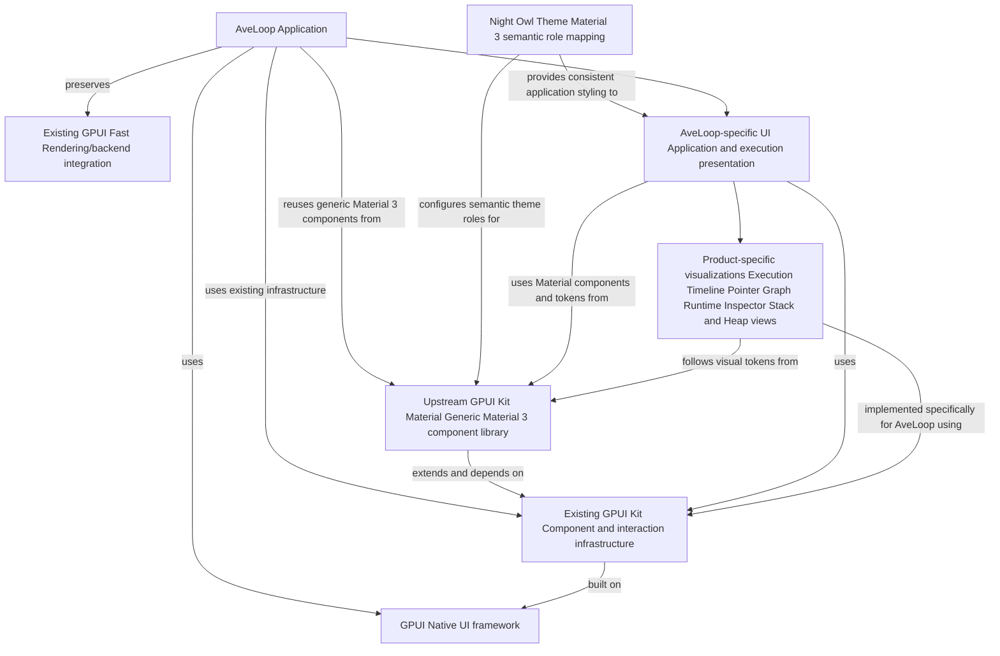

# AveLoop Alpha — Implementation Plan

**Document ID:** AVE-PLAN-001\
**Version:** 1.1.0\
**Status:** Derived from AVE-SPEC-001; review required\
**Date:** 22 November 2026

---

## 1. Plan objective

Deliver the Alpha defined in `spec.md` as one native cross-platform desktop application. The plan deliberately avoids premature package splitting, platform-specific product forks, and broad IDE scope.

The delivery sequence is:

1. Establish project rules and verify the external toolchain/framework assumptions.
2. Create the smallest clean Rust/GPUI application foundation.
3. Implement the shared domain and application state contracts.
4. Implement native editing and project workflow.
5. Implement build and debugger integration.
6. Record and reconstruct real execution states.
7. Add runtime visualizations and synchronized navigation.
8. Validate the full workflow on Linux, Windows, and macOS.
9. Complete release hardening and Alpha acceptance.

Implementation must not begin by creating a large directory tree or multiple crates. Create a module only when a coherent responsibility is implemented.

---

## 2. Delivery strategy

### 2.1 Architecture style

**Modular monolith, one Cargo package, one application crate.**

This is the Alpha default. Cargo workspaces and extra crates are not introduced merely to make the repository look modular. Extraction requires a documented reason: independent lifecycle, dependency isolation, reuse outside the app, compile-time isolation, or an independently maintained public API.

### 2.2 Shared codebase policy

All product behavior, domain types, use cases, trace semantics, and GPUI views are shared. Platform differences are handled behind narrow adapters only where the OS APIs actually differ.

No `linux-app`, `windows-app`, or `macos-app` application trees. No duplicated application logic.

### 2.3 Dependency direction

```text
main / composition root
        |
        v
presentation  ------> application ------> domain
     |                    ^
     |                    |
     v                    |
infrastructure -----------+
     |
     v
platform adapters (only where OS-specific behavior is required)
```

Rules:
- `domain` imports no GPUI, DAP, filesystem, compiler, or OS process types.
- `application` owns use cases and ports/contracts.
- `infrastructure` implements compiler, debugger, trace, and project persistence ports.
- `presentation` owns GPUI views, design tokens/components, and view models.
- `platform` contains narrow OS-specific process/path/toolchain adapters. It must not become a second business-logic layer.
- `main` composes concrete implementations; it does not contain product logic.

### 2.4 Proposed repository layout

This is a starting layout for one package, not a mandate to create every directory empty on day one.

```text
aveloop/
├── Cargo.toml
├── Cargo.lock
├── rust-toolchain.toml
├── README.md
├── LICENSE
├── .gitignore
├── .github/
│   └── workflows/
│       └── ci.yml
├── assets/
│   ├── fonts/
│   └── icons/
├── docs/
│   ├── decisions/
│   ├── development/
│   └── testing/
├── specs/
│   └── 001-ave-loop-alpha/
│       ├── spec.md
│       ├── plan.md
│       └── tasks.md
└── src/
    ├── main.rs
    ├── app/
    │   ├── mod.rs
    │   └── composition.rs
    ├── domain/
    │   ├── mod.rs
    │   ├── project/
    │   ├── source/
    │   ├── execution/
    │   ├── trace/
    │   └── runtime/
    ├── application/
    │   ├── mod.rs
    │   ├── ports/
    │   └── use_cases/
    ├── infrastructure/
    │   ├── mod.rs
    │   ├── project/
    │   ├── toolchain/
    │   ├── debugger/
    │   └── trace/
    ├── presentation/
    │   ├── mod.rs
    │   ├── design_system/
    │   ├── workspace/
    │   ├── editor/
    │   ├── execution/
    │   └── inspector/
    └── platform/
        ├── mod.rs
        ├── process/
        ├── paths/
        └── toolchain/
```

Structure rules:
- Do not create empty modules solely to match this diagram.
- Keep feature-local private modules private; expose only necessary module APIs.
- `presentation` may depend on application-facing view models, never the reverse.
- Platform submodules may use `cfg` only at the OS boundary. Shared code remains outside `cfg`.
- Add a new top-level module only when it owns a distinct dependency boundary.

---

## 3. Technical baseline

### 3.1 Rust and GPUI

- Rust is the only application implementation language.
- GPUI is the native UI framework.
- Pin the exact GPUI Git revision used by the first verified integration; do not depend on a moving `main` branch.
- Pin the Rust toolchain and commit `Cargo.lock`.
- Isolate GPUI APIs within `presentation` and app composition.
- GPUI is pre-1.0 and active development; framework upgrades are explicit maintenance work, not automatic dependency drift.

### 3.2 Cross-platform target matrix

| OS | Alpha architecture | UI backend | Required validation |
|---|---|---|---|
| Linux | x86_64 | GPUI Linux backend; Wayland and X11 build/runtime coverage | CI build + real desktop smoke test + full debugger workflow |
| Windows | x86_64 | GPUI Win32 backend | CI build + real desktop smoke test + full debugger workflow |
| macOS | arm64 | GPUI macOS/Metal backend | CI build + real desktop smoke test + full debugger workflow |

The application code remains shared. The table identifies release targets, not separate products.

### 3.3 C/C++ toolchain

AveLoop uses the compiler already installed on the platform. It does not bundle, download, or install one.

- **Linux:** existing GCC/G++, or the compiler explicitly selected through project configuration or `CC`/`CXX`. Clang is used only when the user selects it.
- **macOS:** the active Apple Clang/Clang++ toolchain (`xcrun --find clang`); Command Line Tools are sufficient.
- **Windows:** existing MSVC (`cl.exe`) with its compatible debugger (CDB/DbgEng), or existing MinGW-w64 GCC/G++ with GDB.

Windows selection is pair-based, never compiler-only:
1. Only MinGW-w64 GCC/G++ with GDB complete and compatible → select that pair.
2. Only MSVC with CDB/DbgEng complete and compatible → select that pair.
3. Both pairs complete and compatible → prefer MinGW-w64 GCC/G++ with GDB.
4. Neither pair complete → report that no supported Windows compiler-debugger combination was found; install nothing.

A compiler without its compatible debugger, or a debugger without its compatible compiler, is not a valid pair. Explicit project or user configuration overrides the default preference; when the configured family has no complete pair, report that family as unavailable instead of silently switching. Linux and macOS pairings are fixed by the platform (GCC/GDB, Apple Clang/LLDB).

Standards: C17 (`-std=c17`), C++20 (`-std=c++20`), debug information enabled, low/no optimization in the debug profile. Platform-native linker and runtime prerequisites are documented per OS. Discovery reports executable path, version, target, and required companions; `cc`/`c++` aliases are resolved to the real compiler before capability reporting. Unsupported or mismatched installations produce actionable diagnostics. Verified versions are recorded per platform; there is no single pinned cross-platform compiler version.

### 3.4 Debugger

- **Linux:** GDB. Use its DAP interpreter when the installed build provides one (GDB DAP requires Python support); otherwise use GDB/MI through a narrow adapter.
- **macOS:** LLDB and `lldb-dap` from the active Apple developer toolchain.
- **Windows:** the debugger of the pair selected by §3.3 — CDB/DbgEng for MSVC, GDB for MinGW-w64. Never pair an MSVC-built binary with GDB or a MinGW-built binary with CDB.

DAP capability negotiation happens at session startup and is verified per backend, never assumed. DAP protocol structures stay inside infrastructure. Do not assume `supportsStepBack`. Capture ordered stop observations and reconstruct prior selected states from AveLoop-owned trace data. Source-level stepping is the Alpha granularity. Compiler and debugger discovery are independent.

### 3.5 Editor

Build a bounded native editor using GPUI text/input primitives. Alpha is not intended to reproduce Zed's full editor. Use Tree-sitter C/C++ grammars for syntax parsing/highlighting. Do not embed CodeMirror or a WebView. LSP is deferred.

### 3.6 Design system

AveLoop uses upstream `gpui-kit-material` as its Material 3 component system instead of owning a separate generic component layer. The intended integration relationships are:



Rules:
- **GPUI Kit** remains the existing component and interaction infrastructure; it is not replaced.
- **GPUI Fast** remains the existing rendering/backend integration; it is not replaced.
- **GPUI Kit Material** supplies the generic Material 3 components; AveLoop does not reimplement them.
- **Night Owl** remains the default theme and maps its colors into the upstream Material 3 semantic role system; it is not replaced by the upstream default palette.
- AveLoop owns its specialized execution visualizations; they reuse GPUI Kit primitives and Material 3 tokens where appropriate.
- No local GPUI Kit Material fork is created or modified; no second independent theme system is introduced.

Dependency-level details (exact Cargo features, version pins, Rust MSRV) live in §8.

---

## 4. Execution architecture

### 4.1 Responsibilities

1. **Toolchain discovery:** locate the platform C/C++ compiler, the matching debugger adapter, linker, and platform prerequisites; report versions and capabilities.
2. **Build adapter:** produce a deterministic debug build from project configuration and source revision.
3. **Debug session adapter:** launch/attach the process through the selected debugger backend (GDB DAP or GDB/MI on Linux, `lldb-dap` on macOS, the compiler-matched debugger on Windows), negotiate capabilities, send step/continue/terminate requests, and parse protocol responses.
4. **Capture coordinator:** convert debugger stops and output into ordered raw observations.
5. **Trace store:** persist bounded session data and source/build provenance.
6. **State resolver:** reconstruct a deterministic selected state from recorded observations/checkpoints.
7. **Runtime normalizer:** map debugger-specific values into language-neutral domain values while preserving language/capability metadata.
8. **Presentation:** render the resolved state without making debugger requests directly from panels.

### 4.2 Capture granularity

Alpha uses source-level debugger stops. A stop record captures:
- Session ID and monotonically ordered stop ID.
- Thread identity and selected frame when available.
- Source location when available.
- Available stack frames.
- Available variables and child values within configured inspection depth.
- Output records and ordering metadata available at that time.
- Raw observation provenance and capture limitations.

The capture layer must bound recursive expansion and avoid unbounded evaluation of arbitrary expressions.

### 4.3 Trace model

Keep these concepts distinct:
- Raw debugger observation.
- Stop record.
- Derived event/diff.
- Checkpoint.
- Resolved selected execution state.

A checkpoint is stored at a chosen interval or when needed for bounded reconstruction. The initial implementation may store complete stop observations for a conservative bounded trace, then optimize only after measuring. The plan does not require a sophisticated event-sourcing engine before a working vertical slice.

### 4.4 Reverse navigation

Previous/seek selects a prior recorded stop and resolves its state from the trace. It never asks LLDB to reverse the running process. The UI must label the session as recorded/paused when appropriate and prevent a stale live debugger response from overwriting a historical selected state.

### 4.5 Memory visualization policy

The runtime model distinguishes:
- Debugger-observed values.
- Resolved target objects.
- Symbolic identities.
- Actual addresses.
- Unresolved references.
- Verified lifetime events.

The Heap panel is an **observable object view**, not a process-wide allocator map. Lifecycle labels are emitted only from verified capture evidence. The first vertical slice should prioritize variables, frames, aggregates, pointers, and null values; allocation instrumentation is not a prerequisite for falsely claiming full heap support.

---

## 5. Workspace and project configuration

### 5.1 Workspace first

A workspace is any local directory the user opens. Opening, browsing, and editing never require an AveLoop-specific file and never modify the directory. A workspace becomes a *project* only when a build/run descriptor is resolved for it.

### 5.2 Project descriptors

A descriptor tells AveLoop how to build and run a project. Sources are pluggable and resolved in this order:

1. **Native build-system descriptor** — `CMakeLists.txt`, `Cargo.toml`, `go.mod`, `Makefile`, and similar. Alpha detects and reports it; it does not drive it.
2. **AveLoop overlay** — an optional `ave.toml` supplying build/run settings where no supported descriptor exists, or overriding specific settings.
3. **No descriptor** — the workspace opens in edit-only mode; that is not an error.

`ave.toml` must never replace, re-encode, or mirror a native descriptor. When a native descriptor is present, `ave.toml` may only add settings that descriptor cannot express.

### 5.3 `ave.toml` (optional overlay)

Owned settings: format version, display name, entry source file, additional source files, optional language override for ambiguous files, include directories, preprocessor definitions, extra compiler and linker arguments, program arguments, working directory.

Rules:
- Unknown keys and unsupported versions are reported clearly.
- Paths are resolved relative to the workspace root unless documented otherwise.
- The file is optional; its absence is not an error.
- In Alpha the overlay is the supported way to build C17/C++20 programs directly. Native-descriptor builds arrive post-Alpha.

### 5.4 Languages

Languages are registered integrations, not a closed enum in the project model. A language owns its file-extension mapping, highlighting, language-standard flag, and default build/run recipe. Alpha registers C17 and C++20 only. Generic workspace, project, and configuration types carry a language identifier; adding Rust or Go later adds a registration rather than changing the model or the `ave.toml` schema.

### 5.5 Separation of responsibilities

| Responsibility | Owner |
|---|---|
| Opened directory, file tree, buffers | workspace |
| Descriptor resolution and precedence | `application` (ports) |
| Descriptor detection (`CMakeLists.txt`, `Cargo.toml`, `go.mod`) | `infrastructure/build_system` |
| Overlay contract | `domain/project`; I/O in `infrastructure/project` |
| Language registration and file-to-language mapping | `domain` (registry) + `infrastructure` |
| Compiler and debugger discovery/invocation | `infrastructure/toolchain`, `infrastructure/debugger` |

Defaults: C uses C17, C++ uses C++20, the debug profile is selected by default, the compiler is discovered locally, and no package manager, network fetch, or toolchain installation is performed.

---

## 6. Delivery phases and gates

### Phase 0 — Product baseline and repository hygiene

**Outcome:** the team has one authoritative specification set and a clean project baseline.

Work:
- Apply the approved constraints from `spec.md`.
- Establish project constitution/principles for implementation quality.
- Confirm repository state and avoid overwriting prototype assets.
- Add Spec Kit feature directory and document authority.
- Record decisions and rejected alternatives.

**Exit gate:** no conflicting product definition remains; no production code changes are made in this phase.

### Phase 1 — Ecosystem and feasibility spikes

**Outcome:** critical external dependencies are verified on all three OS targets before architecture is frozen.

Spikes:
- Build and launch a minimal GPUI app on Linux, Windows, and macOS.
- Verify GPUI platform features and system dependencies.
- Verify the platform C/C++ toolchain builds C17/C++20 debug binaries on each OS: GCC/G++ on Linux, Apple Clang on macOS, MSVC or MinGW-w64 on Windows.
- Verify debugger integration on each OS: GDB DAP or GDB/MI on Linux, Apple `lldb-dap` on macOS, the compiler-matched debugger on Windows.
- Verify Tree-sitter C/C++ grammars and highlighting.
- Evaluate GPUI text primitives for editor scope.
- Verify Material 3 implementation effort and required GPUI component primitives.
- Test process cancellation/child termination per OS.

**Exit gate:** platform feasibility matrix is completed with evidence. A platform blocker is resolved or the Alpha release target is explicitly re-baselined before production foundation work. Do not silently proceed with Linux-only behavior.

### Phase 2 — Native application foundation

**Outcome:** a minimal native application launches from one Rust package on all target platforms.

Work:
- Pin Rust toolchain, GPUI revision, and dependencies.
- Establish the modular-monolith boundaries.
- Add CI build matrix.
- Add error/logging conventions and test harness.
- Establish application composition and background-task ownership.
- Add initial Material 3/Night Owl tokens.

**Exit gate:** same shared application builds and launches on all three targets; no duplicate OS-specific app implementation.

### Phase 3 — Domain and application contracts

**Outcome:** the execution model and selected-state invariant are testable without GPUI or DAP.

Work:
- Project/source identity and revisions.
- Debug session and provenance model.
- Stop/observation/event/checkpoint/selected-state concepts.
- Runtime values, frames, scopes, objects, pointers, and capability metadata.
- State resolver and deterministic reconstruction.
- Application ports and use cases.
- Architecture tests for forbidden dependencies.

**Exit gate:** core invariants pass unit/property tests with clearly labelled synthetic fixtures.

### Phase 4 — Project workflow and native editor

**Outcome:** users can open a workspace or project, edit C/C++ source, save, and configure a build.

Work:
- Workspace/project model and descriptor resolution, including the optional `ave.toml` overlay parsing/validation.
- Workspace/file navigation.
- Native GPUI text editor.
- Tree-sitter highlighting.
- Editing operations, undo/redo, clipboard, line numbers.
- Source revision tracking and stale-trace state.
- Responsive workspace skeleton.

**Exit gate:** native editing workflow passes on all target OSes.

### Phase 5 — Toolchain and debugger integration

**Outcome:** the app builds and launches real C17/C++20 programs under the platform debugger.

Work:
- Platform toolchain discovery and diagnostics.
- Compiler command construction.
- Build output/diagnostic parsing.
- Debugger transport and protocol lifecycle (DAP or GDB/MI).
- Capability negotiation per backend.
- Launch, stop, step, continue, terminate.
- stdout/stderr capture.
- Cancellation and process cleanup.

**Exit gate:** real sample programs compile and run under debugger on all three platforms.

### Phase 6 — Trace capture and state reconstruction

**Outcome:** a real debug session becomes a deterministic, navigable trace.

Work:
- Capture ordered stops and observations.
- Persist source/build/session provenance.
- Normalize frames, variables, values, and source locations.
- Store bounded trace records/checkpoints.
- Reconstruct any recorded selected stop.
- Handle missing/partial/malformed debugger data.
- Prevent old-session async messages from mutating the active trace.

**Exit gate:** trace replay and selected-state identity tests pass; Previous/seek work without reverse debugger support.

### Phase 7 — Runtime visualizations and synchronized workspace

**Outcome:** the distinctive AveLoop experience is usable.

Work:
- Stack visualization.
- Variables inspector.
- Arrays/structures/class member inspection.
- Heap observable-object view.
- Pointer/null/alias/interior-offset visualization when provable.
- Trace inspector and timeline.
- Output console.
- Atomic selected-state publication.
- Material 3 component states and Night Owl mapping.
- Keyboard shortcuts and workspace resizing.

**Exit gate:** every panel displays the same selected stop ID under forward, backward, seek, playback, session replacement, and reconstruction failure tests.

### Phase 8 — Cross-platform validation and Alpha hardening

**Outcome:** Alpha release criteria are evidenced rather than assumed.

Work:
- CI build/test matrix.
- Per-OS toolchain setup docs.
- Full manual workflow on Linux/Windows/macOS.
- DAP fault injection and cancellation tests.
- Long-trace/performance/resource tests.
- Accessibility/focus/keyboard review.
- Dependency/license audit.
- Installer/package smoke tests.
- Known limitations and release notes.

**Exit gate:** all acceptance items in `spec.md` are checked with evidence. Unsupported capabilities remain explicitly labelled.

---

## 7. Testing strategy

### Domain tests
- Identity and lifetime.
- Value-state distinctions.
- Pointer target resolution.
- Address reuse behavior.
- Trace ordering.
- State reconstruction determinism.
- Selected-state invariants.

### Application tests
- Create/open project.
- Build and launch use cases.
- Session cancellation.
- Stale source handling.
- Trace selection and navigation.
- Session replacement and async invalidation.

### Infrastructure tests
- Compiler command construction.
- Toolchain discovery.
- DAP request/response handling.
- GDB/MI request/response handling where the installed GDB lacks DAP.
- Capability negotiation.
- Malformed/partial protocol payloads (DAP and GDB/MI).
- stdout/stderr capture.
- Process termination.
- Trace serialization/recovery.

### Presentation tests
- GPUI view rendering and interactions.
- Keyboard/focus behavior.
- Panel synchronization.
- Timeline/trace selection.
- Console resize/collapse/copy.
- Accessibility semantics where supported.

### End-to-end tests
Use small deterministic C17 and C++20 sample projects covering:
- Local variables and scopes.
- Nested calls and recursion.
- Arrays and structs/classes.
- Pointer initialization and null.
- Pointer reassignment and aliases.
- Interior pointer where safely demonstrable.
- Heap allocation and release only where observed by the backend.
- stdout/stderr.
- Compile failure.
- Runtime exit/failure.
- Timeout and cancellation.

Synthetic fixtures may be used for unit tests, but end-to-end acceptance must use real compiled programs.

### Cross-platform evidence
A CI matrix is necessary but insufficient. Each OS requires a real desktop smoke test and at least one full build/debug/record/navigate/inspect run.

---

## 8. Dependency policy

Every dependency must be classified as:
- Use upstream.
- Reuse selected primitives.
- Fork (only with explicit approval).
- Build in AveLoop.
- Reject.

Before adoption, record:
- Purpose and exact feature used.
- License.
- Release/activity and maintenance evidence.
- API stability.
- Platform support.
- Transitive dependency cost.
- GPUI compatibility.
- Exit/migration cost.

Alpha baseline:
- GPUI: selected framework, exact revision pinned.
- Tree-sitter: use for C/C++ syntax parsing/highlighting after integration validation.
- LLDB-DAP: one supported debugger interface on macOS (Apple toolchain); GDB is the Linux default. Exact versions are recorded per verified platform, not pinned globally.
- Material components: upstream `gpui-kit-material` release 0.2.0 is the adopted generic Material 3 component system; AveLoop does not own a separate generic component layer.
- GPUI Kit Material dependency decision (verified against crates.io):
  - Upstream repository: https://github.com/mizorewww/gpui-kit-material (release 0.2.0, 2026-11-18; 45★, 7 forks, 1 open issue, not archived).
  - License: MIT AND Apache-2.0.
  - Verified compatibility baseline: depends on GPUI Kit 0.10.0 and GPUI Base 0.10.0, matching AveLoop's pinned versions (`gpui-kit` 0.10.0, `gpui-base` 0.10.0).
  - Newer upstream release: `gpui-kit-material 0.3.0` was published 2026-11-24 and requires GPUI Kit `^0.11.0` and GPUI Base `^0.11.0` (it also moves the optional Fast pin to `=0.1.19`, symbols to `^0.3`, and pickers to `jiff`). That is incompatible with AveLoop's 0.10.0 baseline, so 0.2.0 remains the correct pin; 0.3.0 is recorded but not adopted.
  - GPUI Fast: the upstream release declares an optional exact-pin dependency `gpui-fast = "=0.1.16"`. AveLoop pins `gpui-fast` 0.1.17. Enabling the upstream `gpui-fast` feature would introduce a duplicate `gpui-fast` version (0.1.16 alongside 0.1.17) and two incompatible framework type trees, so the feature is **not** enabled. Material components integrate with AveLoop's existing GPUI Fast 0.1.17 through the shared GPUI Kit 0.10.0 / GPUI Base 0.10.0 types instead.
  - Cargo configuration (baseline example to be applied at implementation): `gpui-kit-material = { version = "0.2.0", default-features = false, features = ["full", "serde"] }`. `full` enables the complete Material component groups; `serde` enables serialization support. `embedded-symbols` and `gpui-fast` are deliberately excluded.
  - Embedded symbols: the upstream default enables `embedded-symbols`, which pulls `gpui-material-symbols/embed-assets` (~51 MB of fonts/SVG data). AveLoop excludes it; icon use is evaluated separately against AveLoop's existing asset infrastructure.
  - Rust MSRV: upstream release 0.2.0 requires Rust 1.98; AveLoop's installed toolchain is 1.96.0. A toolchain update to at least 1.98 is a documented developer/CI requirement, not an end-user requirement (AveLoop does not bundle a Rust toolchain).
  - No fork: consuming the published upstream crate is allowed; creating or modifying a local fork or vendoring modified upstream code is prohibited.
- GPUI Kit: remains the component and interaction infrastructure; it is not replaced or duplicated.
- LSP: defer.

---

## 9. Release and quality gates

No phase is considered complete based on code presence alone.

A phase is complete only when:
1. Its output exists.
2. Its tests pass.
3. Its documented acceptance criteria are met.
4. Its known limitations are recorded.
5. It does not violate the architecture boundaries.
6. Cross-platform implications are assessed.

No commits, pushes, PRs, repository creation, fork creation, or upstream modifications are authorized by these documents. Those actions require separate explicit user authorization.

---

## 10. Risk register

| ID | Risk | Mitigation / gate |
|---|---|---|
| R-01 | GPUI API/platform gaps | Phase 1 GPUI spike on all OSes; pin revision. |
| R-02 | Debugger backends behave differently by OS | Phase 1 debugger matrix; per-backend capability negotiation. |
| R-03 | Debugger data insufficient for full heap | Observable-object scope; no complete-heap claim. |
| R-04 | C++ debug information is incomplete | Debug profile; supported type matrix; unavailable states. |
| R-05 | Reverse debugger support absent | Trace-backed reverse navigation. |
| R-06 | Process termination differs by OS | Narrow process adapter and per-OS tests. |
| R-07 | Untrusted code runs with user privileges | Explicit consent and honest security disclosure. |
| R-08 | Trace growth harms responsiveness | Bounded capture, checkpoints, stress tests. |
| R-09 | UI and runtime state diverge | Single selected-state owner and integration invariants. |
| R-10 | Architecture becomes over-modular | One crate; extraction requires evidence and approval. |

---

## 11. Plan completion definition

The plan is complete when the tasks in `tasks.md` are implemented and verified, all Alpha acceptance criteria are satisfied on the three target OSes, and the remaining known limitations are published. The existence of the three documents alone is not completion.