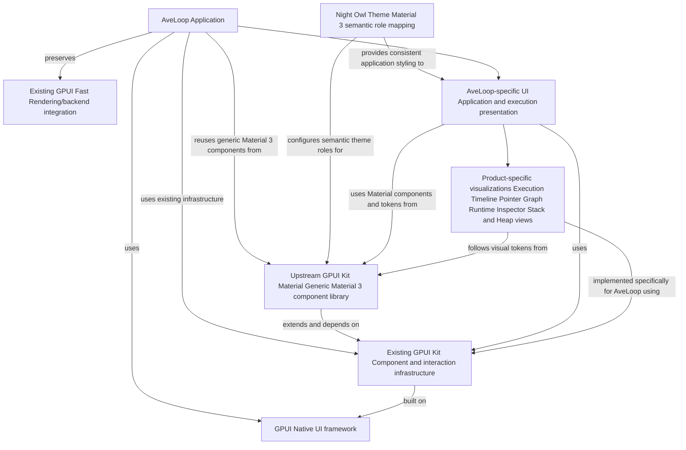
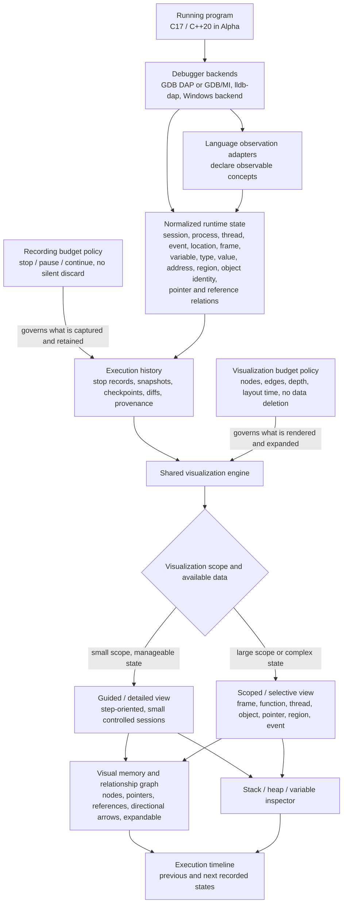
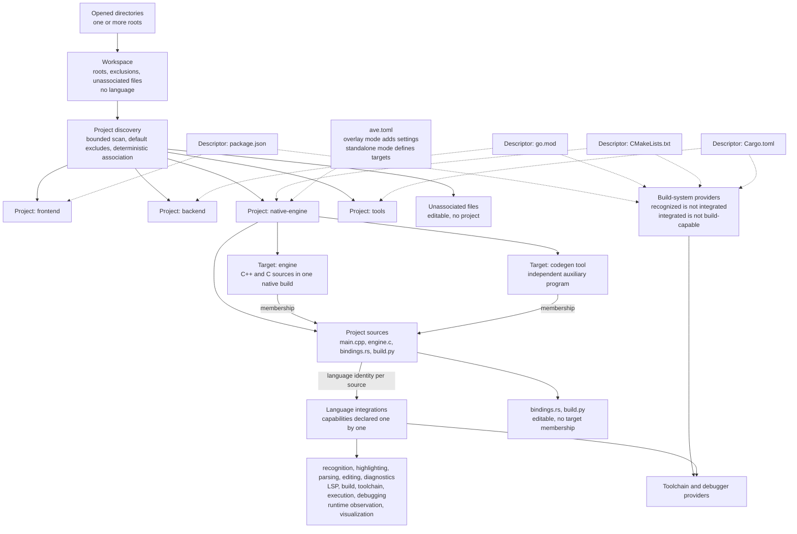

# AveLoop Alpha — Implementation Plan

**Document ID:** AVE-PLAN-001\
**Version:** 1.1.0\
**Status:** Derived from AVE-SPEC-001; review required\
**Date:** 22 November 2026

---

## 1. Plan objective

Deliver the Alpha defined in `spec.md` as one native cross-platform desktop application. The plan deliberately avoids premature package splitting, platform-specific product forks, and broad IDE scope.

The delivery sequence is:

1. Establish project rules and verify the external toolchain/framework assumptions.
2. Create the smallest clean Rust/GPUI application foundation.
3. Implement the shared domain and application state contracts.
4. Implement native editing and project workflow.
5. Implement build and debugger integration.
6. Record and reconstruct real execution states.
7. Add runtime visualizations and synchronized navigation.
8. Validate the full workflow on Linux, Windows, and macOS.
9. Complete release hardening and Alpha acceptance.

Implementation must not begin by creating a large directory tree or multiple crates. Create a module only when a coherent responsibility is implemented.

---

## 2. Delivery strategy

### 2.1 Architecture style

**Modular monolith, one Cargo package, one application crate.**

This is the Alpha default. Cargo workspaces and extra crates are not introduced merely to make the repository look modular. Extraction requires a documented reason: independent lifecycle, dependency isolation, reuse outside the app, compile-time isolation, or an independently maintained public API.

### 2.2 Shared codebase policy

All product behavior, domain types, use cases, trace semantics, and GPUI views are shared. Platform differences are handled behind narrow adapters only where the OS APIs actually differ.

No `linux-app`, `windows-app`, or `macos-app` application trees. No duplicated application logic.

### 2.3 Dependency direction

```text
main / composition root
        |
        v
presentation  ------> application ------> domain
     |                    ^
     |                    |
     v                    |
infrastructure -----------+
     |
     v
platform adapters (only where OS-specific behavior is required)
```

Rules:
- `domain` imports no GPUI, DAP, filesystem, compiler, or OS process types.
- `application` owns use cases and ports/contracts.
- `infrastructure` implements compiler, debugger, trace, and project persistence ports.
- `presentation` owns GPUI views, design tokens/components, and view models.
- `platform` contains narrow OS-specific process/path/toolchain adapters. It must not become a second business-logic layer.
- `main` composes concrete implementations; it does not contain product logic.

### 2.4 Proposed repository layout

This is a starting layout for one package, not a mandate to create every directory empty on day one.

```text
aveloop/
├── Cargo.toml
├── Cargo.lock
├── rust-toolchain.toml
├── README.md
├── LICENSE
├── .gitignore
├── .github/
│   └── workflows/
│       └── ci.yml
├── assets/
│   ├── fonts/
│   └── icons/
├── docs/
│   ├── decisions/
│   ├── development/
│   └── testing/
├── specs/
│   └── 001-ave-loop-alpha/
│       ├── spec.md
│       ├── plan.md
│       └── tasks.md
└── src/
    ├── main.rs
    ├── app/
    │   ├── mod.rs
    │   └── composition.rs
    ├── domain/
    │   ├── mod.rs
    │   ├── project/
    │   ├── source/
    │   ├── execution/
    │   ├── trace/
    │   └── runtime/
    ├── application/
    │   ├── mod.rs
    │   ├── ports/
    │   └── use_cases/
    ├── infrastructure/
    │   ├── mod.rs
    │   ├── project/
    │   ├── toolchain/
    │   ├── debugger/
    │   └── trace/
    ├── presentation/
    │   ├── mod.rs
    │   ├── design_system/
    │   ├── workspace/
    │   ├── editor/
    │   ├── execution/
    │   └── inspector/
    └── platform/
        ├── mod.rs
        ├── process/
        ├── paths/
        └── toolchain/
```

Structure rules:
- Do not create empty modules solely to match this diagram.
- Keep feature-local private modules private; expose only necessary module APIs.
- `presentation` may depend on application-facing view models, never the reverse.
- Platform submodules may use `cfg` only at the OS boundary. Shared code remains outside `cfg`.
- Add a new top-level module only when it owns a distinct dependency boundary.

---

## 3. Technical baseline

### 3.1 Rust and GPUI

- Rust is the only application implementation language.
- GPUI is the native UI framework.
- Pin the exact GPUI Git revision used by the first verified integration; do not depend on a moving `main` branch.
- Pin the Rust toolchain and commit `Cargo.lock`.
- Isolate GPUI APIs within `presentation` and app composition.
- GPUI is pre-1.0 and active development; framework upgrades are explicit maintenance work, not automatic dependency drift.

### 3.2 Cross-platform target matrix

| OS | Alpha architecture | UI backend | Required validation |
|---|---|---|---|
| Linux | x86_64 | GPUI Linux backend; Wayland and X11 build/runtime coverage | CI build + real desktop smoke test + full debugger workflow |
| Windows | x86_64 | GPUI Win32 backend | CI build + real desktop smoke test + full debugger workflow |
| macOS | arm64 | GPUI macOS/Metal backend | CI build + real desktop smoke test + full debugger workflow |

The application code remains shared. The table identifies release targets, not separate products.

### 3.3 C/C++ toolchain

AveLoop uses the compiler already installed on the platform. It does not bundle, download, or install one.

- **Linux:** existing GCC/G++, or the compiler explicitly selected through project configuration or `CC`/`CXX`. Clang is used only when the user selects it.
- **macOS:** the active Apple Clang/Clang++ toolchain (`xcrun --find clang`); Command Line Tools are sufficient.
- **Windows:** existing MSVC (`cl.exe`) with its compatible debugger (CDB/DbgEng), or existing MinGW-w64 GCC/G++ with GDB.

Windows selection is pair-based, never compiler-only:
1. Only MinGW-w64 GCC/G++ with GDB complete and compatible → select that pair.
2. Only MSVC with CDB/DbgEng complete and compatible → select that pair.
3. Both pairs complete and compatible → prefer MinGW-w64 GCC/G++ with GDB.
4. Neither pair complete → report that no supported Windows compiler-debugger combination was found; install nothing.

A compiler without its compatible debugger, or a debugger without its compatible compiler, is not a valid pair. Explicit project or user configuration overrides the default preference; when the configured family has no complete pair, report that family as unavailable instead of silently switching. Linux and macOS pairings are fixed by the platform (GCC/GDB, Apple Clang/LLDB).

Standards: C17 (`-std=c17`), C++20 (`-std=c++20`), debug information enabled, low/no optimization in the debug profile. Platform-native linker and runtime prerequisites are documented per OS. Discovery reports executable path, version, target, and required companions; `cc`/`c++` aliases are resolved to the real compiler before capability reporting. Unsupported or mismatched installations produce actionable diagnostics. Verified versions are recorded per platform; there is no single pinned cross-platform compiler version.

### 3.4 Debugger

- **Linux:** GDB. Use its DAP interpreter when the installed build provides one (GDB DAP requires Python support); otherwise use GDB/MI through a narrow adapter.
- **macOS:** LLDB and `lldb-dap` from the active Apple developer toolchain.
- **Windows:** the debugger of the pair selected by §3.3 — CDB/DbgEng for MSVC, GDB for MinGW-w64. Never pair an MSVC-built binary with GDB or a MinGW-built binary with CDB.

DAP capability negotiation happens at session startup and is verified per backend, never assumed. DAP protocol structures stay inside infrastructure. Do not assume `supportsStepBack`. Capture ordered stop observations and reconstruct prior selected states from AveLoop-owned trace data. Source-level stepping is the Alpha granularity. Compiler and debugger discovery are independent.

### 3.5 Editor

Build a bounded native editor using GPUI text/input primitives. Alpha is not intended to reproduce Zed's full editor. Use Tree-sitter C/C++ grammars for syntax parsing/highlighting. Do not embed CodeMirror or a WebView. LSP is deferred.

### 3.6 Design system

AveLoop uses upstream `gpui-kit-material` as its Material 3 component system instead of owning a separate generic component layer. The intended integration relationships are:



Rules:
- **GPUI Kit** remains the existing component and interaction infrastructure; it is not replaced.
- **GPUI Fast** remains the existing rendering/backend integration; it is not replaced.
- **GPUI Kit Material** supplies the generic Material 3 components; AveLoop does not reimplement them.
- **Night Owl** remains the default theme and maps its colors into the upstream Material 3 semantic role system; it is not replaced by the upstream default palette.
- AveLoop owns its specialized execution visualizations; they reuse GPUI Kit primitives and Material 3 tokens where appropriate.
- No local GPUI Kit Material fork is created or modified; no second independent theme system is introduced.

Dependency-level details (exact Cargo features, version pins, Rust MSRV) live in §8.

---

## 4. Runtime observation and visualization architecture

One pipeline serves both small, controlled sessions and large real programs. The difference between the two experiences is visualization scope and detail, not a second execution or rendering engine.



This is a conceptual data-flow diagram, not a module or directory tree. The recording budget policy and the visualization budget policy are independent: the first decides what enters history, the second decides what is drawn from it.

### 4.1 Responsibilities

1. **Toolchain discovery:** locate the platform compiler, matching debugger adapter, linker, and prerequisites; report versions and capabilities.
2. **Build adapter:** produce a deterministic debug build from project configuration and source revision.
3. **Debug session adapter:** launch/attach through the selected backend, negotiate capabilities, send step/continue/terminate requests, and parse protocol responses. DAP and GDB/MI structures stay inside infrastructure.
4. **Language observation adapter:** translate backend responses into language-meaningful observations and declare which concepts the language/backend pair can observe.
5. **Normalizer:** map observations into the normalized runtime-state model while preserving provenance and language/capability metadata.
6. **History store:** persist ordered stops, snapshots, checkpoints, diffs, and source/build/session provenance within recorded budgets.
7. **Visualization engine:** build view models from normalized state, route scope, schedule lazy expansion, and publish immutable state to panels.
8. **Presentation:** render the resolved state. Panels never query the debugger directly and never read backend protocol types.

### 4.2 Observation layer

Alpha records source-level debugger stops. Backend interfaces are capability-based, not assumed uniform: each backend reports which of frames, scopes, variables, memory reads, registers, threads, module/source mapping, function entry/exit, and reverse execution it supports for the current session.

No capability is inferred from the backend's name or version. A capability that is absent is reported as unavailable, not emulated with guesses.

### 4.3 Normalized runtime state

The normalizer represents, where observed:

- Execution session, process, thread, execution event, and source location.
- Stack frame, variable, type information, and runtime value.
- Memory address and memory region.
- Object identity, established only under documented session rules.
- Pointer relationship, reference relationship, and alias relationship.
- Allocation and deallocation events, only when observed.

The model is language-neutral in shape and language-aware in meaning. It contains no GPUI, DAP, GDB/MI, or filesystem types. Unknown, unavailable, and unsupported are distinct states, not empty values.

### 4.4 Provenance classes

Every datum and every relationship carries one class:

| Class | Meaning | Rendering rule |
|---|---|---|
| Observed | Returned by the backend for the recorded stop | Normal |
| Derived | Computed from observations by a deterministic, documented rule | Normal, with rule available on inspection |
| Inferred | Produced by a heuristic | Explicitly labelled; never described as verified |
| Unavailable | Not provided by the backend or debug information | Shown as unavailable, with reason |
| Unreconstructable | Existed at runtime but cannot be recovered from the recording | Shown as unreconstructable |

Derived and inferred data never overwrite observed data. A relationship with no established provenance is not drawn.

### 4.5 Execution history and snapshots

Keep these concepts distinct: raw observation, stop record, derived event/diff, snapshot/checkpoint, and resolved selected state.

- Stops are recorded in their real order and never reordered or fabricated.
- A checkpoint is stored at a chosen interval or when needed to bound reconstruction cost.
- The Alpha implementation may store complete stop observations for a bounded trace and optimize only after measuring.
- Recording bounds are configured, accounted (memory/disk), and reported. Reaching one is resolved by a declared stop, pause, or continue policy and produces a partial recording whose recorded interval is identified — never a trace trimmed to look complete. An intentional stop is distinguished from an interrupted recording.
- Capture is not a claim of reverse execution.

### 4.6 Capture granularity

A stop record captures:
- Session and monotonically ordered stop ID.
- Thread identity and selected frame when available.
- Source location when available.
- Available stack frames.
- Available variables and child values within configured inspection depth.
- Output records and ordering metadata available at that time.
- Observation provenance and capture limitations.

The capture layer bounds recursive expansion and never evaluates arbitrary expressions.

### 4.7 Visualization engine

The engine consumes normalized state and history, never debugger protocols. It:

1. Resolves the visualization scope from the selected inspection context (frame, function, thread, variable, pointer, object, memory region, or event) plus available data.
2. Selects guided detail for small, manageable state and scoped detail for large or complex state. Both use the same renderers and the same normalized data.
3. Builds nodes and edges for the requested scope only.
4. Schedules on-demand expansion, cancelling requests that a newer selection has made stale.
5. Publishes one immutable view per selected stop so every panel shows the same state.
6. Reports coverage: what is shown, what is expandable, what is unavailable, and whether the recording itself is partial.

Depth limits, node budgets, and aggregation thresholds belong to visualization policy. They change what is displayed, never what was recorded, and the UI labels the view as scoped or partially displayed rather than implying a recording failure.

### 4.8 Relationship graph

- **Nodes:** frames, variables, aggregate members, arrays, objects, memory regions, and unresolved references.
- **Edges:** points-to, references, member-of, element-of, interior-offset, and alias.
- An edge is drawn only from an observed relation, a documented derivation, or an explicitly labelled inference.
- Object identity follows documented session rules; address equality alone is not identity. Address reuse after a verified deallocation does not silently preserve identity.
- Null, uninitialized, invalid, unresolved, unavailable, optimized-out, and unknown values render as distinct node states, not empty objects.

### 4.9 Two independent resource policies

Real programs require selective inspection, not restricted capability. Scalability limits are split into two policies with different guarantees; neither may be reported as the other (`spec.md` §6.6).

**Visualization budget — what is displayed.** Nodes and edges per view, expansion depth, rendering memory, layout time, and on-demand inspection limits. Reaching it changes only the rendered view: recorded stops, snapshots, and events are untouched, an otherwise complete recording stays complete, and the UI reports the view as scoped or partially displayed with a way to expand or re-scope.

**Recording budget — what is captured and retained.** Recording memory, trace and snapshot storage, event capture limits, and recording time. Reaching it is resolved by a declared stop, pause, or continue policy; the user is informed, the recorded interval and missing observations are identified, and nothing already recorded is discarded. An intentional stop is distinguishable from an interrupted recording.

**Independence.** A scoped view is never described as an incomplete recording. A partial recording is never hidden by rendering a smaller graph that looks complete. The two states are labelled by different UI mechanisms.

Implementation techniques:

- Scope selection narrows the graph before rendering; it never disables debugging.
- Object graphs expand on demand; nothing is eagerly traversed to the end of a pointer graph.
- Rendering is virtualized and incremental: only visible nodes are laid out, and updates are applied as diffs.
- Heavy inspection runs off the UI thread; results that no longer match the current selection are discarded.
- Snapshots use structural sharing so unchanged subtrees are not duplicated.
- Both budgets are configurable and surfaced in the UI when they affect the view.

### 4.10 Language observation adapters

C and C++ are Alpha adapters. Rust and Go are post-Alpha adapters, not model changes.

- Each adapter declares its observable concepts and its known limitations. Concepts it cannot observe are reported as unavailable.
- C: raw pointers, stack/static storage, heap blocks when observable, structs, unions, arrays, pointer arithmetic.
- C++: pointers and references, classes and inheritance, object lifetime, containers, smart pointers, RAII, dynamic dispatch where debug information supports it.
- Debugger pretty-printers and language runtime metadata are adapter inputs, not core-model assumptions.

### 4.11 Reverse navigation

Previous/seek selects a prior recorded stop and resolves its state from the history store. It never asks the backend to reverse the running process. GDB's reverse execution requires target support and is not assumed; where a backend supports it, it remains an optional backend capability, not an AveLoop requirement. The UI labels the session as recorded when showing historical states and prevents stale live responses from overwriting them.

### 4.12 Honesty constraints

The Heap panel is an **observable object view**, not a process-wide allocator map. Lifecycle labels come only from verified capture evidence. The first vertical slice prioritizes variables, frames, aggregates, pointers, null and unresolved values; allocation instrumentation is not a prerequisite for claiming heap support, and the UI states the coverage limit.

---

## 5. Workspace, project, language, and build-target model

### 5.1 Three independent identities

A workspace is not a language, a project is not necessarily a single language, and a build target is not necessarily a single source file. The model keeps these identities separate so that mixed-language projects and multi-project workspaces are ordinary cases, not migrations.



Conceptual data flow, not a directory tree. A project owns descriptor attachments, targets, and sources; a language integration is registered globally and referenced by sources, never stored as a project field.

### 5.2 Workspace

- Represents the opened working context: one or more root directories, exclusion rules, discovered projects, and files that belong to no project.
- Has no language, build system, or compiler of its own.
- Opening a workspace never requires `ave.toml`, never modifies the directory, and never executes project code.
- Multi-root workspaces are first class; roots inside another root collapse into the ancestor root instead of duplicating the tree.
- Files outside any project stay editable; they are shown as unassociated, not silently attached to a nearby project.

### 5.3 Deterministic project discovery

1. Canonicalize roots, preserve user order, deduplicate, and collapse nested roots.
2. Never scan default-excluded directories: `.git`, `.hg`, `.svn`, `build`, `out`, `target`, `node_modules`, `vendor`, `dist`, `.venv`, `__pycache__`. User exclusions extend this list.
3. Bound the scan by depth and visited-entry count. Exceeding a bound reports an **incomplete discovery**, never a silently truncated tree.
4. A candidate project root is a directory containing a recognized descriptor or an `ave.toml`.
5. Association is nearest-ancestor: a file belongs to the closest candidate ancestor. A candidate inside another candidate is a **child project**, never merged into its parent.
6. Several descriptors in one root produce **one project with several descriptor attachments**; each attachment contributes targets in its own namespace, and targets are never merged across attachments.
7. Conflicts (two attachments claiming the same target name, or two standalone definitions claiming the same source) are reported with both candidates. Nothing is silently resolved.
8. Symlinks are not followed by default; skipping them is reported.
9. User overrides: add or remove a root, exclude a path, pin or unpin a project root, disable a descriptor, rename a project, or force a source's language.

Discovery never infers a build target from directory layout alone.

### 5.4 Project

- Identity: workspace identity plus the project root path. Renaming does not change identity; moving does.
- Owns one or more descriptor attachments, zero or more build targets, and the source files associated with its root.
- Its language set is **derived** from its sources and targets. There is no stored project language.
- Projects in one workspace keep separate build configurations, compilers, dependencies, and debug capabilities. Workspace membership is a presentation fact, not a merge.

### 5.5 Build target

A target is the unit that build, run, and debug operate on:

- Identity: project identity plus owning descriptor attachment plus target name.
- Kind: executable, library, test, or auxiliary tool.
- Source membership: an explicit set of source units, not "every file under the root".
- Language participation: derived from its sources. Multiple languages only when the owning build system and toolchain genuinely support the combination.
- Build-system ownership: exactly one descriptor attachment owns a target.
- Toolchain requirement: requested compiler family and language standard, resolved at build time.
- Target dependencies and an optional entry point.
- Build configuration (defines, include directories, arguments) and run configuration (arguments, working directory, environment where supported).

Alpha honesty rule: a native descriptor is recognized but not parsed, so Alpha reports it with **zero enumerated native targets**. Targets exist in Alpha only where `ave.toml` standalone mode defines them. The model admits native targets without pretending they are already discovered.

### 5.6 Source language identity

Resolution order for each source unit:

1. Explicit override from `ave.toml` (path or glob), highest precedence.
2. Registered extension mapping from the language registry.
3. **Ambiguous** (for example `.h`, which may be C or C++): reported as ambiguous, resolved only by an explicit override or a target-scoped language hint. Never guessed silently.
4. **Unknown**: reported as unknown, opened as plain text, editable, never built or debugged.

Generated files identified from build output directories are excluded from project source scans but remain viewable. Language detection never implies language support: the integration's declared capability status decides what is available.

### 5.7 Native descriptors and status

Each descriptor attachment carries three independent statuses:

| Status | Meaning | Alpha |
|---|---|---|
| Recognized | The descriptor kind was identified at a path | CMakeLists.txt, Makefile, compile_commands.json, Cargo.toml, go.mod |
| Integrated | AveLoop can read the descriptor's model and targets | none |
| Build-capable | AveLoop can execute a build through it | none |

Descriptors are never modified, replaced, or reinterpreted. A recognized `Cargo.toml` does not mean Rust building, debugging, or visualization is available; it means the descriptor was seen and reported.

### 5.8 `ave.toml`: two distinct roles

One file, two modes with different semantics. The mode is explicit; it is never inferred from content.

**A. Overlay mode** — used when a native descriptor owns the project. Adds only what the native descriptor cannot express: run configurations, debug configurations, user-selected target, source language overrides, discovery exclusions, presentation preferences. It cannot define, rename, or duplicate native targets, and native metadata stays authoritative for its own source and target graph.

**B. Standalone mode** — defines AveLoop-managed targets when no integrated native descriptor owns the project. It is a project definition, not an overlay. It is permitted when the root has no descriptor or has only recognized-but-unintegrated descriptors; in that case the application labels the build as AveLoop-managed and does not claim the native descriptor's semantics. Standalone definitions that would shadow an integrated native descriptor are rejected with an actionable error.

Shared semantics for both modes:

- Format version, unknown keys rejected, paths relative to the project root and forbidden from escaping it.
- No project-wide language key. A project-level `language` is an invalid key with an actionable message; language belongs to sources and, for ambiguous files only, to a target-scoped hint.
- Target entries carry: name, kind, entry (optional for libraries), source membership, optional target-scoped language hint, include directories, defines, compiler and linker arguments, run arguments, working directory, and target dependencies where supported.
- Multiple named targets, each with its own language participation, run configuration, and settings, are the normal case.
- Conflicts between two targets claiming the same source or name are reported, not auto-resolved.

The exact TOML schema is fixed during T022 implementation; the semantics above are the contract.

### 5.9 Language capability registry

Each integration declares twelve capabilities independently: recognition, highlighting, parsing, editing, diagnostics, LSP, build integration, toolchain discovery, execution, debugging, runtime observation, and visualization. Each is one of supported, partial, or unavailable.

Alpha registers two integrations:

| Capability | C17 (`c`) | C++20 (`cpp`) |
|---|---|---|
| Recognition, highlighting, parsing, editing | supported | supported |
| Diagnostics | partial (compiler diagnostics) | partial (compiler diagnostics) |
| LSP | unavailable | unavailable |
| Build integration | supported for standalone targets | supported for standalone targets |
| Toolchain discovery, execution, debugging, observation, visualization | supported | supported |

Rust and Go are extension targets, not registrations: their files are unknown extensions in Alpha, opened as plain text. Adding them later is a registry addition plus a capability declaration, not a model change.

### 5.10 Separation of responsibilities

| Responsibility | Owner |
|---|---|
| Roots, exclusions, unassociated files | workspace |
| Discovery rules and conflict reporting | `application` (ports) over `infrastructure/project` |
| Descriptor recognition and status | `infrastructure/build_system` |
| `ave.toml` two-role contract | `domain/project`; I/O in `infrastructure/project` |
| Project, target, and source language identity | `domain/project` |
| Language capability registry | `domain` (registry) plus per-language integration |
| Compiler and debugger discovery/invocation | `infrastructure/toolchain`, `infrastructure/debugger` |
| Target build and run configuration | `application`, resolved from the owning attachment |

A project is never coupled to one compiler, build system, or language: targets carry the requirement, descriptors own targets, and sources carry languages.

### 5.11 Module: not a separate entity in Alpha

`Project` and `BuildTarget` express every relationship the three scenarios require; a separate `Module` entity would duplicate target membership without adding a distinct responsibility. Module-level grouping is represented today by target membership and directory scope. Revisit only if a requirement needs a grouping that is neither a project nor a build target (for example partial linkage units that span targets).

---

## 6. Delivery phases and gates

### Phase 0 — Product baseline and repository hygiene

**Outcome:** the team has one authoritative specification set and a clean project baseline.

Work:
- Apply the approved constraints from `spec.md`.
- Establish project constitution/principles for implementation quality.
- Confirm repository state and avoid overwriting prototype assets.
- Add Spec Kit feature directory and document authority.
- Record decisions and rejected alternatives.

**Exit gate:** no conflicting product definition remains; no production code changes are made in this phase.

### Phase 1 — Ecosystem and feasibility spikes

**Outcome:** critical external dependencies are verified on all three OS targets before architecture is frozen.

Spikes:
- Build and launch a minimal GPUI app on Linux, Windows, and macOS.
- Verify GPUI platform features and system dependencies.
- Verify the platform C/C++ toolchain builds C17/C++20 debug binaries on each OS: GCC/G++ on Linux, Apple Clang on macOS, MSVC or MinGW-w64 on Windows.
- Verify debugger integration on each OS: GDB DAP or GDB/MI on Linux, Apple `lldb-dap` on macOS, the compiler-matched debugger on Windows.
- Verify Tree-sitter C/C++ grammars and highlighting.
- Evaluate GPUI text primitives for editor scope.
- Verify Material 3 implementation effort and required GPUI component primitives.
- Test process cancellation/child termination per OS.

**Exit gate:** platform feasibility matrix is completed with evidence. A platform blocker is resolved or the Alpha release target is explicitly re-baselined before production foundation work. Do not silently proceed with Linux-only behavior.

### Phase 2 — Native application foundation

**Outcome:** a minimal native application launches from one Rust package on all target platforms.

Work:
- Pin Rust toolchain, GPUI revision, and dependencies.
- Establish the modular-monolith boundaries.
- Add CI build matrix.
- Add error/logging conventions and test harness.
- Establish application composition and background-task ownership.
- Add initial Material 3/Night Owl tokens.

**Exit gate:** same shared application builds and launches on all three targets; no duplicate OS-specific app implementation.

### Phase 3 — Domain and application contracts

**Outcome:** the execution model and selected-state invariant are testable without GPUI or DAP.

Work:
- Workspace, project, build-target, and per-source language identity.
- Source revision tracking.
- Debug session and provenance model.
- Stop/observation/event/checkpoint/selected-state concepts.
- Runtime values, frames, scopes, objects, pointers, and capability metadata.
- State resolver and deterministic reconstruction.
- Application ports and use cases.
- Architecture tests for forbidden dependencies.

**Exit gate:** core invariants pass unit/property tests with clearly labelled synthetic fixtures.

### Phase 4 — Project workflow and native editor

**Outcome:** users can open a workspace or project, edit C/C++ source, save, and configure a build.

Work:
- Workspace discovery and the project/target model, including nested and multi-project cases, native-descriptor recognition status, and the two-role `ave.toml` contract (overlay and standalone).
- Workspace/file navigation.
- Native GPUI text editor.
- Tree-sitter highlighting.
- Editing operations, undo/redo, clipboard, line numbers.
- Source revision tracking and stale-trace state.
- Responsive workspace skeleton.

**Exit gate:** native editing workflow passes on all target OSes, and discovery reports multi-project, nested, multi-descriptor, ambiguous, and excluded cases deterministically.

### Phase 5 — Toolchain and debugger integration

**Outcome:** the app builds and launches real C17/C++20 programs under the platform debugger.

Work:
- Platform toolchain discovery and diagnostics.
- Compiler command construction.
- Build output/diagnostic parsing.
- Debugger transport and protocol lifecycle (DAP or GDB/MI).
- Capability negotiation per backend.
- Launch, stop, step, continue, terminate.
- stdout/stderr capture.
- Cancellation and process cleanup.

**Exit gate:** real sample programs compile and run under debugger on all three platforms.

### Phase 6 — Trace capture and state reconstruction

**Outcome:** a real debug session becomes a deterministic, navigable trace.

Work:
- Capture ordered stops and observations.
- Persist source/build/session provenance.
- Normalize frames, variables, values, and source locations through a language observation adapter that declares its observable concepts.
- Store bounded trace records, checkpoints, and diffs; label a recording that hit its bound as partial.
- Reconstruct any recorded selected stop.
- Handle missing/partial/malformed debugger data with provenance classes.
- Prevent old-session async messages from mutating the active trace.

**Exit gate:** trace replay and selected-state identity tests pass; Previous/seek work without reverse debugger support; a partial recording is distinguishable from a complete one.

### Phase 7 — Runtime visualizations and synchronized workspace

**Outcome:** the distinctive AveLoop experience is usable.

Work:
- Shared visualization engine: scope routing, incremental graph construction, on-demand expansion, stale-request cancellation, virtualization, and disclosed budgets.
- Stack visualization.
- Variables inspector.
- Arrays/structures/class member inspection.
- Heap observable-object view with explicit coverage limits.
- Pointer/null/alias/interior-offset visualization when provable, with provenance labels.
- Expandable pointer/object relationship graph.
- Trace inspector and timeline.
- Output console.
- Atomic selected-state publication.
- Material 3 component states and Night Owl mapping.
- Keyboard shortcuts and workspace resizing.

**Exit gate:** every panel displays the same selected stop ID under forward, backward, seek, playback, session replacement, and reconstruction failure tests; a scoped view of a large session stays responsive and expands on demand; a visualization budget is never reported as a recording failure, and a recording budget is never hidden as a complete trace.

### Phase 8 — Cross-platform validation and Alpha hardening

**Outcome:** Alpha release criteria are evidenced rather than assumed.

Work:
- CI build/test matrix.
- Per-OS toolchain setup docs.
- Full manual workflow on Linux/Windows/macOS.
- DAP fault injection and cancellation tests.
- Long-trace/performance/resource tests.
- Accessibility/focus/keyboard review.
- Dependency/license audit.
- Installer/package smoke tests.
- Known limitations and release notes.

**Exit gate:** all acceptance items in `spec.md` are checked with evidence. Unsupported capabilities remain explicitly labelled.

---

## 7. Testing strategy

### Domain tests
- Identity and lifetime.
- Value-state distinctions.
- Pointer target resolution.
- Address reuse behavior.
- Trace ordering.
- State reconstruction determinism.
- Selected-state invariants.

### Application tests
- Create/open project.
- Build and launch use cases.
- Session cancellation.
- Stale source handling.
- Trace selection and navigation.
- Session replacement and async invalidation.

### Infrastructure tests
- Compiler command construction.
- Toolchain discovery.
- DAP request/response handling.
- GDB/MI request/response handling where the installed GDB lacks DAP.
- Capability negotiation.
- Malformed/partial protocol payloads (DAP and GDB/MI).
- stdout/stderr capture.
- Process termination.
- Trace serialization/recovery.

### Presentation tests
- GPUI view rendering and interactions.
- Keyboard/focus behavior.
- Panel synchronization.
- Timeline/trace selection.
- Console resize/collapse/copy.
- Accessibility semantics where supported.

### End-to-end tests
Use small deterministic C17 and C++20 sample projects covering:
- Local variables and scopes.
- Nested calls and recursion.
- Arrays and structs/classes.
- Pointer initialization and null.
- Pointer reassignment and aliases.
- Interior pointer where safely demonstrable.
- Heap allocation and release only where observed by the backend.
- stdout/stderr.
- Compile failure.
- Runtime exit/failure.
- Timeout and cancellation.

Synthetic fixtures may be used for unit tests, but end-to-end acceptance must use real compiled programs.

### Cross-platform evidence
A CI matrix is necessary but insufficient. Each OS requires a real desktop smoke test and at least one full build/debug/record/navigate/inspect run.

---

## 8. Dependency policy

Every dependency must be classified as:
- Use upstream.
- Reuse selected primitives.
- Fork (only with explicit approval).
- Build in AveLoop.
- Reject.

Before adoption, record:
- Purpose and exact feature used.
- License.
- Release/activity and maintenance evidence.
- API stability.
- Platform support.
- Transitive dependency cost.
- GPUI compatibility.
- Exit/migration cost.

Alpha baseline:
- GPUI: selected framework, exact revision pinned.
- Tree-sitter: use for C/C++ syntax parsing/highlighting after integration validation.
- LLDB-DAP: one supported debugger interface on macOS (Apple toolchain); GDB is the Linux default. Exact versions are recorded per verified platform, not pinned globally.
- Material components: upstream `gpui-kit-material` release 0.2.0 is the adopted generic Material 3 component system; AveLoop does not own a separate generic component layer.
- GPUI Kit Material dependency decision (verified against crates.io):
  - Upstream repository: https://github.com/mizorewww/gpui-kit-material (release 0.2.0, 2026-11-18; 45★, 7 forks, 1 open issue, not archived).
  - License: MIT AND Apache-2.0.
  - Verified compatibility baseline: depends on GPUI Kit 0.10.0 and GPUI Base 0.10.0, matching AveLoop's pinned versions (`gpui-kit` 0.10.0, `gpui-base` 0.10.0).
  - Newer upstream release: `gpui-kit-material 0.3.0` was published 2026-11-24 and requires GPUI Kit `^0.11.0` and GPUI Base `^0.11.0` (it also moves the optional Fast pin to `=0.1.19`, symbols to `^0.3`, and pickers to `jiff`). That is incompatible with AveLoop's 0.10.0 baseline, so 0.2.0 remains the correct pin; 0.3.0 is recorded but not adopted.
  - GPUI Fast: the upstream release declares an optional exact-pin dependency `gpui-fast = "=0.1.16"`. AveLoop pins `gpui-fast` 0.1.17. Enabling the upstream `gpui-fast` feature would introduce a duplicate `gpui-fast` version (0.1.16 alongside 0.1.17) and two incompatible framework type trees, so the feature is **not** enabled. Material components integrate with AveLoop's existing GPUI Fast 0.1.17 through the shared GPUI Kit 0.10.0 / GPUI Base 0.10.0 types instead.
  - Cargo configuration (baseline example to be applied at implementation): `gpui-kit-material = { version = "0.2.0", default-features = false, features = ["full", "serde"] }`. `full` enables the complete Material component groups; `serde` enables serialization support. `embedded-symbols` and `gpui-fast` are deliberately excluded.
  - Embedded symbols: the upstream default enables `embedded-symbols`, which pulls `gpui-material-symbols/embed-assets` (~51 MB of fonts/SVG data). AveLoop excludes it; icon use is evaluated separately against AveLoop's existing asset infrastructure.
  - Rust MSRV: upstream release 0.2.0 requires Rust 1.98; AveLoop's installed toolchain is 1.96.0. A toolchain update to at least 1.98 is a documented developer/CI requirement, not an end-user requirement (AveLoop does not bundle a Rust toolchain).
  - No fork: consuming the published upstream crate is allowed; creating or modifying a local fork or vendoring modified upstream code is prohibited.
- GPUI Kit: remains the component and interaction infrastructure; it is not replaced or duplicated.
- LSP: defer.

---

## 9. Release and quality gates

No phase is considered complete based on code presence alone.

A phase is complete only when:
1. Its output exists.
2. Its tests pass.
3. Its documented acceptance criteria are met.
4. Its known limitations are recorded.
5. It does not violate the architecture boundaries.
6. Cross-platform implications are assessed.

No commits, pushes, PRs, repository creation, fork creation, or upstream modifications are authorized by these documents. Those actions require separate explicit user authorization.

---

## 10. Risk register

| ID | Risk | Mitigation / gate |
|---|---|---|
| R-01 | GPUI API/platform gaps | Phase 1 GPUI spike on all OSes; pin revision. |
| R-02 | Debugger backends behave differently by OS | Phase 1 debugger matrix; per-backend capability negotiation. |
| R-03 | Debugger data insufficient for full heap | Observable-object scope; no complete-heap claim. |
| R-04 | C++ debug information is incomplete | Debug profile; supported type matrix; unavailable states. |
| R-05 | Reverse debugger support absent | Trace-backed reverse navigation. |
| R-06 | Process termination differs by OS | Narrow process adapter and per-OS tests. |
| R-07 | Untrusted code runs with user privileges | Explicit consent and honest security disclosure. |
| R-08 | Trace growth harms responsiveness | Bounded capture, checkpoints, stress tests. |
| R-09 | UI and runtime state diverge | Single selected-state owner and integration invariants. |
| R-10 | Architecture becomes over-modular | One crate; extraction requires evidence and approval. |

---

## 11. Plan completion definition

The plan is complete when the tasks in `tasks.md` are implemented and verified, all Alpha acceptance criteria are satisfied on the three target OSes, and the remaining known limitations are published. The existence of the three documents alone is not completion.