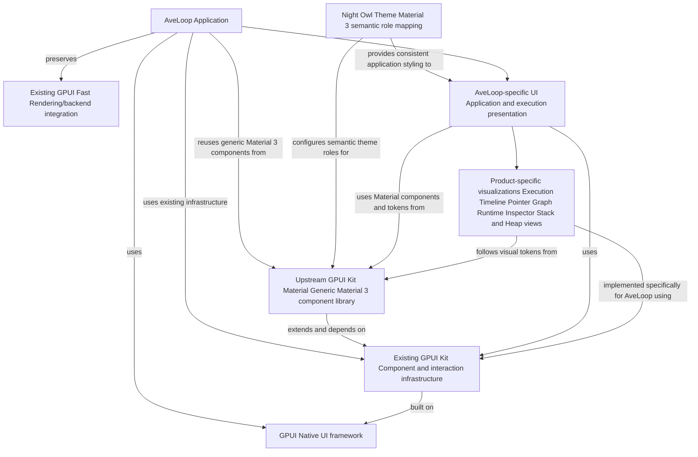

# AveLoop — Product & Software Requirements Specification

**Document ID:** AVE-SPEC-001\
**Version:** 1.1.0\
**Status:** Consolidated Alpha Baseline — Review Required\
**Date:** 22 November 2026\
**Product:** AveLoop Native Desktop Visual Programming IDE\
**Target release:** Alpha\
**Specification authority:** This document supersedes the earlier draft SRS where explicitly stated below.

---

## 0. Document authority and interpretation

This specification defines the product contract for the AveLoop Alpha. It is the source of truth for **what** the Alpha must do and the conditions under which it is considered complete. `plan.md` defines **how** the product is to be implemented. `tasks.md` is the dependency-ordered work breakdown derived from those two documents.

Requirement classifications:

- **MUST** — required for Alpha acceptance.
- **SHOULD** — required unless a documented technical constraint justifies deferral.
- **MAY** — optional and not an Alpha release blocker.
- **OUT** — explicitly excluded from Alpha.

This is a consolidated baseline, not a claim that implementation or platform verification has already happened. Product decisions explicitly established in the conversation are treated as approved constraints. Technical selections made here to make the Alpha executable are identified as **Alpha baseline decisions** and must be validated by the implementation gates in `plan.md`.

### 0.1 Superseded statements

The following statements in the earlier SRS draft are obsolete:

1. “C is the leading candidate” and “the first language remains open” are superseded by the approved Alpha language scope: **C17 and C++20**.
2. “Linux-first” is rejected. Linux, Windows, and macOS are co-equal target platforms for one application and one shared codebase.
3. The preliminary six/eight-crate Cargo workspace is not approved and must not be used as a default structure.
4. A Cargo workspace is not a prerequisite. The Alpha starts as one Rust package and one application crate, organized as a modular monolith.
5. The HTML prototype is not the product implementation, but its interaction model and visual decisions are valid design references. Its simulated compiler/runtime/trace boundaries are intentional prototype limitations.
6. A debugger's ability to inspect variables must not be conflated with complete knowledge of the process heap, allocation history, or pointer lifetime.
7. "Clang/LLVM 23.1.4 as the mandatory cross-platform compiler baseline" and "LLDB as the sole debugger backend" are superseded by the per-platform toolchain policy in §7.2 and §7.3. No compiler or debugger is bundled, downloaded, or installed by the application.

---

# 1. Product definition

## 1.1 Purpose

AveLoop is a native desktop development environment that makes real program execution observable and navigable. It connects source code to execution progression and to the runtime information that can be reliably obtained from the program being debugged.

The defining capability is not code editing alone and not a conventional debugger panel. It is a synchronized visual explanation of a program's recorded execution: source location, call stack, variables, inspectable memory objects, pointer relationships, events, and output.

## 1.2 Product promise

> AveLoop makes real program execution inspectable, step by step, without presenting inferred or simulated information as verified runtime truth.

The product prefers a smaller, accurate visualization over a visually complete but technically fabricated one.

## 1.3 Product category

AveLoop is a:

- General-purpose, multi-language native desktop IDE; C17 and C++20 are the Alpha language set.
- Visual execution and runtime-inspection environment.
- Recorded execution timeline and state navigator.
- Source, stack, variable, memory, pointer, and output visualizer.

AveLoop is not a general-purpose visual programming language, cloud IDE, or replacement for every feature of a mature commercial IDE.

Workspace management, language integration, build-system handling, and debugger backends are separate, extensible responsibilities. Alpha implements only C17 and C++20; adding another language must not require redesigning the workspace, project, or project-configuration model.

Workspace, project, build target, source file, and language integration are independent identities. One workspace may contain several projects, one project may contain several languages and several build targets, and one build target may contain sources from more than one language when its build system genuinely supports that arrangement. No workspace or project carries one authoritative language. A source file stays editable even when it belongs to no build target.

Build-system recognition is not build-system integration and is not successful build support. The application reports what it recognized, what it can consume, and what it can actually build as separate states.

Runtime execution visualization is AveLoop's central product capability. AveLoop makes actual program execution — progression, stack frames, variables, objects, pointers, references, and memory relationships — observable and navigable. It serves both teaching-scale examples and real, complex programs from one normalized runtime-observation model: small, controlled sessions may present detailed step-oriented views, while large sessions use scoped, selective, expandable views. The same observation, history, and normalization model feeds both; there is no separate educational engine. Accuracy outranks visual completeness: no visualization may present an inference as an observation.

## 1.4 Intended users

1. Learners who need to understand how source statements affect runtime state.
2. C and C++ developers investigating scopes, calls, pointers, arrays, objects, and memory.
3. Educators demonstrating actual program behavior.
4. Developers who need a visual view of recorded execution rather than only textual debugger output.

## 1.5 Alpha success definition

An Alpha user can create or open a local project, edit a C17 or C++20 source file, build it with the platform's supported C/C++ toolchain, launch a real debug session, record a sequence of debugger stops, navigate the recorded sequence in both directions, and inspect all supported runtime panels at one consistent selected state.

The Alpha is successful only if this workflow works on Linux, Windows, and macOS according to the platform acceptance matrix.

---

# 2. Product scope

## 2.1 Included in Alpha

### A. Native desktop shell and project workflow
- Native Rust/GPUI desktop application.
- One shared application codebase for Linux, Windows, and macOS.
- Open any local directory as a workspace without requiring an AveLoop manifest.
- Discover zero or more projects in a workspace, including nested and sibling projects with different build systems.
- Recognize multiple build-system descriptors (`CMakeLists.txt`, `Makefile`, `compile_commands.json`, `Cargo.toml`, `go.mod`, and other registered kinds) without modifying or replacing them, reporting recognition, integration, and build support as separate states.
- Treat a project as language-agnostic: languages are recorded per source file, never as one project-wide language field.
- Represent multiple build targets per project, each with its own source membership, language participation, dependencies, entry point, build configuration, and run configuration.
- Use an optional `ave.toml` either as an overlay on a native descriptor or as a standalone definition of AveLoop-managed targets when no native integration exists.
- Open, edit, and save source files.
- Maintain a clear current-workspace/current-project/current-file context.
- Report missing or incompatible toolchains.

### B. Source editor
- Native text editing; no WebView.
- C and C++ syntax highlighting.
- Line numbers.
- Cursor movement and selection.
- Undo and redo.
- Clipboard operations.
- Keyboard-first editing and navigation.
- Unsaved-change indication.
- Current execution-line marker and source mapping.
- Stale-trace indication when source changes after recording.

### C. Build and launch
- C17 compilation.
- C++20 compilation.
- Platform C/C++ toolchain integration: GCC/G++ on Linux, Apple Clang on macOS, MSVC or MinGW-w64 on Windows.
- Debug build configuration suitable for source-level debugging.
- Compiler diagnostics with source locations where available.
- Capture standard output and standard error.
- Launch and terminate a local debug session.

### D. Execution capture and navigation
- Real execution through the platform debugger — GDB on Linux, LLDB on macOS, a debugger compatible with the selected Windows toolchain — using the Debug Adapter Protocol where the installed backend provides it.
- Source-line-granularity stepping for Alpha.
- Capture ordered stop records and runtime observations.
- Record the source revision and build configuration used by the session.
- Navigate first, previous, next, last, and seek to a recorded stop.
- Play and pause automatic navigation through recorded stops.
- Playback speed selection.
- Reverse navigation means selecting an earlier recorded state; it is **not** reverse execution by the debugger.
- The timeline is bounded by the recorded trace. It does not promise that every machine instruction or every source expression is represented.

### E. Runtime inspection
- Call stack and active frames.
- Parameters and local variables when exposed by the debugger.
- Supported primitive values.
- Arrays and aggregate members when exposed by debug information.
- C structures and C++ classes/structs.
- Pointer and reference values.
- Null pointer distinction.
- Pointer target relationships when the target can be resolved.
- Interior pointer offsets when both pointer and target range can be established.
- Aliasing when multiple inspected references resolve to the same observed target.
- Observable memory objects reachable from inspected variables.
- Expandable pointer/object relationship graph with verified nodes, edges, and directional arrows.
- Scope selection for visualization: selected frame, function, thread, variable, pointer, object, memory region, or execution event.
- On-demand expansion of related objects, with branch collapse and cancellation of stale expansion requests.
- Explicit coverage and budget disclosure for any visualization that is scoped, filtered, or truncated.
- Explicit unavailable/optimized-out/unknown states.

### F. Trace and event inspection
- Ordered recorded stops.
- Function entry/exit and stepping events when available.
- Variable observations/differences between recorded stops.
- Runtime errors and debugger-reported exceptions/signals when available.
- Build and execution diagnostics.
- Event selection updates the one authoritative selected state.

### G. Output console
- Captured stdout and stderr.
- Output records associated with the session.
- Show output up to the selected stop only when the backend provides reliable attribution; otherwise show session output with an explicit attribution limitation.
- Copy, wrap, resize, collapse, and follow-latest-output behavior.

### H. Visual system
- Material Design 3 as the actual component and interaction system.
- Night Owl as the default application-wide theme.
- GPUI-native components.
- Product-specific Stack, Heap, Pointer, Timeline, and Runtime Inspector visualizations.
- Keyboard-accessible interactions, visible focus, and non-color-only status communication.

## 2.2 Explicit Alpha limits

These are deliberate scope boundaries, not unfinished promises:

1. **No complete process-memory map.** The Heap view displays objects that the debugger can inspect or that the capture layer can reliably identify. It must not imply that it displays every allocation in the process.
2. **No universal allocation/deallocation history.** `malloc/free`, `new/delete`, custom allocators, allocator pools, and optimized code can prevent reliable lifecycle reconstruction. An allocation or deallocation event is shown only when observed and verified.
3. **No unsupported dangling-pointer claims.** A pointer whose target cannot be resolved is “unresolved/unknown”, not automatically “dangling”. “Dangling” is reserved for a target whose lifetime end was actually observed.
4. **No true reverse debugger execution.** Previous/seek operates on captured records and reconstructed states.
5. **No instruction-level trace guarantee.** Alpha navigation is source-line/debugger-stop based.
6. **No guarantee that optimized-out variables are recoverable.** The Alpha debug profile uses low/no optimization; values unavailable from the debugger remain unavailable.
7. **No arbitrary C++ object-layout guarantee.** Debugger-provided fields and values are shown; the application does not invent object layout.
8. **No full STL visualizer guarantee.** Standard-library pretty-printers may vary by platform/toolchain and are capability-reported.
9. **No LSP-based IDE feature set in Alpha.** Completion, refactoring, semantic navigation, and advanced diagnostics are not required.
10. **No integrated terminal/PTY.** The output console is a captured-output viewer, not an interactive shell.
11. **No remote/cloud execution, collaboration, plugin marketplace, AI features, or integrated Git hosting.**
12. **No hardened security sandbox claim.** Alpha launches local programs with the user's OS permissions. It applies explicit launch consent, working-directory controls, timeout/cancellation, and process-tree termination where supported, but it is not a security boundary against hostile code.
13. **No bundled or automatically installed toolchain.** AveLoop neither bundles nor downloads a compiler, debugger, or LLVM distribution. Missing components are reported with official installation guidance; the user performs any installation.
14. **No artificial small-program ceiling.** Resource limits exist and are configurable, accounted, and reported, but no fixed step count or program size defines the product. A large program that cannot be wholly visualized at once remains fully debuggable through scoped visualization. Visualization budgets and recording budgets are independent policies with different guarantees (§6.6).
15. **No claim of a complete relationship graph.** Any node/edge set is a view over observed, derived, or explicitly labelled inferred relationships, not a claim that all process memory has been discovered.

## 2.3 Out of scope

- Any implementation language other than Rust for AveLoop itself, and any target language beyond C17/C++20 in Alpha. Additional target languages are deferred, not architecturally excluded (§1.3).
- Build or test execution through CMake, Cargo, Go modules, or another native descriptor. Alpha recognizes those descriptors and reports their integration status but does not drive them.
- Language integration for Rust, Go, or any language outside C17/C++20. Their files open as plain text, remain editable, and are not built, debugged, or visualized by Alpha.
- JavaScript/HTML/CSS production UI.
- WebView-based application UI.
- CodeMirror 5 or a browser editor embedded in the native app.
- Microservices or a separate Go execution service.
- A mandatory multi-crate workspace.
- Full IDE parity with Zed, Visual Studio, or CLion.
- Remote debugging.
- Distributed execution.
- Multi-user collaboration.
- AI code generation or AI debugging.
- Full static analysis suite.
- Full C/C++ language-server implementation.
- Guaranteed reverse execution.
- Guaranteed complete heap/allocation visualization.

---

# 3. Product invariants

These are non-negotiable correctness rules.

## INV-001 — Execution truth
Runtime information presented as actual must originate from the real compiler/debugger/session or a documented deterministic derivation from its recorded data. Synthetic fixtures must be visibly identified as fixtures and must never be mixed into a real session.

## INV-002 — One authoritative selected execution state
At any moment, there is exactly one selected execution position for the active session. Source highlighting, stack, variables, heap, pointers, trace selection, and attributable output derive from that same selected state.

## INV-003 — Atomic state publication
A state transition is published as one coherent state. Panels must not independently update from different trace indices. If reconstruction fails, the application retains the last valid state and reports the failure.

## INV-004 — Honest uncertainty
Known-empty, null, uninitialized, optimized-out, unavailable, invalid, unresolved, and unknown are distinct states. The UI must not collapse them into one blank value.

## INV-005 — Identity is not display
Variable names, addresses, labels, and UI positions are not stable identity. Runtime entities use session-scoped identities where possible. Address reuse must not silently imply object identity continuity.

## INV-006 — Address semantics
The UI labels actual process addresses as addresses and symbolic identifiers as symbolic IDs. It must not invent physical addresses or imply that an abstract identifier is a machine address.

## INV-007 — Source/trace provenance
Every trace is bound to the exact source snapshot/build inputs that produced it. Editing source after capture marks the trace stale; old source mappings remain tied to the captured revision.

## INV-008 — Platform parity
The same feature contract and Rust application code apply to Linux, Windows, and macOS. OS-specific adapters are allowed only at real platform boundaries; platform divergence must be documented and tested.

## INV-009 — UI/domain separation
GPUI types and presentation state do not define runtime semantics. The domain model remains independent of GPUI.

## INV-010 — No fabricated completeness
If the backend cannot establish a value, target, allocation lifetime, or source location, the UI reports the limitation rather than drawing a definitive but unsupported representation.

---

# 4. Users and primary workflows

## US-01 — Create/open a project
A user opens a local directory as a workspace, or creates/opens a project with an optional AveLoop configuration, then selects a source file and sees the workspace, project, and file context.

**Acceptance criteria**
- Opening an ordinary directory never requires an AveLoop manifest and never modifies the directory.
- A workspace that contains a recognized native build-system descriptor opens as a project and reports that descriptor without claiming it can build through it.
- A workspace may contain several projects with different descriptors, and a project may contain several languages and targets.
- `ave.toml` is optional; when present it either overlays a native descriptor or, in a distinct standalone mode, defines AveLoop-managed targets.
- No project or workspace exposes one authoritative language; languages are reported per source file.
- The app can create a workspace, add an optional `ave.toml`, and reopen it.
- Invalid or unsupported project metadata produces an actionable error.
- File paths are handled correctly on all three target OSes.
- The application does not silently modify source files during project opening.

## US-02 — Edit source
A user edits C17/C++20 code in a native editor.

**Acceptance criteria**
- Typing, selection, cursor movement, undo/redo, copy/paste, save, and unsaved indication work.
- Syntax highlighting is selected by language/file mode.
- Source edits invalidate the current trace mapping without deleting the recorded session.
- No browser/WebView editor is used.

## US-03 — Build a program
A user builds the selected project using the configured C17 or C++20 mode.

**Acceptance criteria**
- The correct language standard flag is passed explicitly.
- Compiler output and diagnostics are captured.
- Build failure is distinct from runtime failure.
- A failed build cannot create a valid-looking new execution session.
- Debug artifacts are generated with the Alpha debug profile.

## US-04 — Run and record execution
A user starts a real debug session and captures source-level execution stops.

**Acceptance criteria**
- A real executable is launched under the platform debugger.
- The user is informed that local program code runs with the user's OS permissions.
- The session records source/build provenance.
- Stop records preserve order and available source locations.
- Cancellation/termination ends the active process and releases session resources.

## US-05 — Navigate the trace
A user moves through captured execution stops.

**Acceptance criteria**
- First/previous/next/last and seeking select valid recorded positions.
- Play advances through the recorded positions; pause stops it.
- End-of-trace stops playback.
- Previous selects a recorded earlier state and does not claim to reverse the live process.
- A new session cannot receive delayed updates from a previous session.

## US-06 — Inspect runtime state
A user inspects stack frames, variables, aggregates, pointers, and observable memory.

**Acceptance criteria**
- Each panel is derived from the same selected state.
- Frame, variable, and object identities are stable within the session where possible.
- Null, unavailable, optimized-out, unresolved, and known values are distinguishable.
- Pointer links are rendered only when a target can be resolved.
- References, aliases, and interior offsets are labelled by provenance class; inferred relationships are never shown as verified.
- Scoping the view to a frame, function, object, or memory region changes what is displayed, not what was recorded.
- Expanding a graph node retrieves additional state on demand and a stale request cannot overwrite a newer selection.
- A scoped or truncated view is visibly distinct from an incomplete recording.
- Reaching a visualization budget never deletes recorded data; reaching a recording budget is reported and never disguised as a display limit.
- Heap visualizations explicitly state that they are debugger-observable/reachable objects, not a complete process heap.

## US-07 — Inspect trace and output
A user selects trace entries and reviews program output.

**Acceptance criteria**
- Selecting a trace entry selects its corresponding execution state.
- Trace, timeline, source, and runtime inspector stay synchronized.
- stdout and stderr are distinguishable when captured separately.
- Output attribution precision is shown honestly.

## US-08 — Use the native workspace
A user works in the editor, visualization, inspector, transport, and output areas.

**Acceptance criteria**
- The workspace supports resizing and practical window dimensions.
- The output area can be resized/collapsed and restored.
- Keyboard navigation and focus are predictable.
- The interface uses Material 3 behavior and Night Owl semantic tokens throughout.

## US-09 — Work across platforms
A user performs the same primary workflow on Linux, Windows, and macOS.

**Acceptance criteria**
- Each platform has a documented supported toolchain installation path.
- CI builds the application on all three target OSes.
- The primary build/debug/record/navigate/inspect workflow is manually verified on each OS before claiming support.
- A missing platform dependency is reported clearly, not hidden behind a generic failure.

---

# 5. Functional requirements

Priority: **P0** = Alpha critical; **P1** = Alpha usability requirement; **P2** = post-Alpha candidate.

## 5.1 Project and source

| ID | Requirement | Priority |
|---|---|---|
| FR-001 | The application shall open any local directory as a workspace without requiring an AveLoop manifest, and shall discover zero or more projects within it. | P0 |
| FR-002 | The application shall open, edit, and save C and C++ source files. | P0 |
| FR-003 | The editor shall provide cursor movement, selection, text insertion/deletion, undo/redo, and clipboard operations. | P0 |
| FR-004 | The editor shall display line numbers and syntax highlighting for C17 and C++20. | P0 |
| FR-005 | The editor shall indicate unsaved changes. | P1 |
| FR-006 | The editor shall distinguish the source revision used by a trace from the current buffer revision. | P0 |
| FR-007 | The editor shall display execution source locations only when provided by the recorded session. | P0 |
| FR-008 | Source changes shall mark the trace mapping stale. | P0 |
| FR-009 | The application shall treat `ave.toml` as optional and shall distinguish its overlay role (additional settings over a native descriptor) from its standalone role (AveLoop-managed targets when no native integration exists); native descriptor metadata remains authoritative for its own source and target graph. | P0 |
| FR-010 | The application shall recognize multiple build-system descriptors per workspace and per project root (`CMakeLists.txt`, `Makefile`, `compile_commands.json`, `Cargo.toml`, `go.mod`, and other registered kinds), shall report recognition, integration, and build support separately, and shall never modify, replace, or silently reinterpret them. | P0 |
| FR-011 | No workspace or project shall expose one authoritative language. The application shall associate language identity with individual source units. | P0 |
| FR-012 | The application shall represent multiple build targets per project, each with source membership, language participation, dependencies, optional entry point, and build/run configuration. | P0 |
| FR-013 | The application shall determine a source unit's language from an explicit override, then a registered extension mapping, and shall report ambiguous or unknown identities as such rather than guessing. | P0 |
| FR-014 | The application shall keep language detection, build-system recognition, build integration, and language support as separate reported states. | P0 |

## 5.2 Build and execution

| ID | Requirement | Priority |
|---|---|---|
| FR-020 | The application shall build C sources in C17 mode. | P0 |
| FR-021 | The application shall build C++ sources in C++20 mode. | P0 |
| FR-022 | The application shall use the configured platform C/C++ toolchain — GCC/G++ on Linux, Apple Clang on macOS, MSVC or MinGW-w64 on Windows — and explicitly select the language standard. | P0 |
| FR-023 | The application shall produce debug information and use the Alpha debug profile. | P0 |
| FR-024 | The application shall capture compiler stdout, stderr, exit status, and source diagnostics where available. | P0 |
| FR-025 | Build failure shall be distinct from launch failure and runtime failure. | P0 |
| FR-026 | The application shall launch the executable under the configured platform debug adapter — GDB on Linux, LLDB on macOS, or the debugger matching the selected Windows toolchain. | P0 |
| FR-027 | The application shall support explicit cancellation and process termination. | P0 |
| FR-028 | The application shall record the compiler/debugger versions and build inputs used for a session. | P1 |

## 5.3 Execution capture and trace

| ID | Requirement | Priority |
|---|---|---|
| FR-040 | The application shall record ordered debugger stop records from a real execution session. | P0 |
| FR-041 | Each stop record shall preserve the source location and thread/frame context when available. | P0 |
| FR-042 | The capture layer shall record available stack and variable observations for a stop. | P0 |
| FR-043 | The trace shall distinguish raw debugger observations from derived events/diffs. | P0 |
| FR-044 | The trace shall preserve stdout/stderr records and their available ordering metadata. | P0 |
| FR-045 | The trace shall record session provenance and source revision. | P0 |
| FR-046 | The trace shall support deterministic reconstruction of every recorded selected position. | P0 |
| FR-047 | The system shall use captured records/checkpoints for reverse navigation; it shall not require debugger reverse-step support. | P0 |
| FR-048 | Trace corruption or incomplete capture shall be reported and shall not be rendered as a complete trace. | P0 |
| FR-049 | The trace shall distinguish unsupported, missing, and known-empty values. | P0 |
| FR-050 | Trace storage shall be bounded and cancellable; exact limits are established by the Alpha performance gate. | P1 |

## 5.4 Selected execution state

| ID | Requirement | Priority |
|---|---|---|
| FR-060 | The application shall maintain one authoritative selected execution position per active trace. | P0 |
| FR-061 | Every runtime panel shall derive its content from the same resolved selected state. | P0 |
| FR-062 | Timeline, trace-list, and transport actions shall update the same selected position. | P0 |
| FR-063 | State reconstruction shall complete before a new state is published to dependent panels. | P0 |
| FR-064 | A failed reconstruction shall retain the last valid selected state and show an error. | P0 |
| FR-065 | Session replacement/cancellation shall invalidate stale asynchronous updates from the old session. | P0 |

## 5.5 Runtime inspection

| ID | Requirement | Priority |
|---|---|---|
| FR-080 | The application shall display available call-stack frames. | P0 |
| FR-081 | The application shall display available parameters and local variables. | P0 |
| FR-082 | The application shall display primitive values and debugger-provided aggregate children. | P0 |
| FR-083 | The application shall display C arrays, structures, and available C++ class/struct members. | P0 |
| FR-084 | The application shall display pointer/reference values and distinguish null pointers. | P0 |
| FR-085 | The application shall draw pointer relationships only when the target is resolved from observed data. | P0 |
| FR-086 | The application shall show interior offsets only when the base range and offset are established. | P1 |
| FR-087 | The application shall identify aliases when inspected references resolve to the same observed object/address under the session's identity rules. | P1 |
| FR-088 | The Heap view shall identify itself as an observable/reachable-object view, not a complete process heap. | P0 |
| FR-089 | Allocation/deallocation lifecycle labels shall be shown only when the lifecycle event is observed and verified. | P0 |
| FR-090 | The application shall not label an unresolved pointer as dangling without evidence of target lifetime termination. | P0 |
| FR-091 | The application shall distinguish known, null, uninitialized, unavailable, optimized-out, invalid, unresolved, and unknown states where the backend provides that distinction. | P0 |
| FR-092 | The UI shall disclose backend capability/coverage limitations. | P0 |
| FR-093 | The application shall let the user scope runtime visualization to a selected frame, function, thread, variable, pointer, object, memory region, or execution event. | P0 |
| FR-094 | The application shall render relationships as an expandable graph with verified nodes and directional edges, retrieving additional state on demand and cancelling stale expansion requests. | P0 |
| FR-095 | Detailed and scoped visualization shall consume the same normalized observation and history model; no separate visualization engine shall exist for small programs. | P0 |
| FR-096 | Reaching a visualization budget or rendering a scoped/filtered view shall be reported as partially displayed, shall not delete or alter recorded data, and shall never be presented as an incomplete recording. | P0 |
| FR-097 | Runtime recording shall impose no fixed small-program step ceiling; recording limits shall be configurable, accounted, and reported through a declared stop/pause/continue policy, and reaching one shall identify the recorded interval and missing observations without silently discarding data. | P0 |
| FR-098 | Each language integration shall declare which runtime concepts it can observe, and concepts it cannot observe shall be reported as unavailable rather than inferred. | P0 |
| FR-099 | Visualization budgets and recording budgets shall remain independent: no visualization limitation shall be reported as a recording failure, and no recording limitation shall be presented as complete visualization. | P0 |

## 5.6 Navigation and visualization

| ID | Requirement | Priority |
|---|---|---|
| FR-100 | The application shall provide first, previous, play, pause, next, last, and seek controls. | P0 |
| FR-101 | The application shall provide configurable playback speed. | P1 |
| FR-102 | The timeline shall represent recorded stops and selected position. | P0 |
| FR-103 | The Trace inspector shall list ordered recorded stops/events. | P0 |
| FR-104 | Selecting a trace row shall select its corresponding state. | P0 |
| FR-105 | Source, Stack, Variables, Heap, Pointer relationships, Trace, and attributable Output shall update from one selected state. | P0 |
| FR-106 | The workspace shall provide Variables, Stack, Heap, and Trace inspector views. | P0 |

## 5.7 Output

| ID | Requirement | Priority |
|---|---|---|
| FR-120 | The application shall display captured stdout and stderr. | P0 |
| FR-121 | stdout and stderr shall be visually distinguishable when separately available. | P1 |
| FR-122 | Output-to-state attribution shall be shown only at the precision supported by the backend. | P0 |
| FR-123 | The console shall support copy, line wrapping, resize, collapse, and follow-latest behavior. | P1 |

## 5.8 Safety and failure handling

| ID | Requirement | Priority |
|---|---|---|
| FR-140 | The application shall inform users that Alpha programs execute locally with the user's OS permissions. | P0 |
| FR-141 | The application shall require an explicit user action to launch a program. | P0 |
| FR-142 | The application shall support execution timeout and cancellation. | P0 |
| FR-143 | The application shall terminate the launched process and its child-process tree where the OS integration supports it. | P0 |
| FR-144 | The application shall not claim hardened sandbox isolation. | P0 |
| FR-145 | Compiler, debugger, launch, protocol, timeout, and trace errors shall be distinguishable and actionable. | P0 |

---

# 6. Runtime information model requirements

The specification defines concepts and invariants, not final Rust struct names.

## 6.1 Distinct concepts

- **Workspace:** the user's opened working context. One or more root directories, exclusion rules, discovered projects, and unassociated files. A workspace has no language. Opening one never requires an AveLoop file and never modifies the directory.
- **Project:** an identifiable project discovered within a workspace, owned by one or more descriptor attachments (native descriptor and/or `ave.toml`) at a project root. A project may contain several languages and several build targets and has no single authoritative language.
- **Build Target:** a concrete build or execution unit inside a project. It owns source membership, language participation, build-system ownership, toolchain requirement, target dependencies, an entry point where applicable, and build/run configuration. Its sources may span several languages only when its build system and toolchain genuinely support that.
- **Source File:** a file or language unit carrying its own language identity (explicit override, registered extension, ambiguous, or unknown) and zero or more target memberships. Zero target memberships means editable but not built.
- **Language Integration:** a registered capability provider keyed by an extensible identifier. It declares file recognition, highlighting, parsing, editing, diagnostics, LSP, build integration, toolchain discovery, execution, debugging, runtime observation, and visualization individually.
- **Build-System Provider:** a descriptor kind together with its recognition, integration, and build-support status. It is separate from any language: one descriptor may own targets in several languages, and one language may be built by several providers.
- **Debug Session:** one launched process/debugger lifetime and its provenance.
- **Debugger Observation:** raw data returned by the debugger at a stop.
- **Execution Stop:** one navigable source-level/debugger stop.
- **Trace Event:** a recorded or deterministically derived occurrence, such as a stop, frame transition, variable difference, output record, or verified memory event.
- **Checkpoint/Snapshot:** a stored representation sufficient to resolve a selected stop without depending on the live debugger state.
- **Selected Execution State:** the fully resolved state currently presented to the user.

A debugger observation is not automatically a complete memory snapshot. A trace event is not automatically a new state. A derived event must retain provenance to the observations from which it was derived.

Every runtime datum carries one provenance class:
- **Observed** — returned by the backend for the recorded stop.
- **Derived** — computed from observations by a deterministic, documented rule.
- **Inferred** — produced by a heuristic; labelled inferred in the UI and never presented as a verified relationship.
- **Unavailable** — the backend or the debug information does not provide it.
- **Unreconstructable** — it existed at runtime but cannot be recovered from the recording.

Derived or inferred data must never overwrite or masquerade as observed data.

## 6.2 Identity and lifetime

- Session IDs are unique per debug session.
- Stop IDs are stable within a trace.
- Frame identity distinguishes recursive calls to the same function.
- Variable identity must account for scope/frame lifetime and shadowing.
- Object identity must not be based only on a display address.
- Address reuse after a verified deallocation must not silently preserve object identity.
- Unknown identity must remain unknown rather than being guessed.

## 6.3 Value-state vocabulary

The runtime model must represent, where available:

- Known value.
- Null.
- Uninitialized.
- Unavailable.
- Optimized out.
- Invalid.
- Unresolved reference.
- Unknown.

The presentation must explain unavailable information without implying that the variable does not exist.

## 6.4 Memory and pointer model

The model must represent debugger-observable:

- Stack frame variables.
- Aggregate members.
- Arrays and indexed elements.
- Pointer values.
- Resolved target objects.
- Interior offsets when provable.
- Aliases when identity resolution is reliable.
- Verified allocation/deallocation events if captured.

It must not claim complete visibility into:
- All process allocations.
- Allocator metadata.
- Memory not reachable/inspectable through the debugger.
- Object lifetime events not observed by the capture mechanism.
- C++ object lifetime details erased by optimization or unavailable debug information.

## 6.5 Language observation adapters

Runtime observation is language-specific even when the normalized model is shared. Each language integration supplies an observation adapter that declares which concepts it can observe reliably: frames, locals, aggregates, arrays, pointers, references, object identity, allocation/deallocation events, and thread relationships.

- A concept the adapter cannot observe is reported as unavailable for that language/backend combination; it is not rendered as empty, inferred, or silently omitted.
- Universal assumptions about pointers, object identity, or lifetimes are not allowed to override language semantics.
- Alpha declares adapter capabilities for C17 and C++20 only. Rust (ownership, borrowing, slices) and Go (slices, maps, interfaces, goroutines, channels) require new adapters and are post-Alpha.

## 6.6 Visualization budgets and recording budgets

Two independent resource policies govern the visualization system. They carry different correctness guarantees and must never be conflated.

### A. Visualization budget — controls what is displayed

Applies to displayed state only: maximum visible nodes and edges, graph expansion depth, rendering memory, layout computation time, and on-demand inspection limits.

Reaching a visualization budget:
- Must not delete recorded events, modify historical snapshots, or truncate the execution trace.
- Must not mark an otherwise complete recording as incomplete.
- Must not imply that the underlying recording is missing information.
- Must be reported as a scoped or partially displayed visualization, and the user must be able to expand or change the inspection scope while more recorded information is available.

### B. Recording budget — controls what is captured and retained

Applies to capture and retention: recording memory, trace and snapshot storage, event capture limits, recording time, and other explicitly configured constraints.

Reaching a recording budget:
- Must never silently discard previously recorded information.
- Must inform the user.
- Must be resolved by a declared policy: stop, pause, or continue recording.
- Must identify the recorded interval and any missing observations accurately.
- Must never present the trace as a complete recording of the entire session.

A recording that ended at a declared stopping point (intentional stop) is distinct from a recording interrupted before the session's expected completion.

### C. Independence

A visualization limitation shall never be reported as a recording failure. A recording limitation shall never be hidden by presenting the remaining graph as complete.

---

# 7. Language and toolchain requirements

## 7.1 Alpha language standards

- C: ISO C17, selected explicitly with `-std=c17`.
- C++: ISO C++20, selected explicitly with `-std=c++20`.
- GNU language extensions are not enabled by default.
- Compiler extensions required by a project must be explicit project configuration, not silently enabled.
- The selected language mode does not imply that every standard-library facility or every C++20 feature is fully implemented by the compiler. AveLoop must maintain a tested C++20 feature/toolchain matrix and report compiler diagnostics rather than claiming universal conformance beyond the compiler's documented support.

## 7.2 Compiler baseline

AveLoop uses the C/C++ toolchain already present on the user's system. No compiler is bundled, downloaded, or installed by the application.

Platform defaults:
- **Linux:** the existing GCC/G++ toolchain when it supports C17/C++20 and debug information. Clang is used only when the user or project selects it.
- **macOS:** the active Apple Clang/Clang++ toolchain from Xcode or the Xcode Command Line Tools.
- **Windows:** a complete, compatible compiler-debugger pair: MSVC (`cl.exe`) with its compatible debugger (CDB/DbgEng), or MinGW-w64 GCC/G++ with GDB.

Selection order is: explicit project configuration, then `CC`/`CXX`, then the platform default discovered on `PATH`. `cc` and `c++` are resolved to the actual compiler behind the alias before capabilities are reported. Compiler discovery and debugger discovery are separate probes, but a selection is valid only when the pair is complete: a compiler without its compatible debugger, or a debugger without its compatible compiler, is not a usable toolchain.

On Windows the selection rules are:
1. If only MinGW-w64 GCC/G++ with GDB is complete and compatible, select it.
2. If only MSVC with its compatible debugger (CDB/DbgEng) is complete and compatible, select it.
3. If both pairs are complete and compatible, prefer MinGW-w64 GCC/G++ with GDB.
4. If neither pair is complete, report that no supported Windows compiler-debugger combination was found. Do not install or download anything.

Explicit user or project toolchain configuration overrides the default preference. If the explicitly configured family has no complete compatible pair, report that family as unavailable; do not silently substitute the other family.

On Linux and macOS the pairing is fixed by the platform (GCC with GDB, Apple Clang with LLDB), so the completeness rule applies without a preference order.

A toolchain is considered supported only after the compiler, debugger adapter, debug symbols, launch, capture, and navigation workflow pass the platform smoke test. Verified compiler versions are recorded per platform rather than pinned to one cross-platform reference version.

## 7.3 Debugger baseline

The debugger is the one that matches the selected platform toolchain:
- **Linux:** GDB, using its DAP interpreter when the installed build provides one (GDB DAP requires Python support), otherwise GDB/MI.
- **macOS:** the LLDB and `lldb-dap` shipped with the active Apple developer toolchain.
- **Windows:** the debugger of the compiler-debugger pair selected by the §7.2 rules — the Visual Studio debugger interfaces (CDB/DbgEng) for MSVC, GDB for MinGW-w64.

DAP is a protocol, not a debugger. A backend that exposes only a different machine interface is reached through a narrow adapter inside infrastructure. Capabilities are negotiated at session start and verified per backend; no capability is assumed because a protocol defines a related message.

`supportsStepBack` is not assumed. Backward timeline navigation is implemented over AveLoop's recorded trace.

Debugger protocol and message types are infrastructure implementation details. They must not leak into domain entities or presentation components.

## 7.4 Debug build profile

The Alpha default debug profile uses:
- Debug information enabled.
- Optimization disabled or set to the lowest supported level.
- Frame pointers retained where supported.
- Explicit C17/C++20 standard flags.
- Compiler and linker diagnostics captured.

The exact flags may differ by platform/toolchain driver, but the resulting profile must satisfy the same debugging acceptance tests.

---

# 8. User interface and design requirements

## 8.1 Workspace composition

The primary workspace contains:
1. Source Editor.
2. Execution Visualization (Stack/Heap/Pointer relationships).
3. Runtime Inspector (Variables/Stack/Heap/Trace).
4. Execution transport/timeline.
5. Output console.
6. Compact status/context area.

The exact pixel dimensions and split ratios are responsive implementation decisions. The interaction model should preserve the hierarchy and key behaviors shown in the HTML prototype.

## 8.2 Prototype as reference

The existing `index.html` is a deliberate HTML/CSS/JavaScript preview prototype. It contains interactive UI behavior and simulated execution data. Its limitations—no real compiler, no real debugger, no real execution trace—are intentional.

Preserve and evaluate these demonstrated behaviors:
- Three-area workspace.
- Source edit/execution modes.
- Stack and Heap visualization.
- Inspector tabs.
- Execution transport and timeline seeking.
- Play/pause and speed control.
- Trace navigation.
- Execution-line highlighting.
- Pointer relationship drawing.
- Changed-value indication.
- Output console resize/collapse/maximize/follow/wrap/copy.
- Keyboard shortcuts.
- Stale-trace indication.

The prototype is not a production dependency. Do not embed it, convert it to WebView, or port its HTML/CSS mechanically into GPUI.

## 8.3 Material Design 3

Material Design 3 is the actual design system, not an inspiration label. It governs:
- Semantic color roles.
- Typography.
- Shape.
- Elevation/surface hierarchy.
- State layers.
- Component behavior.
- Motion.
- Focus and accessibility behavior.

### 8.3.1 Component source

Generic Material 3 components are obtained from the upstream `gpui-kit-material` library (GPUI-native Material 3 component system built on GPUI Kit), not reimplemented in AveLoop. AveLoop:

- Uses upstream GPUI Kit Material as the primary source of generic Material 3 components (buttons, inputs, menus, dialogs, navigation, feedback, progress, containment, pickers, shapes, window chrome, adaptive components, dynamic color).
- Keeps GPUI Kit as the underlying component and interaction infrastructure.
- Keeps GPUI Fast as the existing rendering/backend integration.
- Maps Night Owl into the upstream Material 3 semantic theme roles.
- Owns its specialized execution visualizations (Execution Timeline, Pointer Graph, Runtime Inspector, Stack and Heap views) using GPUI Kit primitives and Material 3 tokens.

AveLoop does not create or maintain a local fork of GPUI Kit Material, does not vendor modified upstream code, and does not introduce a WebView or web component runtime.

Generic design-system components are separate from product-specific runtime visualizations.

The conceptual integration is:

## 8.4 Night Owl

Night Owl is the default application-wide theme. It must cover the editor chrome, workspace, panels, dialogs, menus, console, timeline, and visualizations. Its source palette is mapped deliberately to Material 3 semantic roles. It is not limited to syntax highlighting. Dynamic system colors do not replace it by default.

## 8.5 Accessibility

Alpha requirements:
- Keyboard access to primary workflows.
- Visible focus.
- Predictable focus order.
- Accessible names/roles/states where GPUI/platform support permits.
- Status never communicated by color alone.
- Adequate contrast.
- Resizable layout that does not make essential controls unreachable.
- Reduced-motion respect where the platform/GPUI integration exposes it.

Accessibility limitations must be documented; do not claim full conformance without an audit.

---

# 9. Non-functional requirements

| ID | Requirement | Acceptance approach |
|---|---|---|
| NFR-001 | Compilation, debugger I/O, trace reconstruction, and large parsing work shall not block the UI event path. | UI responsiveness tests during active build/capture. |
| NFR-002 | Selected-state publication shall be atomic across dependent views. | Integration tests asserting shared stop ID across panels. |
| NFR-003 | Trace reconstruction shall be deterministic for the same trace and schema version. | Repeatable fixture/property tests. |
| NFR-004 | Trace growth shall be bounded by configurable session limits. | Long-running trace stress test and documented limit behavior. |
| NFR-005 | Large variable/aggregate lists shall not require rendering every row at once. | Virtualization or incremental rendering test where needed. |
| NFR-006 | Background work shall support cancellation where technically possible. | Cancellation tests for build, launch, capture, and reconstruction. |
| NFR-007 | A failed or malformed debugger-protocol response shall not crash the application or corrupt the selected state. | Protocol fault-injection tests. |
| NFR-008 | Platform-specific code shall be isolated and tested on its target OS. | CI matrix plus manual smoke-test evidence. |
| NFR-009 | The application shall not install, download, or silently substitute compilers, debuggers, or toolchains, and shall not execute project code during project opening. | Behavior/security tests. |
| NFR-010 | The application shall disclose execution's local privilege model and absence of hardened sandboxing. | UI copy and release checklist. |
| NFR-011 | The app shall use a single Rust codebase and avoid duplicated per-OS application implementations. | Repository architecture review. |
| NFR-012 | Dependencies shall be justified, license-reviewed, and pinned/reproducible. | Dependency audit and lockfile review. |

Exact latency, memory, and trace-size budgets are set from measured Alpha baselines before release; no arbitrary performance numbers are asserted without measurement.

---

# 10. Cross-platform requirements

## 10.1 Target platforms

Alpha release targets:
- Linux x86_64.
- Windows x86_64.
- macOS Apple Silicon (arm64).

The application codebase and product behavior are shared. Additional architectures may be added after their toolchain and GPUI paths are validated; they are not implied by this Alpha target list.

## 10.2 Platform support levels

A platform is:
- **Build-supported** only when CI produces the application successfully.
- **Runtime-supported** only when the app launches and core UI/input works.
- **Alpha-supported** only when the primary build/debug/capture/navigate/inspect workflow passes on that OS.

A green compile alone is not platform support.

## 10.3 OS integration boundaries

Only actual differences belong in platform adapters, including:
- Native path and executable resolution.
- Process creation, termination, and process-tree handling.
- Toolchain discovery.
- File dialogs/window-system integration where GPUI requires it.
- Packaging and signing/notarization requirements.

Business rules, runtime models, trace semantics, and visual state must remain shared.

---

# 11. Architecture constraints (product-level)

1. Rust is the sole language used to implement the native AveLoop application.
2. GPUI is the selected native UI framework.
3. The application is a modular monolith in one Rust package for Alpha.
4. The default structure is one Cargo package/crate, not a forced multi-crate workspace.
5. Domain/runtime semantics must be independent of GPUI and DAP.
6. Application use cases coordinate domain and infrastructure through explicit interfaces.
7. Compiler/debugger/process integration belongs behind infrastructure boundaries.
8. Presentation contains GPUI views, design-system components, and AveLoop-specific visualizations.
9. Platform-specific code exists only where an OS boundary requires it.
10. A module may be extracted into a crate only when dependency ownership, independent testing/reuse, or build isolation provides a concrete benefit and the extraction is approved.

---

# 12. Alpha release acceptance

The Alpha is not accepted until all of the following are true:

### Product workflow
- [ ] Create/open a local project.
- [ ] Edit/save a C17 source file and a C++20 source file.
- [ ] Build both standards with the platform's C/C++ toolchain.
- [ ] Display compiler diagnostics and distinguish build/runtime failures.
- [ ] Launch a real program under the platform debug adapter.
- [ ] Capture ordered source-level stops.
- [ ] Navigate forward and backward through recorded states.
- [ ] Verify selected-state synchronization across source, stack, variables, heap, trace, pointers, and output.
- [ ] Demonstrate pointer/null/aggregate behavior using real programs.
- [ ] Correctly label unavailable and unverified memory information.
- [ ] Cancel a running program and clean up its process/session.
- [ ] Preserve trace provenance and stale-source behavior.

### Cross-platform
- [ ] Linux x86_64 build, launch, and primary workflow verified.
- [ ] Windows x86_64 build, launch, and primary workflow verified.
- [ ] macOS arm64 build, launch, and primary workflow verified.

### Quality
- [ ] Unit and integration tests cover runtime invariants and trace reconstruction.
- [ ] DAP protocol failure and cancellation tests pass.
- [ ] No fabricated memory completeness or reverse-debugging claims.
- [ ] Material 3/Night Owl visual review passes.
- [ ] Keyboard/focus/accessibility review completed.
- [ ] Toolchain installation and limitations documented.
- [ ] Known Alpha limitations published.

---

# 13. Risks and mitigations

| Risk | Impact | Required mitigation |
|---|---|---|
| GPUI is pre-1.0 and changes | UI/API churn | Pin exact revision; isolate GPUI in presentation; update deliberately. |
| Debugger backend capabilities vary by platform | Inconsistent inspection | Negotiate capabilities per backend; platform smoke tests; capability reporting. |
| DAP has no step-back guarantee | False reverse-debugging assumption | Record stop snapshots and navigate the trace. |
| Heap visibility is incomplete | Misleading diagrams | Model observable/reachable objects only; disclose coverage. |
| C++ debug info/pretty printers vary | Partial object views | Explicit supported-value matrix and honest unavailable states. |
| Compiler/runtime availability differs | Platform parity risk | Discover the installed per-OS toolchain; document per-OS setup and acceptance evidence. |
| Untrusted local code | Host security risk | Explicit consent, process limits/termination, no sandbox claim. |
| Large traces | Memory/latency issues | Bounded capture, checkpoints, incremental reconstruction, stress tests. |
| Prototype interactions are copied literally | Native UX mismatch | Preserve behavior intent; implement with GPUI-native patterns. |

---

# 14. Decisions register

## Approved product decisions
- Native desktop visual execution IDE.
- Rust-only implementation.
- GPUI UI framework.
- Linux, Windows, and macOS as co-equal targets in one shared codebase.
- C17 and C++20 as the Alpha languages.
- Material Design 3 as the real design system.
- Night Owl as the application-wide default theme.
- HTML prototype is a preview/reference, not production UI or runtime.
- Python Tutor is a behavioral reference, not a product blueprint.
- One authoritative selected execution state.
- Real execution data only for claims presented as actual runtime facts.
- No Go, WebView production UI, or CodeMirror 5.
- No forced multi-crate architecture.

## Alpha baseline technical decisions
- One Rust package / one application crate, modular monolith.
- Platform-native C/C++ toolchain discovery: GCC/G++ on Linux, Apple Clang on macOS, MSVC or MinGW-w64 on Windows.
- Platform-native debugger integration: GDB on Linux, Apple LLDB on macOS, the debugger matching the selected Windows toolchain.
- Source-line/debugger-stop granularity.
- Recorded trace/checkpoint reconstruction for backward navigation.
- Local execution under the user's OS permissions; not a hardened sandbox.
- Native GPUI editor implementation for the Alpha's bounded editing scope.
- Tree-sitter for C/C++ syntax parsing/highlighting; no LSP requirement in Alpha.
- Runtime memory visualization is limited to debugger-observable/reachable entities and verified events.

## Explicitly rejected
- Linux-only Alpha.
- Separate platform-specific application codebases.
- Six/eight crates created up front.
- Go execution backend.
- HTML/CSS/JS/WebView production UI.
- Fake/static traces presented as real execution.
- Assuming debugger step-back exists.
- Claiming complete process heap visibility from ordinary debugger variable inspection.
- Treating unresolved pointers as proven dangling pointers.

## Deferred beyond Alpha
- LSP/completion/refactoring.
- Full STL/container visualization parity.
- Complete allocation instrumentation across custom allocators.
- True reverse execution.
- Remote/cloud execution.
- Collaboration and plugin marketplace.
- Additional languages.
- Additional CPU architectures beyond the defined Alpha matrix.

---

# 15. Reference sources

These sources inform the implementation plan; they do not override the product requirements above.

- Spec Kit Quickstart: https://github.com/github/spec-kit/blob/main/docs/quickstart.md
- Spec Kit Agentic SDD: https://github.com/github/spec-kit/blob/main/docs/reference/agentic-sdd.md
- Spec Kit task template: https://github.com/github/spec-kit/blob/main/templates/commands/tasks.md
- GPUI README: https://github.com/zed-industries/zed/blob/main/crates/gpui/README.md
- GPUI platform implementation: https://github.com/zed-industries/zed/blob/main/crates/gpui_platform/src/gpui_platform.rs
- Clang C language modes: https://clang.llvm.org/docs/UsersManual.html
- Clang C++ status: https://clang.llvm.org/cxx_status.html
- GCC instrumentation options: https://gcc.gnu.org/onlinedocs/gcc/Instrumentation-Options.html
- GDB documentation: https://sourceware.org/gdb/current/onlinedocs/gdb.html/
- GDB Python support: https://sourceware.org/gdb/current/onlinedocs/gdb.html/Python.html
- LLDB-DAP overview and capabilities: https://lldb.llvm.org/use/lldbdap.html
- Apple Command Line Tools: https://developer.apple.com/documentation/xcode/installing-the-command-line-tools
- MSVC command-line build: https://learn.microsoft.com/en-us/cpp/build/building-on-the-command-line
- Tree-sitter: https://github.com/tree-sitter/tree-sitter
- Material Design 3: https://m3.material.io/
- GPUI Kit Material (upstream Material 3 component library): https://github.com/mizorewww/gpui-kit-material (release 0.2.0)
- GPUI Material Symbols: https://github.com/mizorewww/gpui-material-symbols
- Night Owl: https://github.com/sdras/night-owl-vscode-theme
- Python Tutor: https://pythontutor.com/
- AveLoop UI prototype: repository/project `index.html` supplied with this conversation.